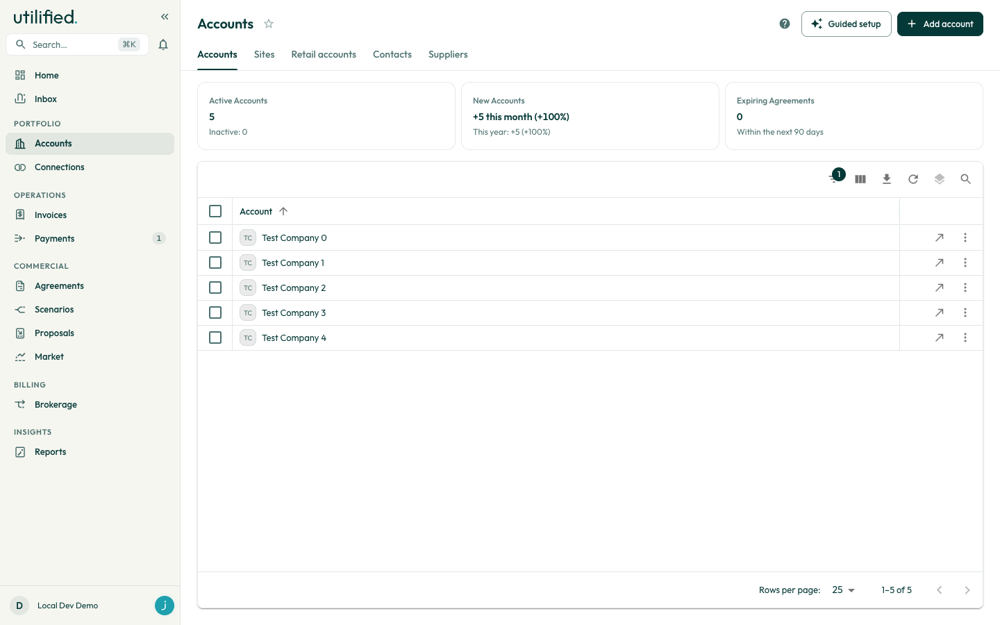
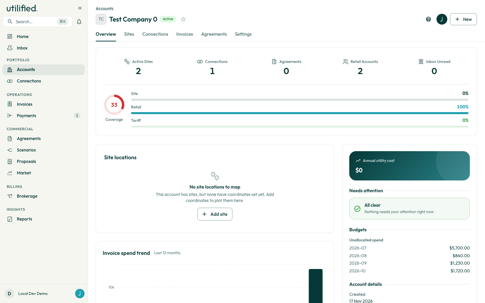

Go to **Accounts** in the sidebar. The **Accounts** hub has tabs for **Accounts**, **Sites**, **Retail accounts**, **Contacts** and **Suppliers**; this page covers the **Accounts** tab.

Accounts represent the businesses or entities you manage energy for. Each account is the top-level container for its sites, connections, agreements, invoices and contacts. An account can have associated (child) accounts, for example the entities in a group.

{/* screenshot-stale */}
<Frame>
  
</Frame>

## Accounts list

Tiles above the grid show **Active Accounts**, **New Accounts** (this month and this year) and **Expiring Agreements** (within the next 90 days).

The grid opens on active, top-level accounts. Click the expand control on a row to show its associated accounts. Click an account name, or **See Details**, to open it.

The grid shows the **Account** column by default. Add other columns from the grid's column settings:

| Column                  | Description                                    |
| ----------------------- | ---------------------------------------------- |
| **Account**             | The account name                               |
| **Tax ID**              | The account's ABN or other tax ID              |
| **Entity Type**         | The legal entity type                          |
| **Annual Cost**         | Annual utility cost for the account            |
| **Next Expiry**         | The nearest agreement end date                 |
| **Sites**               | Active sites                                   |
| **Connections**         | Active connections                             |
| **Associated Accounts** | Active child accounts                          |
| **Status**              | **Active** or **Inactive**                     |

### Actions

| Action             | What it does                                                                                     |
| ------------------ | ------------------------------------------------------------------------------------------------ |
| **Add account**    | Opens a drawer to create an account                                                              |
| **Guided setup**   | Creates an account, then opens guided onboarding to load its sites, connections, agreements and invoices |

See [Creating accounts](/guides/creating-accounts).

## Account detail page

{/* screenshot-stale */}
<Frame>
  
</Frame>

The header shows the account name, its icon and an **Active** or **Inactive** status chip.

| Tab            | Segments                                                          | What it shows                                                     |
| -------------- | ----------------------------------------------------------------- | ----------------------------------------------------------------- |
| **Overview**   | None                                                              | Stats, site map, spend trend, account details and people          |
| **Sites**      | **Sites**, **Site data**, **Consumption**                         | The account's sites, their [site data](/site-data), and consumption |
| **Connections**| None                                                              | The account's [connections](/connections)                         |
| **Invoices**   | **Invoices**, **Retail accounts**, **Completeness**, **Inbox**    | [Invoices](/invoices), [retail accounts](/retail-accounts), billing completeness, and the account's email inbox |
| **Agreements** | None                                                              | The account's [agreements](/agreements)                           |
| **Settings**   | None                                                              | Account settings (see below)                                      |

The **Inbox** segment only appears when the account has an email address. The **Sites** segment has a **Bulk Upload Sites** button that opens a site import scoped to the account.

### Header actions

| Action                                 | What it does                                                                                     |
| -------------------------------------- | ------------------------------------------------------------------------------------------------ |
| **Launch Onboarding with Joule** (Joule icon) | Opens guided onboarding for this account                                                  |
| **New**                                | Opens a menu: **New Associated Account**, **New Contact**, **New Site**, **New Retail Account**, **New Connection**, **New Agreement** |
| **View in portal** (eye icon)          | Previews the account as a portal user sees it. Only shown when your organisation has a customer portal. |

### Overview tab

- Stats: **Active Sites**, **Connections**, **Agreements**, **Retail Accounts** and **Inbox Unread**, plus a data coverage score with **Site**, **Retail** and **Tariff** percentages. Aim for a score of 75 or more.
- **Site locations**: a map of the account's sites and those of its associated accounts.
- **Invoice spend trend**: invoiced spend for the last 12 months.
- Details panel: **Annual utility cost**, a **Needs attention** list (expiring agreements, retail accounts rolling off or on, unread inbox items), **Budgets**, **Account details** (email, ABN, entity type, parent account, created date) and **Associated accounts**.
- **People**: the account's contacts, with an option to add one.

### Settings tab

| Section                  | What you can do                                                                                   |
| ------------------------ | ------------------------------------------------------------------------------------------------- |
| **Account Details**      | Edit **Account name**, **Tax ID**, **Website**, **Tax URL**, **Company type** and **Parent account** |
| **Account Icon**         | Set the icon shown beside the account name                                                        |
| **Email Configuration**  | Set or generate the **Account Email Address** used to import invoices by email                    |
| **Data Feeds**           | List the account's [data feeds](/data-feeds) and click **Create Data Feed** to add one            |
| **Portal Access**        | Manage **Portal users** and choose which portal features and sites they can reach                 |
| **Gap Check Settings**   | Turn on **Default Gap Check for New Retail Accounts**, or enable or disable gap check for retail accounts across all associated accounts |
| **Onboarding Tools**     | Click **Launch Onboarding with Joule** to open guided onboarding                                  |
| **Custom Fields**        | Store organisation-defined fields against the account                                             |
| **Data management**      | **Archive account** (set it inactive) or **Delete account** (permanent)                            |

## Related guides

- [Creating accounts](/guides/creating-accounts)
- [Getting set up](/getting-started/getting-set-up)
