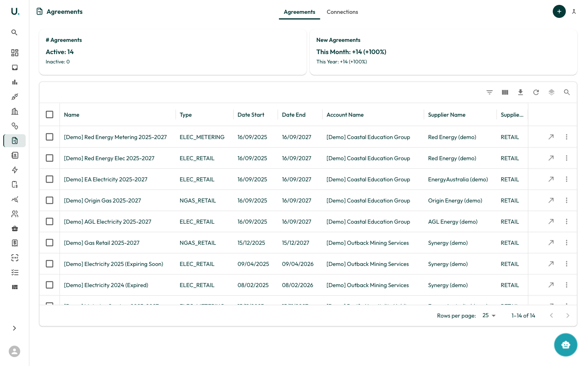

Agreements are the energy contracts between your accounts and suppliers. They hold the contract terms and dates, the connections each contract covers, and the tariffs and brokerage records that depend on it.

## Where to find it

Open **Agreements** in the **Commercial** group of the sidebar. The page has two tabs: **Agreements** and **Pipeline**.

{/* screenshot-stale */}
<Frame>
  
</Frame>

## Agreements tab

The view switch above the grid filters the list:

| View             | Shows                                              |
| ---------------- | -------------------------------------------------- |
| **All**          | Every agreement                                    |
| **Active**       | Agreements with status Active                      |
| **Expiring 90d** | Agreements whose end date falls in the next 90 days |
| **Expired**      | Agreements with status Expired                     |
| **Draft**        | Agreements with status Draft                       |

| Column            | Description                                            |
| ----------------- | ------------------------------------------------------ |
| **Agreement**     | The agreement name. Click it to open the agreement     |
| **Type**          | The agreement type (see below)                         |
| **Status**        | Lifecycle status (see below)                           |
| **Start** / **End** | The contract period                                  |
| **Account**       | The account the agreement belongs to                   |
| **Supplier**      | The retailer or metering provider                      |
| **Supplier Type** | The supplier's type                                    |

### Header actions

| Action               | What it does                                                         |
| -------------------- | -------------------------------------------------------------------- |
| **Add agreement**    | Opens a drawer to create an agreement                                |
| **Merge Agreements** | Merges duplicate agreements into one root agreement. The merge cannot be undone |

<Tip>
  For a walkthrough of creating an agreement and adding its connections, see [Managing Agreements](/guides/managing-agreements).
</Tip>

## Pipeline tab

The **Pipeline** tab tracks every agreement connection's onboarding, from signing to first revenue. Use it to find connections that are stuck.

Metric tiles across the top count connections at each stage, plus **Overdue**, **Blocked** and the median **Signed to live** time. Click a stage tile to filter the grid to that stage. You can also filter by **Type**, **Stage**, **Supplier** and **Account**, and toggle **Overdue**, **Blocked** and **Follow-up due**.

The grid shows each connection's **Stage**, account, connection, agreement, type and supplier, the date each milestone was reached, **Days in stage**, **Overdue**, **Blocker** and **Follow-up**. Click a row to open the agreement connection and record a hand-off, a blocker or a follow-up date.

| Stage          | Reached when                                                   |
| -------------- | -------------------------------------------------------------- |
| **Unsigned**   | No milestone yet: the agreement has no execution date          |
| **Signed**     | The agreement's execution date is recorded                     |
| **Submitted**  | A submitted date is recorded on the agreement connection       |
| **Started**    | The connection's start date has passed                         |
| **In service** | Metering: an in-service date is recorded. Retail: an invoice shows the supply is in service |
| **Data**       | Meter data is arriving (metering agreements only)              |
| **Live**       | The first brokerage revenue is recorded                        |

A connection is flagged **Overdue** when it misses one of these rules: not submitted by 14 days before start, not in service 60 days after start, no data 30 days after in service (metering), or no brokerage revenue 60 days after data or in service.

## Agreement types

| Type                     | Code            |
| ------------------------ | --------------- |
| **Electricity Retail**   | `ELEC_RETAIL`   |
| **Electricity Metering** | `ELEC_METERING` |
| **Natural Gas Retail**   | `NGAS_RETAIL`   |
| **Energy Retail**        | `ENERGY_RETAIL` |
| **LPG Retail**           | `LPG_RETAIL`    |

## Statuses

UMS calculates an agreement's status from its dates. An operator can pin a status (**Confirmed active**, **Blocked** or **Cancelled**) with an override when the dates don't tell the whole story.

| Status        | Meaning                                                  |
| ------------- | -------------------------------------------------------- |
| **Draft**     | No start, end or execution date recorded                 |
| **Upcoming**  | The start date is in the future                          |
| **Active**    | Inside the contract period                               |
| **Expired**   | The end date has passed                                  |
| **Blocked**   | Pinned by an operator: something is stopping the contract |
| **Cancelled** | Pinned by an operator: the contract was cancelled        |

## Agreement detail

Open an agreement to see its **Overview**, **Connections**, **Tariffs**, **Brokerage**, **Activity** and **Settings** tabs. **Activity** shows who changed the agreement's details, and when. The header links to the account and supplier.

| Action                            | What it does                                                         |
| --------------------------------- | -------------------------------------------------------------------- |
| **Extract from contract**         | Upload a signed contract or offer. Joule proposes a tariff for you to review before anything is created |
| **New tariff**                    | Creates a tariff for this agreement. Shows on the **Tariffs** tab only |
| **New Retail Account**            | Creates a retail account pre-filled from the agreement               |
| **Add Document**                  | Attaches a document to the agreement                                 |
| **Add a Connection**              | Links one connection to the agreement                                |
| **Bulk Add Connections**          | Links many connections at once                                       |
| **Merge Into This Agreement**     | Merges other agreements into this one                                |
| **Add a Brokerage Record**        | Creates a brokerage record for this agreement. Only appears when your plan includes brokerage |

See [Managing Agreements](/guides/managing-agreements) for how to use each one.

## Related

- [Managing Agreements](/guides/managing-agreements): create agreements and add connections and tariffs
- [Retail Accounts](/retail-accounts): the retailer references agreements link to
- [Tariffs](/tariffs): the rates attached to agreements
- [Brokerage](/brokerage): commission records billed on agreements
