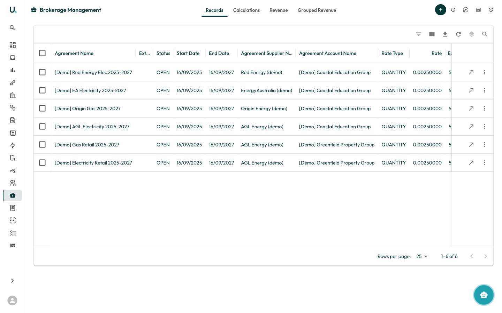

Open **Brokerage** from the **Billing** group in the sidebar.

The Brokerage hub tracks the commission you earn on energy contracts. You record each brokerage contract, calculate its revenue in runs, then bill it: by invoice through Xero, or by accepting a supplier's statement (RCTI). The hub only appears for users with the Brokerage permission.

## Tabs and views

| Tab | Route | Views | What it shows |
| --- | --- | --- | --- |
| **Overview** | `/brokerage` | — | Month-end to-dos, headline tiles, billed and forecast chart, renewals and retailers |
| **Contracts** | `/brokerage/records` | **All**, **Active**, **Ended**, **Ready to close**, **Missing tariff**, **Pending**, **No revenue** | Brokerage contracts (records), one per agreement |
| **Revenue** | `/brokerage/revenue` | **Lines**, **Grouped**, **Coverage** | Revenue lines per connection and period |
| **Runs** | `/brokerage/runs` | **All**, **Drafts**, **Awaiting approval**, **Committed**, **Failed** | Calculation runs |
| **Invoices & RCTIs** | `/brokerage/invoices` | **Invoices**, **RCTIs**, **Supplier billing** | Invoices you raised, supplier statements, and how each supplier pays |
| **Analytics** | `/brokerage/analytics` | — | Value at risk, growth and performance |

### Overview

The **Month end** panel lists what needs doing. Each item links to the view that fixes it, and items with nothing to do are hidden:

- **Runs awaiting approval**
- **RCTIs to accept**
- **Backfilled periods to rerun**
- **Open gaps (last 3 months)**, with the value at risk
- **Contracts ready to close**

The tiles above it show **Billed this month** (recurring and once-off), **Forecast this month**, **Contracted balance** and **Outstanding receivables**. Below are the **Billed and forecast** chart, **Renewals in the next 6 months** and **Retailers** (billed over 12 months, unbilled, outstanding and RCTI variance per retailer).

### Contracts

{/* screenshot-stale */}
<Frame>
  
</Frame>

| Column | Description |
| --- | --- |
| **Agreement** | The agreement the contract earns commission on |
| **External ID** | The contract's OppID |
| **Lifecycle** | Pending, Active, Ended, Closed or Merged |
| **Start** / **End** | The contract's dates |
| **Supplier** / **Account** | The agreement's supplier and account |
| **Rate Type** / **Rate** | How commission is calculated |
| **Expected Revenue** | The value you expect from the contract |

The review views explain themselves in a banner. **Ready to close** lists ended contracts whose revenue is all invoiced, with a **Close** button on each row. **Missing tariff** lists contracts with no rate basis, which can't earn revenue until you add one, and adds **Rate Type** and **Agreement Type** filters.

### Revenue

- **Lines**: one row per revenue line, with **Agreement**, **Connection**, **Rate**, **Start**, **End**, **Quantity**, **Revenue**, **Status** and **Source**. Select rows to **Set Invoice ID**, **Mark Invoiced**, **Mark Actual**, **Dismiss adjustments** or **Delete**. Calculated and draft lines are read-only.
- **Grouped**: revenue grouped by external invoice ID, with total, actual and invoiced amounts and counts per invoice.
- **Coverage**: each connection by month, filtered by **From**, **To**, **Retailer**, **Status** and **Reason**. Click a cell to open its **Revenue lines**, **Invoices** or **Meter reads**. When new data has landed for billed periods, **Rerun N backfilled periods** appears.

Open a line to correct it with **Adjust or override** or **Move to another OppID**. See [Correcting revenue](/guides/brokerage-revenue-and-invoicing#correcting-revenue).

### Runs

Columns include **State**, **Trigger**, **From**, **To**, **Started**, **Ended** and **Invoice status**. A committed run has **Raise invoice** in its row menu.

### Invoices & RCTIs

- **Invoices**: columns **Invoice No.**, **Type** (Invoice or Credit note), **Provider**, **Recipient**, **Status**, **Errors**, **External Status**, **Subtotal**, **Tax**, **Total** and **Created**. The row menu has **View & reconcile** and, for a draft or authorised invoice, **Void invoice**.
- **RCTIs**: **Supplier**, **RCTI number**, **Date**, **From**, **To**, **State**, **Rows**, **Paid**, **Expected**, **Variance** and **Variances**. Click a row to open the RCTI.
- **Supplier billing**: whether each supplier pays by **Invoice from Utilified** or **RCTI**, and whether to **Raise RCTI invoice in Xero**. Use **Add supplier** to set one.

### Analytics

- Value at risk: **Ending within 3 months**, **Ending within 6 months** and **Ending within 12 months** (annualised commission), **Coverage gaps**, **Unbilled**, **Overdue receivables** and **RCTI short-payments**. Each tile links to the matching list.
- **Growth**: earned commission for the last 24 months and the forecast for the next 24. Switch between **Contracted only** and **Assume retention**.
- Performance: **Retention (12 months)**, **New contracts (12 months)**, **New contracted value per month**, **Net growth per month**, **Top customers**, **Top retailers**, **Commission by contract**, **Contracted balance movement** and **Forecast vs actual**.

## Header actions

Every tab carries the same actions. The current tab's main action shows its label; the others show as icons, named by their tooltip.

| Action | Primary on | What it does |
| --- | --- | --- |
| **New record** | Overview, Contracts, Analytics | Create a brokerage contract |
| **New revenue** | Revenue | Add a revenue line by hand |
| **New run** | Runs | Open the run wizard (`/brokerage/runs/new`) |
| **Raise invoice** | Invoices & RCTIs | Open the **Raise invoice from unbilled revenue** wizard (`/brokerage/invoices/new`) |
| Import (icon; **Import** on Revenue) | — | Open **Brokerage import** |
| Settings (icon) | — | Open **Brokerage settings** |
| **Upload RCTI** | Invoices & RCTIs only | Import a supplier statement |
| **Export CSV** | Revenue only | Download every revenue line |

## Contract detail

Open a contract from **Contracts**. Its tabs are **Overview**, **Revenue**, **Agreement Connections** and **Settings**. Set the **Invoice Recipient** (Supplier or Account), dates, rate and **Tariff Rates** on **Settings**.

- **New revenue** adds a revenue line to this contract.
- **Run for this contract** (icon) starts a draft run of this contract up to today and opens it. Nothing goes live until the run is committed or approved. Users limited to assigned accounts don't see it.

## Run detail

A run's page shows its calculation status (**Raised**, **In progress**, **Completed** or **Failed**) beside the title. Its tabs are **Overview** (including the **If committed** preview), **Approval**, **Revenue** and **Records**. **Approval** appears only while the run is awaiting approval or a recipient is on hold.

| Run state | Actions |
| --- | --- |
| **Draft** | **Commit run**, or **Submit for approval** when the run needs approval; **Discard** |
| **Awaiting approval** | **Approve**, **Reject** (approvers only) |
| **Committed** | **Raise invoice** |
| **Invoiced** | **View invoices** |
| **Discarded**, **Failed** | **Retry calculation** |

**Retry calculation** is available on any run that isn't in progress. It starts a new draft over the same contracts and dates.

## RCTI detail

Open an RCTI from **Invoices & RCTIs** › **RCTIs**. Its tabs are **Overview** (the statement's details and totals) and **Rows**.

| RCTI state | Actions |
| --- | --- |
| **Uploaded** | **Accept**, **Delete** |
| **Accepted** | **Raise invoice in Xero**, if the RCTI was accepted without an external invoice number |

Deleting an RCTI returns its rows to the calculated figures and removes rows it added.

## Import

**Brokerage import** (`/brokerage/import`) loads contracts or revenue from a file, with a preview before anything is saved. For a revenue file, turn on **This file is a supplier statement (RCTI)** to import it as an RCTI. **Upload RCTI** opens the import with this already on. See [Bulk importing data](/guides/bulk-importing-data).

## Settings

**Brokerage settings** (`/brokerage/settings`) has three sections:

| Section | Fields |
| --- | --- |
| **Accounting** | **Accounting connection**: which connected accounting system invoices go to |
| **Scheduled runs** | **Schedule Enabled**, **Day Of Month**, **Time**, **Timezone**: start a run every month |
| **Approval** | **Approvers**, **Require Separate Approver**, **Dual Approval Threshold**, **Secondary approvers**, **Approval Reminder Days**, **Approval Escalation Days**, **Escalation approver**, **Manual Runs Require Approval** |

Scheduled runs always wait for approval. Manual runs wait only when **Manual Runs Require Approval** is on. With no **Approvers** set, anyone with brokerage edit access can approve.

## Statuses

| Item | Statuses |
| --- | --- |
| Contract lifecycle | Pending, Active, Ended, Closed, Merged |
| Revenue line | Calculated, Invoiced (Xero), Invoiced (RCTI), Invoiced externally, Paid |
| Coverage cell | Billed, Calculated, RCTI, Gap, Excluded |
| Run state | Draft, Awaiting approval, Committed, Invoiced, Discarded, Failed |
| Invoice | Pending, Draft, Authorised, Paid, Voided, Error |
| RCTI | Uploaded, Accepted |

## Related guides

- [Brokerage revenue and invoicing](/guides/brokerage-revenue-and-invoicing): runs, invoices, supplier statements (RCTIs), corrections and disputes
- [Customising Xero brokerage invoicing](/guides/customising-xero-brokerage-invoicing): connect Xero and customise invoice lines
- [Tracking metering coverage](/guides/tracking-metering-coverage): find large-market NMIs without metering, and metering agreements that aren't earning
