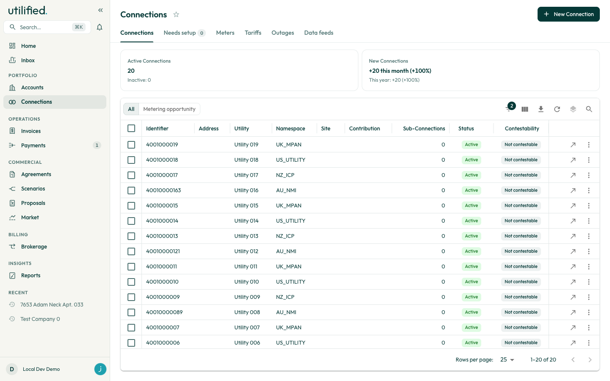
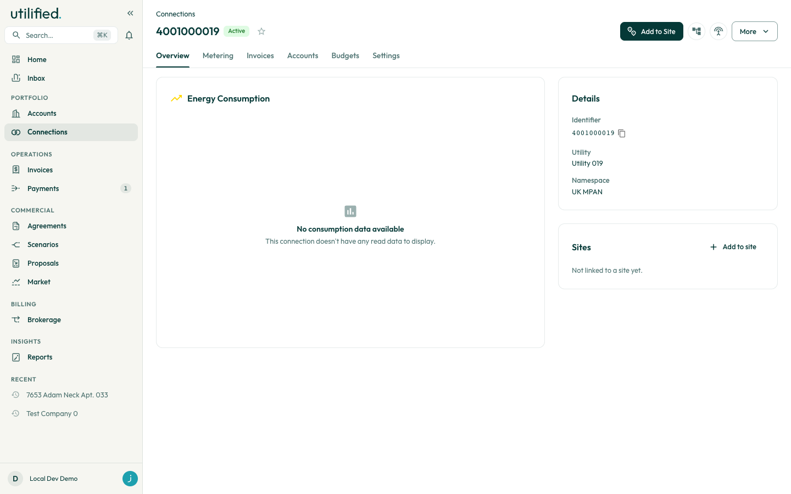

A connection is a single utility meter point: an electricity `NMI`, a gas `MIRN` or a water meter reference. Each connection sits under a [site](/sites) and carries its meters, reads, [retail accounts](/retail-accounts), [agreements](/agreements) and [invoices](/invoices).

Find it in the sidebar under **Portfolio** › **Connections**. You need access to the Utilities module.

## Hub tabs

The Connections hub groups everything about metering and pricing into tabs.

| Tab              | What it's for                                                                   |
| ---------------- | ------------------------------------------------------------------------------- |
| **Connections**  | Every connection in your organisation                                           |
| **Needs setup**  | Identifiers found on invoices that match no connection yet                      |
| **Meters**       | Every meter across your connections. See [Meters, registers and reads](/meters) |
| **Tariffs**      | Tariff groups and their rates. See [Tariffs](/tariffs)                          |
| **Outages**      | Network outages affecting your connections, now or soon                         |
| **Data feeds**   | External data brought in for an account. See [Data feeds](/data-feeds)          |

<Frame>
  
</Frame>

## Connections list

The **Connections** tab lists your connections in a grid. It shows top-level connections only. A connection with sub-connections can be expanded to show them.

Use the view switch at the top of the grid to change the list:

| View                     | Shows                                                                                                               |
| ------------------------ | ------------------------------------------------------------------------------------------------------------------- |
| **All**                  | All connections. The grid starts filtered to active ones: open **Filters** in the grid toolbar and remove the **Status** filter to include inactive connections |
| **Metering opportunity** | Contestable connections, or ones whose customer size isn't confirmed, with no active or upcoming metering agreement |

| Column              | Description                                                         |
| ------------------- | ------------------------------------------------------------------- |
| **Identifier**      | The `NMI`, `MIRN` or meter reference. Click it to open the connection |
| **Address**         | The connection's address                                            |
| **Utility**         | Electricity, gas or water                                           |
| **Namespace**       | The identifier market, for example `AU_DEFAULT`                     |
| **Site**            | The site the connection belongs to                                  |
| **Contribution**    | How a sub-connection rolls into its parent                          |
| **Sub-Connections** | The number of active sub-connections                                |
| **Status**          | Active or Inactive                                                  |
| **Contestability**  | Whether the connection is contestable for metering                  |

To follow up metering opportunities in more depth, see [Tracking metering coverage](/guides/tracking-metering-coverage).

### New Connection

Click **New Connection** to open the **Create New Connection** drawer. The form is grouped into sections: **Connection Information** (identifier, address, utility and namespace; all but the address are required), **Hierarchy**, **Loss Factors**, **Annual Usage**, **Dates** and **Additional Data**. The drawer doesn't ask for a site. Link one afterwards with **Add to Site** on the connection's page.

For a step-by-step walkthrough, see [Managing connections](/guides/managing-connections).

## Needs setup

When invoice extraction reads a connection identifier that matches no connection in UMS, it lands on **Needs setup**. Each row shows the identifier, its namespace, the suggested utility, how many invoices it appears on and the address if one was read. The tab shows a count of rows waiting.

Click **Create connection** on a row to open a form pre-filled from the invoice. Check the identifier, namespace and utility, add an address, and optionally pick a site. Where the invoice gave a distributor or loss factor codes, the form shows them so you can set loss factors after creating the connection. Saving creates the connection and links it to the invoices that mentioned it.

When every identifier is matched, the tab reads **Nothing to set up**.

## Outages

**Outages** lists distributor outage notices that match your connections. Use the view switch to choose **Live**, **In progress**, **Upcoming** or **Recently ended**. The **In progress** and **Upcoming** views show a count.

The grid shows each outage's **Network**, **Kind**, **Phase**, **Window**, **Sites affected**, **ETR** (estimated time of restoration) and **Cause**. Click a row to see the connections it affects.

| Phase                   | Meaning                                                  |
| ----------------------- | -------------------------------------------------------- |
| **Upcoming**            | A planned outage that hasn't started                     |
| **In progress**         | The connection is off supply now                         |
| **Restored**            | The distributor confirmed supply is back                 |
| **Ended (unconfirmed)** | The window has passed but no restoration notice arrived  |
| **Cancelled**           | The distributor cancelled the outage                     |
| **Unknown**             | The distributor hasn't given a start time                |

A connection with a current or upcoming outage also shows a banner on its **Overview** tab.

## Connection detail

Click a connection's identifier to open it. The header shows the identifier and an **Active** or **Inactive** status. Beneath it are the address (only when it differs from the site name), a link to the site and the utility.

{/* screenshot-stale */}
<Frame>
  
</Frame>

### Tabs

| Tab          | What it's for                                                                      |
| ------------ | ---------------------------------------------------------------------------------- |
| **Overview** | Consumption chart, details, sites and location                                     |
| **Metering** | Meters, sub-connections, reads, data feeds and usage analytics                     |
| **Invoices** | Invoices billed against the connection, and billing completeness                   |
| **Accounts** | Retail accounts and agreements for the connection                                  |
| **Budgets**  | Budgets set for the connection                                                     |
| **Settings** | Connection details, eligibility, cost split, custom fields and quantity constants  |

### Header actions

| Action                     | What it does                                                                               |
| -------------------------- | ------------------------------------------------------------------------------------------ |
| **Add to Site**            | Links the connection to a [site](/sites) in the **Add Connection to Site** drawer           |
| **Add Sub-Connection**     | Creates a submeter beneath this connection                                                 |
| **Connect Data Feed**      | Connects an external metering feed, such as an inverter API, to the connection             |
| **New Meter**              | Adds a physical meter to the connection                                                    |
| **New Retail Account**     | Records the retailer's account reference so invoices match this connection                 |

Only **Add to Site** shows a label. The others are icon buttons; hover to see their names.

### Overview

- Consumption chart: reads over the last 12 months, with drill-down. Download the visible data as CSV from the chart. For a full export, use **Metering** › **Reads**.
- **Billing and contract**: the active retail account and its status, the supplier, and the current energy and metering agreements. Links to **All retail accounts** and **All agreements** open the **Accounts** tab. A sub-connection doesn't show this panel.
- **Details**: identifier, utility, namespace, the annual estimate, loss factors when set, and the parent or sub-connection count.
- **Sites**: the sites the connection is linked to.
- **Location**: the site on a map.

With site analytics enabled for your organisation and access to analytics, the tab also shows a 12-month summary band and **Contract** and **Data and billing** panels. A connection with no reads then shows **Spend and usage** from its invoices in place of the chart.

### Metering

Pick a segment with the switch at the top of the tab.

| Segment             | What it shows                                                                                                                     |
| ------------------- | --------------------------------------------------------------------------------------------------------------------------------- |
| **Meters**          | The connection's meters. See [Meters, registers and reads](/meters)                                                               |
| **Sub-connections** | Submeters beneath this connection, such as a tenant or a generation asset. To add one, use the **Add Sub-Connection** header action, or the **Add Sub-Connection** button shown while there are none yet |
| **Reads**           | A report of the connection's reads. Choose a date range, time aggregation, **Units** and **TOU**, then click **Get Report**. Click **Export** to download the reads as ZIP or XLSX, choosing a scope: **This connection only**, **Connection + sub-connections** (when it has sub-connections), or every connection on its site or account. A parent can turn on **Include sub-connections** |
| **Data feeds**      | Metering feeds connected to this connection. **Alert routing** links to where you choose who hears about a failing feed           |
| **Usage analytics** | How the connection uses its utility and what drives its cost                                                                     |

**Usage analytics** only appears when it's enabled for your organisation and you have access to analytics. The **Data feeds** segment also shows **SolisCloud access** and **Sungrow iSolarCloud access** panels to users with permission to manage inverter sign-ins.

### Invoices

| Segment          | What it shows                                                                                         |
| ---------------- | ----------------------------------------------------------------------------------------------------- |
| **Invoices**     | Every [invoice](/invoices) billed against the connection's retail accounts                            |
| **Completeness** | A calendar of billing periods across every retail account that billed the connection, to spot gaps     |

### Accounts

Pick a segment with the switch at the top of the tab.

| Segment             | What it shows                                                                                       |
| ------------------- | --------------------------------------------------------------------------------------------------- |
| **Retail accounts** | The [retail accounts](/retail-accounts) attached to the connection                                  |
| **Agreements**      | The connection's [agreement](/agreements) links, with an **Onboarding** milestone strip per agreement. Click a row to edit the link |

### Budgets

The budgets set for this connection.

### Settings

| Section                      | What it's for                                                                                                  |
| ---------------------------- | -------------------------------------------------------------------------------------------------------------- |
| **Connection Details**       | Edit the identifier, address, utility, namespace, loss factors and other details                               |
| **Eligibility Criteria**     | Record eligibility details. Click **Edit**, change the values, then **Save**                                   |
| **Cost Allocation Override** | A cost-centre split for payment files that overrides the site's split. Clear it to go back to the site's split |
| **Custom Fields**            | Your organisation's own fields for the connection                                                              |
| **Quantity constants**       | Fixed quantities, such as a contracted demand, applied to the connection's invoices. Click **Add Quantity Constant** |
| **Data management**          | **Archive connection** (sets it inactive) or **Delete connection** (can't be undone)                           |

### Sub-connections

A sub-connection gets its site, retail accounts and agreements through its parent. On a sub-connection's page:

- The **Accounts** and **Budgets** tabs are hidden.
- **Add to Site**, **Add Sub-Connection** and **New Retail Account** are hidden.
- **Metering** has no **Sub-connections** segment, because a sub-connection can't have its own.
- **Overview** shows **Sub-connection of** with a link to the parent, and the **Contribution**.

## Related guides

- [Managing connections](/guides/managing-connections)
- [Tracking metering coverage](/guides/tracking-metering-coverage)
