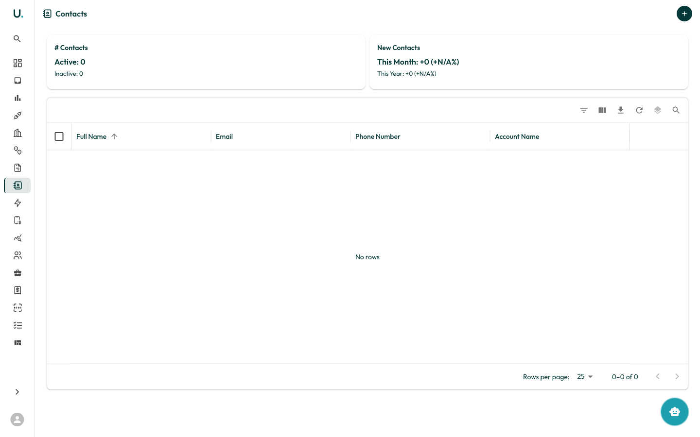

Go to **Accounts** in the sidebar, then the **Contacts** tab.

Contacts are the people at your accounts: key personnel, billing contacts, site managers and other stakeholders. Each contact belongs to one [account](/accounts). An account's contacts also appear in the **People** panel on its **Overview** tab.

{/* screenshot-stale */}
<Frame>
  
</Frame>

## Contacts list

Tiles above the grid show **Active Contacts** and **New Contacts** (this month and this year). The grid shows active contacts by default, sorted by name; clear the status filter to include inactive ones.

| Column      | Description                                     |
| ----------- | ----------------------------------------------- |
| **Name**    | The contact's full name. Click it to open the contact. |
| **Email**   | Email address                                   |
| **Phone**   | Phone number                                    |
| **Account** | The account the contact belongs to              |

A **Status** column (**Active** or **Inactive**) is hidden by default; add it from the grid's column settings.

### Adding a contact

Click **Add contact** to open the **Create New Contact** drawer. Enter the first name, last name, email, phone number and account; all are required. You can also click **New** › **New Contact** on an account's detail page, which fills in the account for you.

## Contact detail page

The header shows the contact's name, a status chip, and a link to their account. You edit fields in place on the tabs.

| Tab          | What it shows                                                                                   |
| ------------ | ----------------------------------------------------------------------------------------------- |
| **Overview** | **Contact Details** (**First name**, **Last name**, **Account**) and **Contact Info** (**Email**, **Phone number**) |
| **Settings** | **Additional details** for the contact, and **Data management**: **Archive contact** (set it inactive) or **Delete contact** (permanent) |
