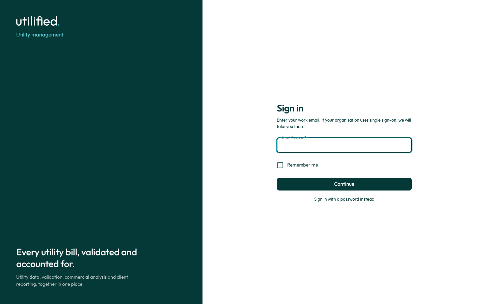
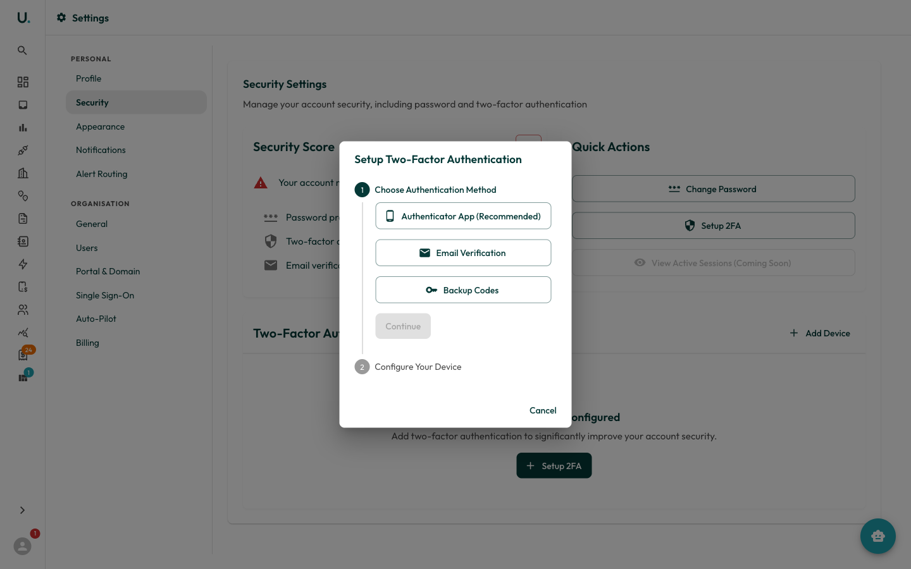

## Creating your organisation

If you're new to UMS, start by creating your organisation's account.

<Steps>
  <Step title="Sign up">
    On the **Create Your Account** page, enter your **Contact Name**, **Email** and **Organisation Name**. If plans are listed under **Plan (optional)**, you can pick one now or leave it for later. Click **Sign Up**.
  </Step>
  <Step title="Verify your email">
    UMS sends a verification link to the address you entered. Click it to activate your account. Check spam or junk if it doesn't arrive within a few minutes.
  </Step>
  <Step title="Choose a plan and get set up">
    After verifying, you're taken to [choosing a plan](/getting-started/choosing-a-plan). Then load your portfolio with [guided onboarding](/getting-started/getting-set-up).
  </Step>
</Steps>

Signing up doesn't ask for a password. The verification link signs you in.

## Signing in

{/* screenshot-stale */}
<Frame>
  
</Frame>

Sign-in asks for your email first, then works out how you sign in.

<Steps>
  <Step title="Enter your email">
    Open your organisation's UMS URL, enter your **Email** and click **Continue**.
  </Step>
  <Step title="Sign in">
    - If your organisation uses single sign-on (SSO), UMS takes you to your organisation's identity provider. Sign in there and you return to UMS.
    - Otherwise, a **Password** field appears. Enter your password and click **Sign in**.
  </Step>
</Steps>

Tick **Remember me** to stay signed in on this browser. If your organisation uses SSO but you need to sign in with a password, click **Sign in with a password instead**. To sign in as someone else from the password step, click **Use a different email**.

If an SSO sign-in doesn't complete, UMS shows **Single sign-on did not finish** with the reason. Click **Back to sign in** to try again.

<Info>
  SSO is set up by your organisation's administrator. Your identity provider's own policies, including its multi-factor authentication, apply when you sign in through it.
</Info>

## Two-factor authentication (2FA)

With 2FA on, UMS asks for a code as well as your password when you sign in.

### Setting up 2FA

<Steps>
  <Step title="Open Security">
    Open the account menu (your name at the bottom of the sidebar), choose **My Account**, then select **Security**.
  </Step>
  <Step title="Start setup">
    Under **Two-factor authentication**, click **Set up 2FA**. If 2FA is already on, the button reads **Add method**.
  </Step>
  <Step title="Choose a method">
    Choose **Authenticator app (recommended)**, **Email verification** or **Backup codes**.

    {/* screenshot-stale */}
    <Frame>
      
    </Frame>
  </Step>
  <Step title="Confirm the code">
    For an authenticator app, scan the QR code with Google Authenticator, Authy, Microsoft Authenticator or any TOTP app. Enter the 6-digit code it shows and click **Verify**. UMS may also ask for **Your password**. For email, enter the code UMS sends you.
  </Step>
  <Step title="Save your backup codes">
    After an authenticator app, UMS asks for backup codes. Confirm it's you, click **Generate backup codes**, store the codes somewhere safe, then click **Complete setup**.
  </Step>
</Steps>

<Warning>
  Backup codes are shown once. Without them, losing your authenticator device can lock you out of your account.
</Warning>

### When your organisation requires 2FA

If your organisation requires 2FA and you haven't set it up, UMS asks you to at sign-in. After your password, the sign-in page shows **Set up two-factor authentication**. Scan the code with an authenticator app, enter the 6-digit code and click **Verify** to finish signing in. You may also be asked for a **Code from the email we sent you**.

This step doesn't create backup codes. Generate them afterwards from **Security**.

### Signing in with 2FA

<Steps>
  <Step title="Sign in as normal">
    Enter your email and password.
  </Step>
  <Step title="Choose how to verify">
    After your password, the sign-in page shows **Verify your identity**. If you've set up more than one method, pick **Authenticator app**, **Email code** or **Backup code**. For email, click **Send email code** first.
  </Step>
  <Step title="Enter the code">
    Enter the **Verification code** (or your **Backup code**) and click **Verify**.
  </Step>
</Steps>

To start again with different details, click **Back to sign in**.

## Resetting your password

<Steps>
  <Step title="Start the reset">
    On the sign-in page, enter your email, click **Continue**, then click **Forgot password?**.
  </Step>
  <Step title="Request the link">
    On the **Reset Password** page, enter your **Email Address** and click **Request Password Reset**.
  </Step>
  <Step title="Set a new password">
    Open the link in the email and set a new password. Check spam or junk if it doesn't arrive within a few minutes.
  </Step>
</Steps>

To change a password you know, open **Security** and click **Change password**.

## Troubleshooting

| Problem | Solution |
| --- | --- |
| Forgotten password | Click **Forgot password?** on the sign-in page |
| 2FA code not working | Check your device's clock is correct, then wait for the next code |
| Lost authenticator device | Sign in with a **Backup code**, then set up 2FA on your new device |
| SSO not working | Ask your IT administrator to check your account is set up for UMS |
