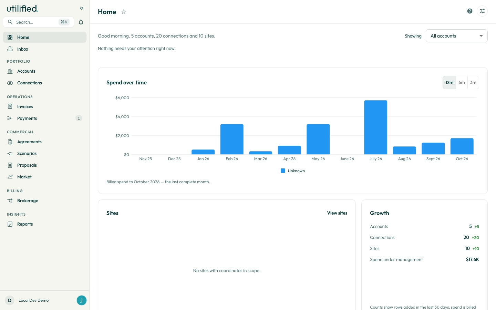
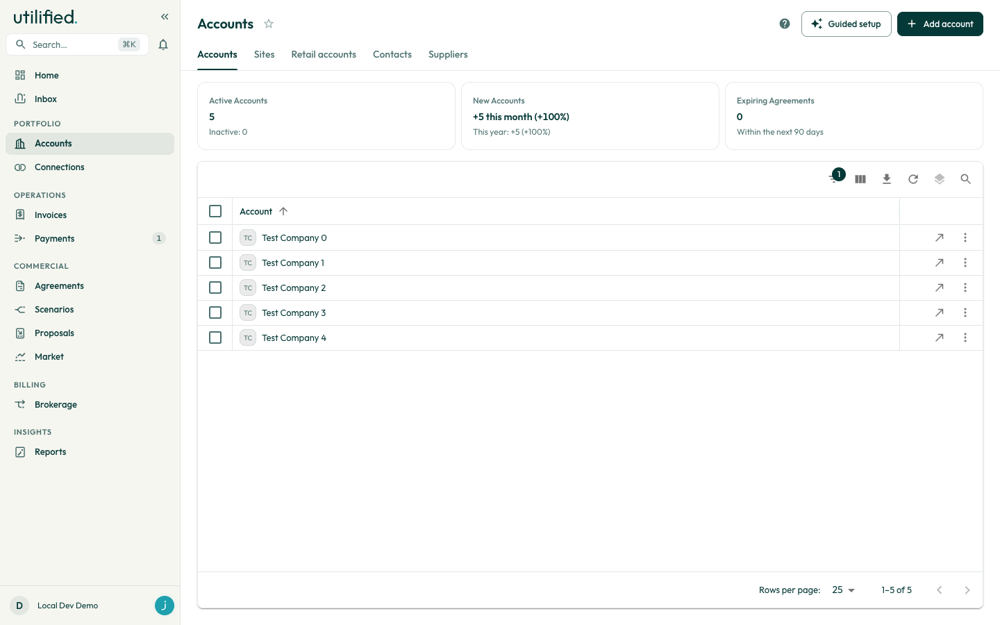

UMS is an energy management platform for Australian businesses and energy brokers. It helps you:

- Track energy accounts across sites and connections
- Process invoices automatically from email or by upload
- Validate billing against tariff rates to catch errors
- Manage agreements and watch contract end dates
- Calculate brokerage revenue from energy agreements
- Report on consumption, spend and portfolio health

## Getting started in 5 steps

<Steps>
  <Step title="Sign in">
    Open your organisation's UMS URL, enter your email and click **Continue**. Then enter your password, or sign in through your organisation's single sign-on if it uses one.

    See [Logging In & Security](/getting-started/logging-in) for 2FA and password resets.
  </Step>
  <Step title="Check Home">
    You land on [Home](/home). It shows a count of your accounts, connections and sites, tiles for work that needs attention, market headlines and the modules you choose.

    <Frame>
      
    </Frame>
  </Step>
  <Step title="Review your accounts">
    Select [Accounts](/accounts) in the sidebar. Click **See Details** on any account to open its sites, connections, invoices and agreements.

    <Frame>
      
    </Frame>
  </Step>
  <Step title="Upload invoices">
    Open [Invoices](/invoices) › **Uploads** and click **Upload invoices** (the upload icon in the header) to add invoice files. UtiliRead extracts them and matches them to accounts and connections. Invoices can also arrive by email through your [Inbox](/inbox).
  </Step>
  <Step title="Run your first report">
    Select [Reports](/reports) and click **Run** on any report card. Try the **Agreement Connections Expiry and Billing Report** to see which contracts are due for renewal.
  </Step>
</Steps>

## What to explore next

| If you want to... | Go to... |
| --- | --- |
| Get around the app | [Navigating UMS](/getting-started/navigating-ums) |
| Ask questions about your data | [Joule](/joule) |
| Invite your team | [Setting Up a User](/guides/setting-up-a-user) |
| Set up your account structure | [Creating Accounts](/guides/creating-accounts) |
| Import data in bulk from CSV | [Bulk Importing Data](/guides/bulk-importing-data) |
| Process incoming invoices | [Editing Invoices](/guides/editing-invoices) |
| Validate invoice accuracy | [Working the validation queue](/guides/invoice-validation) |
| Track brokerage revenue | [Brokerage revenue and invoicing](/guides/brokerage-revenue-and-invoicing) |
| Configure tariff rates | [Managing Tariffs](/guides/managing-tariffs) |
| Manage energy agreements | [Managing Agreements](/guides/managing-agreements) |
| Schedule reports | [Running Reports](/guides/running-reports) |
| Understand the data model | [Key Concepts](/getting-started/key-concepts) |
