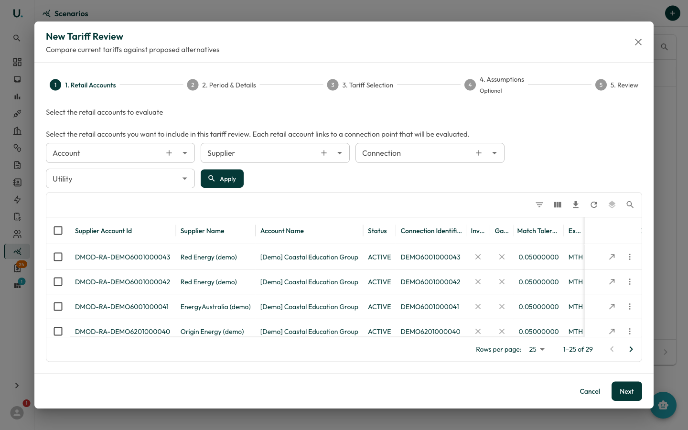

A bulk tariff review compares the tariffs your retail accounts are on today against alternatives, over a period you choose. It can also cost power factor correction and demand reset. For a single site or account, **Model opportunities** is quicker; see [Scenarios & Modelling](/scenarios#new-scenario).

You need create access to Modelling.

## Run a bulk tariff review

Go to **Commercial** › **Scenarios**, click **New scenario**, then **Bulk tariff review**. You can also click **Bulk tariff review** on a retail account's **Scenarios** card, which skips the retail account step.

<Steps>
  <Step title="Scenario types">
    Choose what to assess. Pick one or more:

    - **Tariff Review**: re-prices consumption on an alternative network tariff to find a cheaper structure.
    - **Power Factor Correction**: estimates the saving from correcting power factor to a target, net of capex.
    - **Demand Reset**: compares billed demand against actual interval demand to find reset opportunities.
  </Step>
  <Step title="Retail accounts">
    Select the [retail accounts](/retail-accounts) to evaluate.

    {/* screenshot-stale */}
    <Frame>
      
    </Frame>
  </Step>
  <Step title="Period and details">
    Enter a **Name** and, if you like, a **Description (optional)**. Under **Comparison Period**, choose **Custom Date Range** or **Annualised (12 months)**, then set **Period From** and **Period To**. The period decides which tariff versions and meter data are used.
  </Step>
  <Step title="Tariff selection">
    Select **Current** and **Proposed** tariffs for every retail account. Click **Use assigned current tariffs** to fill in what each account is on today. See [Managing tariffs](/guides/managing-tariffs) for how tariffs are built.

    - **Apply to All** uses the same tariffs for every connection. **Per Connection** lets you set them one connection at a time.
    - Where a tariff group has more than one version, the version overrides let you pin one. The latest is used by default.
  </Step>
  <Step title="Assumptions (optional)">
    UMS checks for quantities it can't source from meter data.

    - **Compare with existing equipment (optional)**: include declared generators or batteries. See [Tariff reviews with existing equipment](/scenarios#tariff-reviews-with-existing-equipment).
    - **Power factor correction**: set a **Target power factor** and an optional **Install cost (optional)**. **Demand reset** needs no inputs.
    - **Load Profiles (Optional)**: assign a **Load Profile** and **Annual Consumption (kWh)** to generate interval data where there are no meter reads.
    - Values marked **No data** need a figure for those charges to be included. For demand, you can estimate from annual consumption.
    - **Quantity Overrides (Optional)**: override calculated demand values.

    If the missing-data check fails, click **Retry check**.
  </Step>
  <Step title="Review">
    Check your selections, then click the create button. It names the count, for example **Create review for 3 retail accounts**. UMS creates the review and starts the calculation.
  </Step>
</Steps>

<Tip>
  Charges with missing quantities are left out and flagged as warnings. Fill them in on the **Assumptions** step for an accurate comparison.
</Tip>

## Read the results

While the review is calculating, the **Overview** tab shows **Calculation in progress…** and the page updates itself.

A completed tariff review has two tabs, **Overview** and **Scenarios**.

### Overview

Switch between the actual period and **Annualised** figures with the toggle above the tiles.

| Item                                  | Shows                                                               |
| ------------------------------------- | ------------------------------------------------------------------- |
| **Current cost**                      | What the current tariffs cost                                       |
| **Best alternative**                  | The cheapest proposed tariff. Reads **Cheapest alternative** when no option saves |
| **Potential saving**                  | Saving against current, with the percentage. Reads **Additional cost** when every option costs more |
| **Cost comparison**                   | Current against each proposed tariff                                |
| **Current cost by category**          | Current charges split by category                                   |
| **Cost by connection and tariff**     | Every connection against every tariff, with the cheapest per connection highlighted |
| **Opportunities**                     | Power factor correction and demand reset results: **Opportunity**, **Connection**, **On tariff**, **Annual saving**, **Payback**, **Notes** |

**Some figures are incomplete** lists charges left out for missing data.

### Scenarios

Lists each costed item: its **Type**, **Opportunity**, **Tariff Group**, **Connection**, **Supplier**, **Account**, **Charges (ex GST)**, **GST** and **Total (inc GST)**. Expand a row for its line items. Click **Add Tariff** to add another tariff to a connection.

<Tip>
  To compare more than two tariffs, add several proposed tariffs to one review. The chart and the connection-by-tariff table show every option side by side.
</Tip>

### Header actions

| Action            | When it shows                        | What it does                                   |
| ----------------- | ------------------------------------ | ---------------------------------------------- |
| **Export report** | Completed                            | Downloads a branded PDF report                 |
| **Clone**         | Completed                            | Copies the review as a new draft               |
| **Recalculate**   | Completed                            | Runs the calculation again                     |
| **Run again**     | Failed                               | Retries the calculation                        |

When an input such as a tariff changes after the calculation, a banner reads **Inputs changed since this was calculated**. Click **Recalculate** on it to refresh the results.

### Create a proposal

On a completed review's **Overview**, click **Create proposal** to start a [proposal](/proposals) from it. You need create access to Modelling and Proposals.

## Solar and battery studies

A solar and battery study, run from **Model opportunities**, opens with these tabs:

| Tab             | What it's for                                                                 |
| --------------- | ----------------------------------------------------------------------------- |
| **Overview**    | The recommended system: **Year-1 saving**, **Simple payback**, **IRR**, **Self-sufficiency**, **Why this system**, **Baseline vs recommended**, **Cumulative cash flow**, **Energy in year 1**, and the other shortlisted systems. Existing equipment results appear here too |
| **Explore**     | Every configuration evaluated, as a **Scatter**, **Grid** or **Table**        |
| **Energy**      | Where the energy goes: solar used on site, exported and curtailed, battery charge and discharge, grid import, month by month |
| **Financials**  | **Bills** before and after, and the **Cash flow**                             |
| **Assumptions** | Every value the study used. Changing a preset later never changes these results |
| **Tracking**    | Forecast against realised savings each month: **Months measured**, **Forecast saving to date**, **Realised saving to date** and **Realised vs forecast**. Appears once you record an installation |

### Actions

- **Create proposal** (Overview): starts a [proposal](/proposals) from the study.
- **Download RFQ pack** (Overview): downloads a request-for-quote pack for the recommended system.
- **Record installation** (Overview): records the system that was installed so its savings can be tracked.
- **Edit assumptions** and **Save as preset** (Assumptions): change the study's inputs, or save them for later studies.
- **Clone to edit** (header and Assumptions): starts a new study from these settings.
- **Recalculate** (header) and **Run again** (header, when failed).

Recalculating, cloning and recording an installation need edit access to Modelling and Solar & Battery Modelling.
