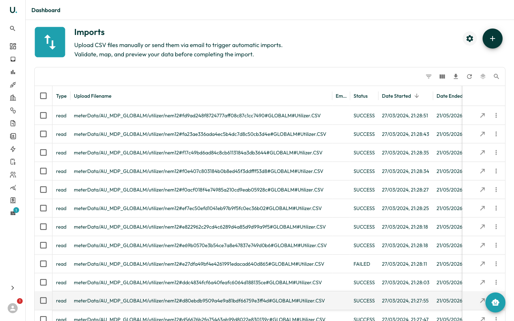
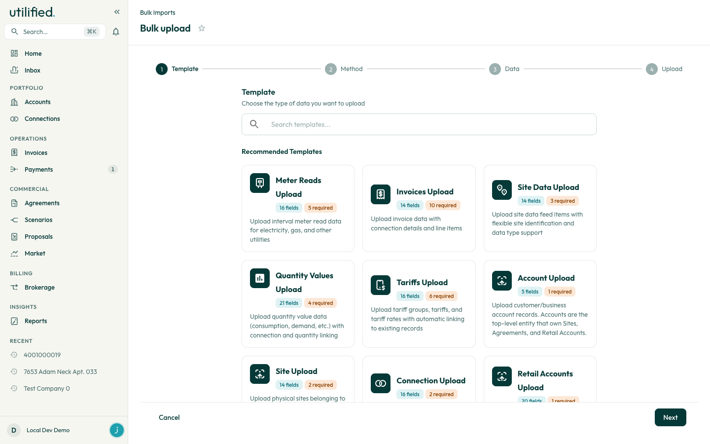
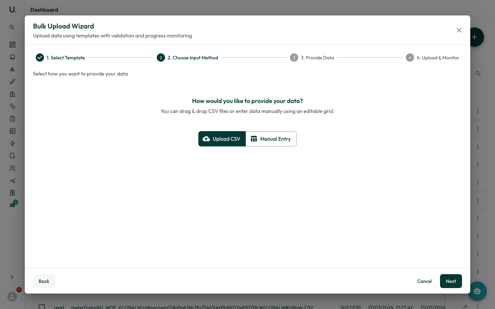
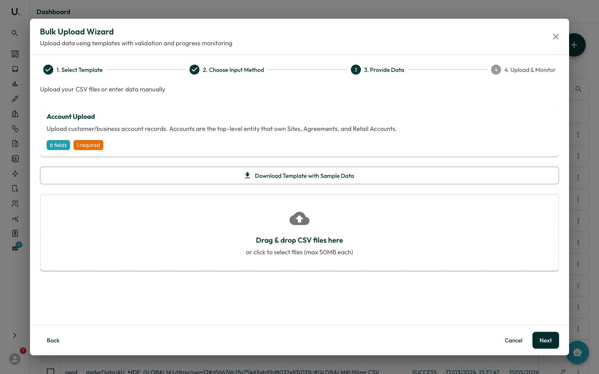

When you are onboarding a large portfolio or loading data from another system, the bulk upload wizard imports many records at once. Each import uses a template that defines the expected columns, so you can download a sample, fill it in and upload it back.

The import options you see depend on your permissions. For a reference of the Import page and its statuses, see [Imports](/imports).

## Open the Imports page

<Steps>
  <Step title="Open Import">
    Open the account menu at the bottom of the sidebar and select **Import**.
  </Step>
  <Step title="Review previous imports">
    Open the **History** tab. The **Portfolio data** view lists your previous imports with their type, file name, status and timestamps.

    {/* screenshot-stale */}
    <Frame>
      
    </Frame>
  </Step>
  <Step title="Start a new import">
    Open the **New import** tab and choose **Portfolio data** to open the **Bulk upload** wizard.
  </Step>
</Steps>

## Choose a template

The first step, **Template**, lists **Recommended Templates** and, below them, **Auto-Generated Templates**. Each card shows how many fields the template has and how many are required. Use **Search templates...** to find one quickly.

{/* screenshot-stale */}
<Frame>
  
</Frame>

| Recommended template               | Imports                                                       |
| ---------------------------------- | ------------------------------------------------------------- |
| **Account Upload**                 | Accounts                                                      |
| **Site Upload**                    | Sites                                                         |
| **Connection Upload**              | Connections                                                   |
| **Retail Accounts Upload**         | Retail accounts                                               |
| **Retail Account Ledger Upload**   | Retail account ledger transactions                            |
| **Agreements Upload**              | Agreements                                                    |
| **Tariffs Upload**                 | Tariffs                                                       |
| **Meter Reads Upload**             | Meter reads                                                   |
| **Quantity Values Upload**         | Quantity values                                               |
| **Site Data Upload**               | Site data                                                     |
| **Invoices Upload**                | Invoices and their line items                                 |
| **Payment File History Upload**    | Past payment files                                            |
| **Brokerage Records Upload**       | Brokerage records (contracts)                                 |
| **Brokerage Revenue Upload**       | Brokerage revenue                                             |
| **Onboarding Upload**              | A whole hierarchy from one file (see below)                   |

The steps that follow depend on the template.

## Import most data types

Every template except the two brokerage templates uses these steps: **Template**, **Method**, **Data**, **Map columns** (meter reads only, when needed) and **Upload**.

<Steps>
  <Step title="Method">
    Choose **Upload CSV** or **Manual Entry** (an editable grid).

    {/* screenshot-stale */}
    <Frame>
      
    </Frame>
  </Step>
  <Step title="Data">
    For **Upload CSV**, click **Download Template with Sample Data** to get a correctly formatted CSV with example rows. Fill it in, then drop one or more files onto the upload area. Each file can be up to 50&nbsp;MB.

    {/* screenshot-stale */}
    <Frame>
      
    </Frame>

    UMS checks each file's columns against the template as soon as you add it, marking it **Valid** or listing the errors to fix. For **Manual Entry**, fill in the grid instead; every required field needs a value.

    <Tip>
      Start from the downloaded template. It has the exact column headers the importer expects, which avoids most validation errors.
    </Tip>
  </Step>
  <Step title="Map columns (meter reads)">
    For a meter-read file in a layout UMS doesn't recognise, a **Map columns** step appears. UMS detects a suggested mapping; confirm how each of your columns maps onto the meter-read fields. A mapped interval file must be uploaded on its own, one file per import.
  </Step>
  <Step title="Upload">
    Click the upload button (for example **Upload 2 files** or **Upload 10 rows**). UMS processes the data in the background and shows live progress for each file, including how many rows succeeded and any per-row errors. Click **Go to imports** when you're done.
  </Step>
</Steps>

## Import brokerage records and revenue

**Brokerage Records Upload** and **Brokerage Revenue Upload** preview every row before anything is saved. The steps are **Template**, **File**, **Map columns**, **Preview** and **Import**.

<Steps>
  <Step title="File">
    Drop a CSV or Excel file, or click **Download CSV template** to start from the template. For a workbook, choose the **Sheet**; set the **Header row** if the column headings aren't on the first row.
  </Step>
  <Step title="Map columns">
    Match the file's columns to the fields being imported. For revenue, map the NMI/MIRN for new rows, or the revenue ID for existing rows.
  </Step>
  <Step title="Preview">
    UMS checks every row and shows what each will do, with a **Result**, **Agreement match** and **Message** per row. Use **Errors only** to focus on problems, and tick **Exclude** on rows you want to skip.
  </Step>
  <Step title="Import">
    Click the import button, for example **Import 120 rows**. Rows with errors are skipped and counted in the label.
  </Step>
</Steps>

<Note>
  You can also import brokerage data from the [Brokerage](/brokerage) area. That route adds a **Details** step after **Template** for who the file is from.
</Note>

## Onboarding upload (all-in-one)

When you're setting up a new portfolio, the **Onboarding Upload** template creates your whole hierarchy (accounts, sites, connections, retail accounts and agreements) from a *single* CSV. You don't need a separate file for each entity in dependency order. It's the file behind the [guided onboarding wizard](/getting-started/getting-set-up).

It's one row per connection (meter). Account, site and agreement values repeat down the rows and are de-duplicated automatically on a natural key, so you list each account or site once across many connections.

<Warning>
  The onboarding upload is all-or-nothing. If any row fails validation, nothing is created. Fix the file and re-submit. You never end up with a half-built hierarchy.
</Warning>

### Before you upload

- Suppliers and utilities must already exist. They're referenced by name and only looked up. An unknown name is a validation error, so set them up first.
- Values that repeat must be consistent. Two rows with the same `account_name` but a different `account_parent_name` are rejected (no last-write-wins).

### Columns

Download the template in the wizard to get the exact headers, or use <a href="https://utilified.com/downloads/onboarding-template.csv" download>onboarding-template.csv</a>.

The required minimum per row is `account_name`, `connection_identifier`, `retail_supplier_name` and `retail_supplier_account_id`. Everything else is optional: a row can create just an account, connection and retail account when there's no site or agreement yet.

| Group | Columns | Notes |
| --- | --- | --- |
| **Account** | `account_name` *(required)*, `account_parent_name` | De-dup on name. `account_parent_name` may reference another row's account. |
| **Site** | `site_name`, `site_address`, `site_city`, `site_state`, `site_postcode`, `site_type` | Optional per row; leave `site_name` blank to skip. The site links to the connection automatically. |
| **Connection** | `connection_identifier` *(required)*, `utility_name`, `connection_namespace`, `connection_address`, `annual_utility_cost`, `annual_utility_consumption` | `utility_name` is looked up (must exist). `connection_namespace` defaults to `AU_DEFAULT`. |
| **Retail Account** | `retail_supplier_name` *(required)*, `retail_supplier_account_id` *(required)*, `retail_status`, `retail_open_date` | `retail_supplier_name` is looked up (must exist). Status defaults to `ACTIVE`. |
| **Agreement** | `agreement_name`, `agreement_type`, `agreement_supplier_name`, `agreement_date_start`, `agreement_date_end`, `agreement_status`, `ac_date_start`, `ac_date_end` | `agreement_type` is required when `agreement_name` is set. The connection and retail account are linked to the agreement automatically; `ac_date_start` and `ac_date_end` set the dates of that link. |

<Tip>
  Fill in only the columns you have. A row with just the four required columns is valid; you can add sites and agreements later.
</Tip>

## Review import results

Back on the **Imports** page, each import has a row menu:

- **Download**: the original file you uploaded.
- **Exceptions**: a CSV of the rows that failed, with the reason for each.
- **Result Data**: a CSV with every row's outcome.
- **Refresh**: re-checks the status of an import in progress.

<Note>
  Invalid files are skipped during upload rather than blocking the rest. Review the **Exceptions** report to see which rows were rejected and why, then fix and re-import just those rows.
</Note>
