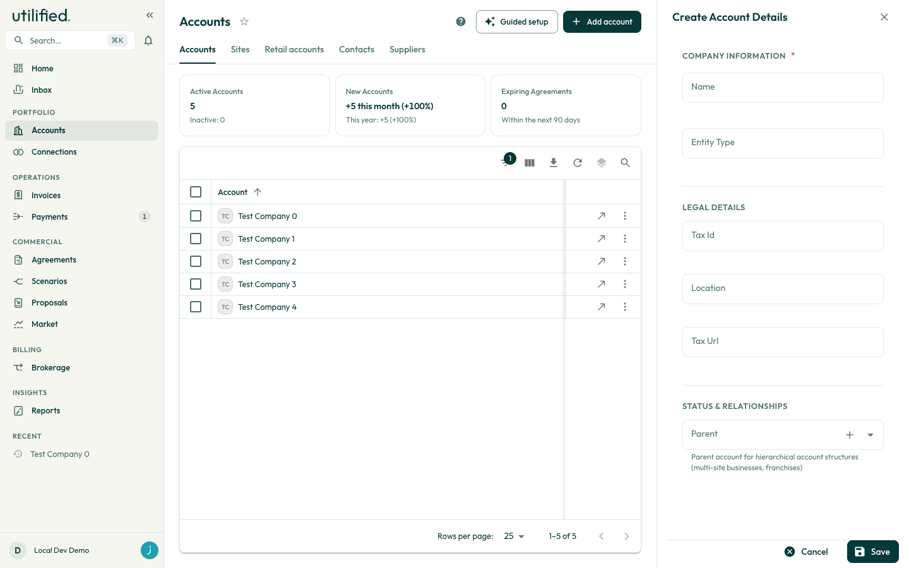

You can create an account in three places:

| Where                                   | Action                          | Use it to                                                        |
| --------------------------------------- | ------------------------------- | ---------------------------------------------------------------- |
| **Accounts** page                       | **Add account**                 | Create the account only                                          |
| **Accounts** page                       | **Guided setup**                | Create the account, then load its records with guided onboarding |
| An account's detail page, **New** menu  | **New Associated Account**      | Create a child account under the account you're viewing          |

## Create an account

<Steps>
  <Step title="Open the drawer">
    Go to **Accounts** in the sidebar and click **Add account**, or **Guided setup** to load the account's records straight after.

    <Frame>
      
    </Frame>
  </Step>
  <Step title="Enter the company information">
    Enter the **Name** (required) and choose the **Entity Type**.
  </Step>
  <Step title="Enter the legal details">
    Optionally enter the tax ID (the ABN or other tax identification number), the **Location** as a country code such as `AU`, and the tax URL, a link to the business registration such as the ABR entry.
  </Step>
  <Step title="Link a parent account">
    To make this an associated account, choose its **Parent**. Click the add icon in the field to create the parent on the fly.
  </Step>
  <Step title="Save">
    Click **Save**. With **Guided setup**, UMS opens guided onboarding for the new account.
  </Step>
</Steps>

## Load the account's records

Guided onboarding walks through five steps. The first four are optional, and your progress is saved as a draft.

| Step               | What you do                                                    |
| ------------------ | -------------------------------------------------------------- |
| **Import data**    | Upload documents for Joule to read, or import a CSV            |
| **Infrastructure** | Add associated accounts, sites and connections                 |
| **Site links**     | Connect sites to connections                                   |
| **Commercial**     | Add agreements and retail accounts                             |
| **Review**         | Check everything, then create the records in one go            |

To reopen it later, click **Launch Onboarding with Joule** on the account's header, or in **Settings** › **Onboarding Tools**. For the full walkthrough, see [Getting set up](/getting-started/getting-set-up).

## Add records one at a time

From the account's detail page, click **New** and choose **New Site**, **New Connection**, **New Retail Account**, **New Agreement** or **New Contact**. See [Sites](/sites), [Connections](/connections), [Retail accounts](/retail-accounts) and [Managing agreements](/guides/managing-agreements).
