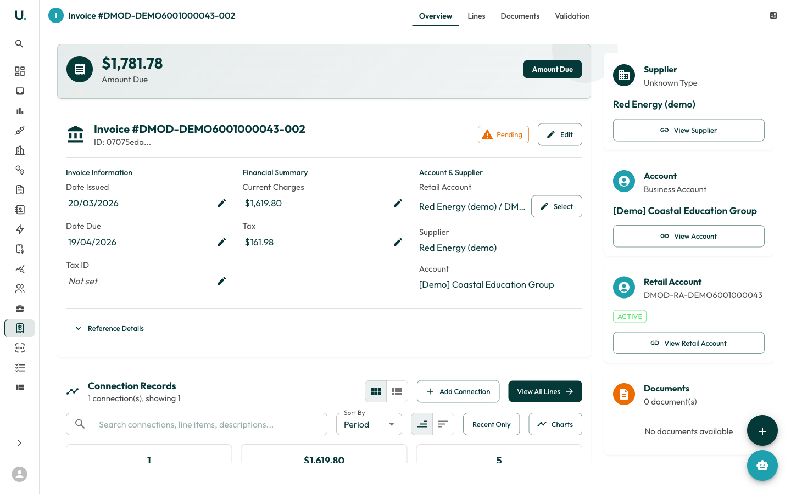
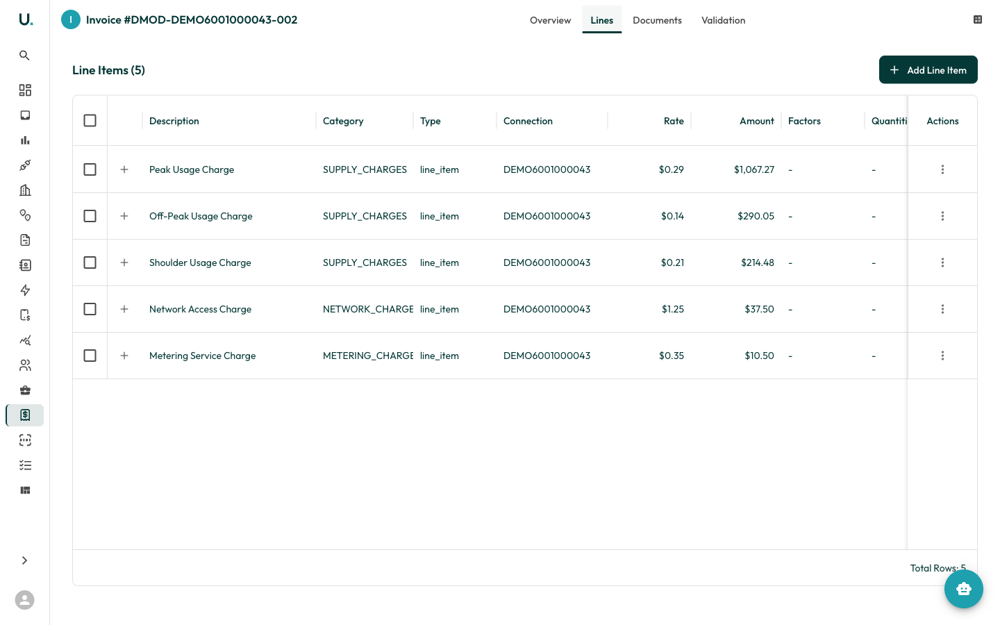

This guide covers fixing an invoice's details and line items, then re-validating it.

## Open an invoice

Go to **Invoices** › **Invoices** and click the invoice number, or use the **See Details** row action. You can also open an invoice from a validation run or an exception.

{/* screenshot-stale */}
<Frame>
  
</Frame>

The detail page has six tabs: **Overview**, **Line items**, **Ledger**, **Review**, **Activity** and **Settings**. See [Invoices](/invoices#invoice-detail) for what each holds.

<Tip>
  On a wide screen, click **Show source document side-by-side** in the header to keep the PDF open beside the tab you're editing.
</Tip>

## Edit invoice details

Open the **Settings** tab. **Invoice Details** holds **Invoice number**, **Date issued**, **Date due**, **Account number**, **Account name**, **Tax ID**, **Retail account** and **Supplier**. **Financials** holds **Amount due**, **Current charges**, **Tax**, **Previous balance**, **Payments**, **Other charges/credits** and **Starting balance**. Edit the fields in place.

To change one field across many invoices, select them on the **Invoices** tab and click **Edit selected**.

## Edit line items

{/* screenshot-stale */}
<Frame>
  
</Frame>

The **Line items** tab opens on **All lines**. Columns are **#**, **Description**, **Category**, **Type**, **Connection**, **Rate**, **Amount**, **Factors** and **Quantities**. Switch to **By connection** to see the connection records the lines belong to.

- Quick edit: double-click **#**, **Description**, **Category**, **Type** or **Amount** to change it in the grid.
- Full edit: open the row's actions menu and click **Edit** to change every field in a drawer.
- **Delete**: open the row's actions menu and click **Delete**.
- Quantities and factors: expand a row to see its **Factors** and **Quantities**. Use **Add Factor** or **Add Quantity**, or the edit and delete icons on each entry.

### Add a line item

<Steps>
  <Step title="Start a new line">
    Click **Add Line Item**. The invoice needs at least one connection record first.
  </Step>
  <Step title="Fill in the line">
    Enter the description, category, charge type and amount. If the invoice has more than one connection record, pick the connection.
  </Step>
  <Step title="Save">
    Save the drawer. The line appears in the grid.
  </Step>
</Steps>

## Correct or reverse an invoice

The **Corrections** panel on **Overview**, and the **Danger zone** on **Settings**, change what is owed without editing the bill:

- **Reverse** nets the invoice's outstanding amount to zero, so future payment files skip it.
- **Adjust** applies a signed adjustment, such as a credit memo or an extra charge.
- **Hold from payment** (on **Overview** only) keeps the invoice out of payment files. You must enter a **Reason** before you can click **Hold**. **Include in batches** lifts the hold.

The **More** menu beside **Reverse** and **Adjust** has more corrections:

- **Record payment** records a payment against the invoice.
- **Apply supplier credit** applies a credit from the supplier.
- **Not an invoice** marks the document as not an invoice. Only organisation admins see it.

Deleting the invoice (from the **Danger zone**) removes it and everything derived from it.

## Re-run validation

After fixing an invoice, click **Validate this invoice** in the header, then **Run validation**. Check the result on the **Review** tab. See [Working the validation queue](/guides/invoice-validation).

## Related

- [Invoices](/invoices)
- [Working the validation queue](/guides/invoice-validation)
- [Reviewing OCR-extracted invoices](/guides/utiliread-review)
