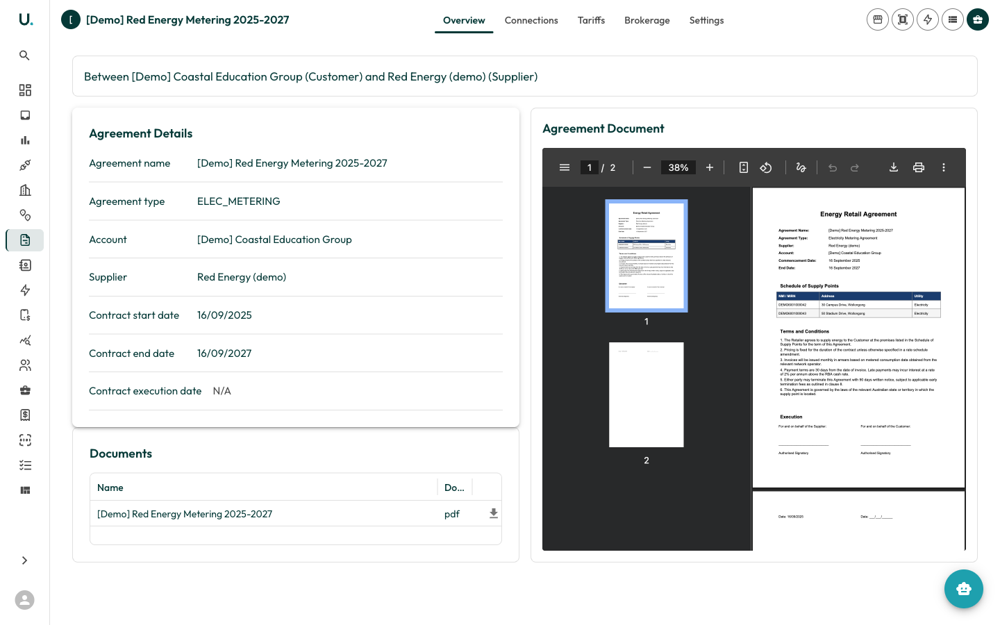
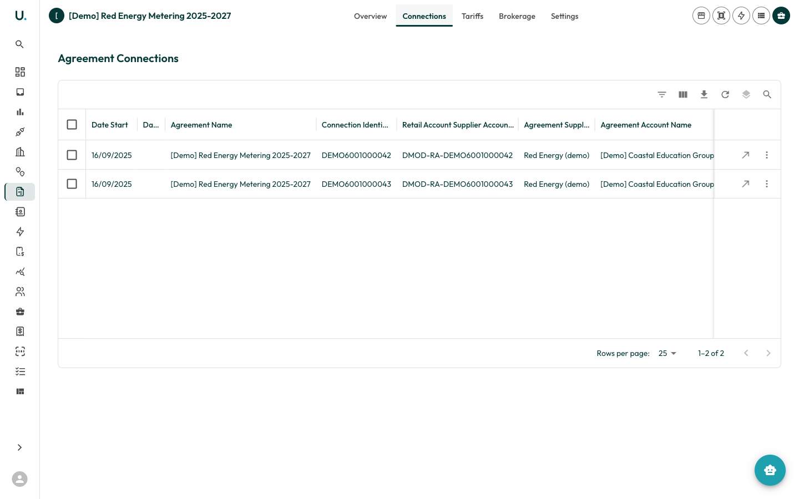
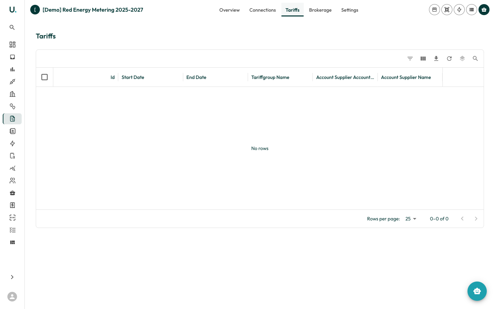

Agreements link accounts, suppliers, connections and tariffs together. For a reference of the Agreements page, its views and statuses, see [Agreements](/agreements).

## Creating a new agreement

<Steps>
  <Step title="Open the Agreements page">
    Open **Agreements** in the **Commercial** group of the sidebar.
  </Step>
  <Step title="Open the create drawer">
    Click **Add agreement**.
  </Step>
  <Step title="Fill in the agreement details">
    The drawer groups the fields under **Agreement Information** (name, type and reference), **Dates** (start, end and executed), **Status** (an optional override and its reason), **Relationships** (account and supplier) and **Documents**. Name and type are required.
  </Step>
  <Step title="Save">
    Save the drawer. The new agreement appears in the list.
  </Step>
  <Step title="Complete the setup">
    Open the agreement and add its connections and tariffs.
  </Step>
</Steps>

## Viewing agreement details

Click an agreement's name in the **Agreement** column to open its detail page.

{/* screenshot-stale */}
<Frame>
  
</Frame>

The detail page has these tabs:

- **Overview**: agreement summary, dates, supplier and key details
- **Connections**: connections covered by this agreement
- **Tariffs**: tariff structures and rates for this agreement
- **Brokerage**: brokerage records linked to this agreement
- **Activity**: who changed the agreement's details, and when
- **Settings**: agreement-specific settings

Header actions cover the rest: **Extract from contract**, **New tariff** (on the **Tariffs** tab), **New Retail Account**, **Add Document**, **Add a Connection**, **Bulk Add Connections**, **Merge Into This Agreement** and **Add a Brokerage Record** (only when your plan includes brokerage).

## Managing connections

The **Connections** tab lists the **Agreement Connections**: the meter connections this agreement covers. Click a row to open it.

{/* screenshot-stale */}
<Frame>
  
</Frame>

### Adding connections

- **One connection**: click **Add a Connection**. The drawer starts with the agreement's dates; pick the connection and, optionally, its retail account.
- **Many connections**: click **Bulk Add Connections** to open **Link connections to agreement**.

Everything happens on the wizard's single **Connections** screen:

<Steps>
  <Step title="Set the namespace and dates">
    Enter the **Namespace**. **Start Date** and **End Date** default from the agreement and apply to every connection created.
  </Step>
  <Step title="Add identifiers">
    Paste the connection identifiers (NMIs or MIRNs) into **Paste connection identifiers** and click **Add identifiers**. UMS looks each one up in that namespace.
  </Step>
  <Step title="Check the summary">
    The summary reads, for example, "8 of 10 ready to link". Identifiers that aren't found, are pending or have no picked match are skipped.
  </Step>
  <Step title="Link">
    Click **Link N connections** (for example **Link 8 connections**) to create the links.
  </Step>
</Steps>

## Managing tariffs

The **Tariffs** tab shows the tariff structures linked to this agreement.

{/* screenshot-stale */}
<Frame>
  
</Frame>

- **New tariff** opens the tariff builder with the agreement and supplier filled in. The button shows only while the **Tariffs** tab is open.
- **Extract from contract** reads a contract for you. See below.

See the [Managing Tariffs](/guides/managing-tariffs) guide for creating and editing tariffs.

### Extracting a tariff from a contract

<Steps>
  <Step title="Upload the contract">
    Click **Extract from contract** and drop a signed contract or offer document into **Extract Tariff from Contract**.
  </Step>
  <Step title="Review the proposal">
    Joule reads the document, usually in under a minute, and proposes a tariff. Nothing is created yet.
  </Step>
  <Step title="Confirm or reject">
    Click **Confirm & Create Tariff** to create it, or **Reject** to discard the proposal.
  </Step>
</Steps>

## Other actions

- **New Retail Account** creates a retail account with the agreement's account, supplier and dates filled in.
- **Add Document** attaches a contract or other file to the agreement.
- **Add a Brokerage Record** creates a [brokerage](/brokerage) record for this agreement, starting as pending, with its dates filled in from the agreement. It only appears when your plan includes brokerage.
- **Merge Into This Agreement** opens the merge flow with this agreement as the root. Pick the duplicate agreements to fold into it, review, then merge. The merge cannot be undone. You can also start a merge from **Merge Agreements** on the Agreements list.
