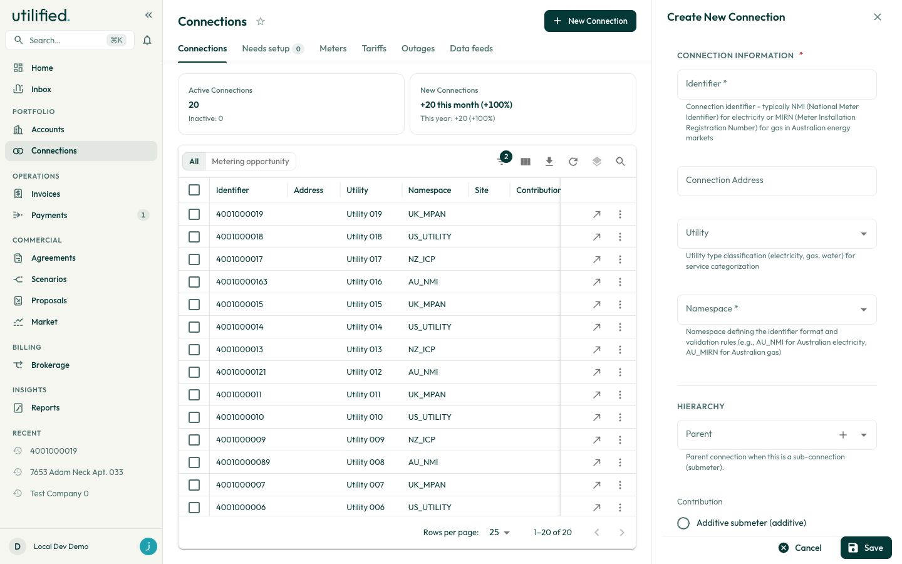

A connection is an individual utility meter point: an electricity `NMI`, a gas `MIRN` or a water meter reference. This guide walks you through creating a connection and wiring it into the rest of your data: a [site](/sites), its [meters and reads](/meters), and a [retail account](/retail-accounts). For every tab and action on the connection page, see [Connections](/connections).

## Creating a connection

<Steps>
  <Step title="Open the create drawer">
    Go to **Portfolio** › **Connections**. On the **Connections** tab, click **New Connection** to open the **Create New Connection** drawer.

    {/* screenshot-stale */}
    <Frame>
      
    </Frame>
  </Step>
  <Step title="Fill in the connection information">
    In **Connection Information**, enter:

    - The identifier *(required)*: the `NMI` for electricity, the `MIRN` for gas, or the meter reference for water.
    - The connection address.
    - The utility *(required)*.
    - The namespace *(required)*, for example `AU_DEFAULT`.

    Expand the other sections if you need them:

    - **Hierarchy**: a parent connection and contribution, to make this a submeter.
    - **Loss Factors**: the distribution and marginal loss factor groups (electricity).
    - **Annual Usage**: the expected annual cost and consumption, and the consumption unit.
    - **Dates**: when the connection was established or abolished.
  </Step>
  <Step title="Save">
    Click **Save**. The drawer closes and the connection appears in the list. Click its identifier to open it.
  </Step>
</Steps>

<Tip>
  If an invoice has already mentioned the identifier, create the connection from **Needs setup** instead. Click **Create connection** on its row: the form is pre-filled from the invoice, and saving links those invoices to the new connection.
</Tip>

## Linking, metering and retail accounts

The connection page's header actions handle the remaining relationships. Only **Add to Site** shows a label; hover over the icon buttons to see their names.

<Steps>
  <Step title="Link the connection to a site">
    Click **Add to Site** to open the **Add Connection to Site** drawer. Choose the [site](/sites) and save. The connection's location then appears on the **Overview** tab.
  </Step>
  <Step title="Add meters and registers">
    Click **New Meter** to add a physical meter. Open the meter and click **New Register** to add its measurement channels. See [Meters, registers and reads](/meters).
  </Step>
  <Step title="Attach a retail account">
    Click **New Retail Account** to record the retailer's account reference for this connection. Incoming [invoices](/invoices) are matched to the connection through it. See [Retail accounts](/retail-accounts).
  </Step>
</Steps>

## Adding a sub-connection

A sub-connection is a submeter beneath a connection, such as a tenant's supply or a solar system.

<Steps>
  <Step title="Open the parent connection">
    Open the connection the submeter sits beneath.
  </Step>
  <Step title="Add the sub-connection">
    Click **Add Sub-Connection** in the header, or go to **Metering** › **Sub-connections** and click **Add Sub-Connection**. Enter the identifier, utility and namespace, set how it contributes to the parent, and save.
  </Step>
</Steps>

A sub-connection takes its site, retail accounts and agreements from its parent, so its page has no **Accounts** or **Budgets** tab.

## Checking reads and billing

- **Metering** › **Reads**: pick a date range, click **Get Report** to chart the reads, and **Export** to download them.
- **Invoices** › **Completeness**: see which billing periods have an invoice, across every retail account that billed the connection.

## Archiving or deleting a connection

Go to **Settings**. Under **Data management**, click **Archive connection** to set it inactive, or **Delete connection** to remove it. A deleted connection can't be recovered.
