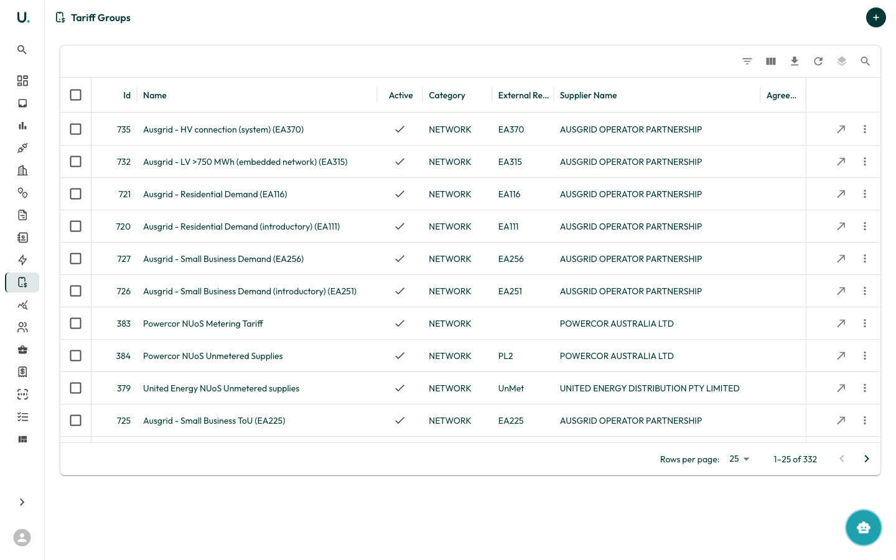

Tariffs define the rate structures that energy retailers charge. Invoice validation and brokerage calculations depend on them. For every column, tab and action, see [Tariffs](/tariffs).

## Starting a tariff

You can start the **Create tariff** wizard from two places:

- **Portfolio** › **Connections** › **Tariffs**: click **New Tariff Group**.
- An [agreement](/agreements): open its **Tariffs** tab and click **New tariff**. The wizard links the tariff to that agreement and its supplier.

{/* screenshot-stale */}
<Frame>
  
</Frame>

## Wizard steps

<Steps>
  <Step title="Template (optional)">
    Pick a tariff template, filtered by market, state and category, or skip this step to start from scratch. Choosing a template means you build the rates by hand, so the **Method** step is skipped.
  </Step>
  <Step title="Method">
    Choose how to enter the rates:

    - **Create Manually**: build the rates in the wizard.
    - **Bulk CSV Import**: upload the rates as a CSV file.
  </Step>
  <Step title="Details">
    Enter the tariff group's **Name** (required), **Category**, **Description** and **External Reference**, and whether it's **Active**. Under **Relationships**, choose the **Supplier** and **Agreement**. Both are filled in when you start from an agreement.
  </Step>
  <Step title="Rates or Import">
    If you chose **Create Manually**, the **Rates** step builds the tariff in periods. Each period becomes a version of the tariff.

    - Give the period a **Period Description**, a **Start Date** and an optional **End Date (Optional)**. Click **Add Period** for another.
    - Add rates to the period. For each rate, set the **Category**, **Description**, **Value** and **Display Units**, and whether **Tax Applicable**. You can also set an **Invoice Match Label**, **Factors** and quantities.
    - Every period needs a start date and at least one rate, and every rate needs a description.

    If you chose **Bulk CSV Import**, the **Import** step takes a CSV file.

    - Click **Download CSV Template** to see the expected columns.
    - Upload your file. UMS validates it and lists any errors and warnings. Fix every error before you go on; click **Clear** to remove the file and try again.
  </Step>
  <Step title="Review">
    Check the tariff, then click **Create tariff with N rates**, where N is the number of rates you added. The new tariff group opens.
  </Step>
</Steps>

## After you create a tariff

<Steps>
  <Step title="Assign it to a retail account">
    On the tariff group, click **Add to Retail Account**. Choose the retail account, an optional connection and the start date, then click **Assign tariff**. To replace the account's current tariff, pick it under **Replaces** and click **Switch tariff**.
  </Step>
  <Step title="Add a new version when rates change">
    On the **Rates** tab, click **New Version** and enter the description, start date and optional end date. Then click **Add Rate** to add the new rates.
  </Step>
  <Step title="Confirm derived tariffs">
    A tariff UMS derives from an invoice starts unconfirmed. Validations that use it raise an unconfirmed-tariff discrepancy until you check the rates and click the confirm icon (**Confirm these rates are correct**) in the header.
  </Step>
</Steps>

## Key concepts

| Term             | Description                                                                 |
| ---------------- | --------------------------------------------------------------------------- |
| **Tariff group** | The overall rate plan, linked to a supplier and an agreement                |
| **Version**      | A date-scoped set of rates within the group. The wizard calls it a period   |
| **Rate**         | An individual charge component, such as a usage rate or a supply charge     |
| **Assignment**   | The link between a tariff group and a retail account for a date range       |
