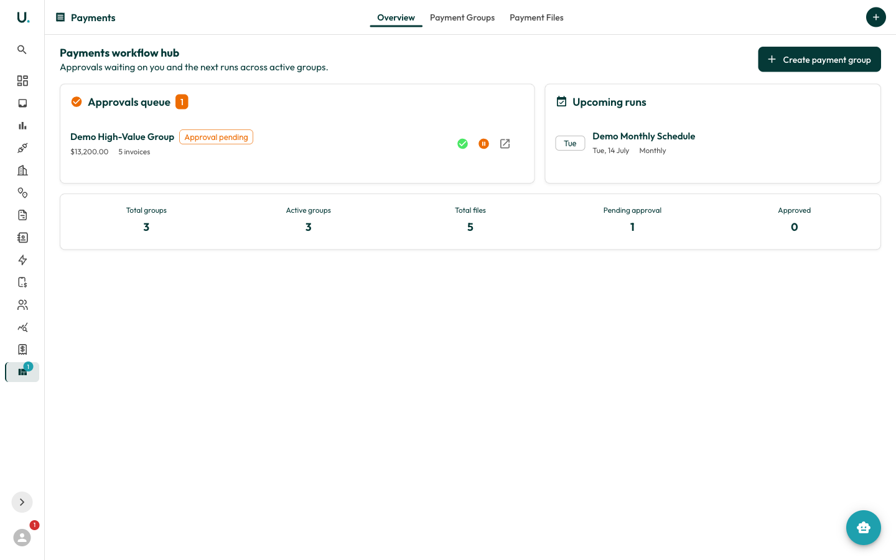
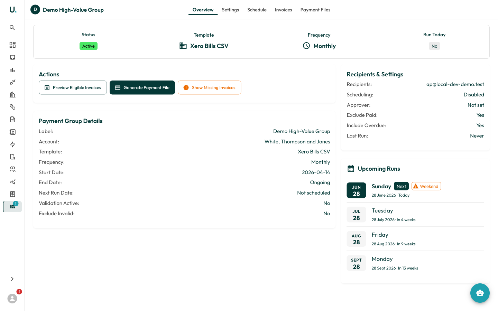
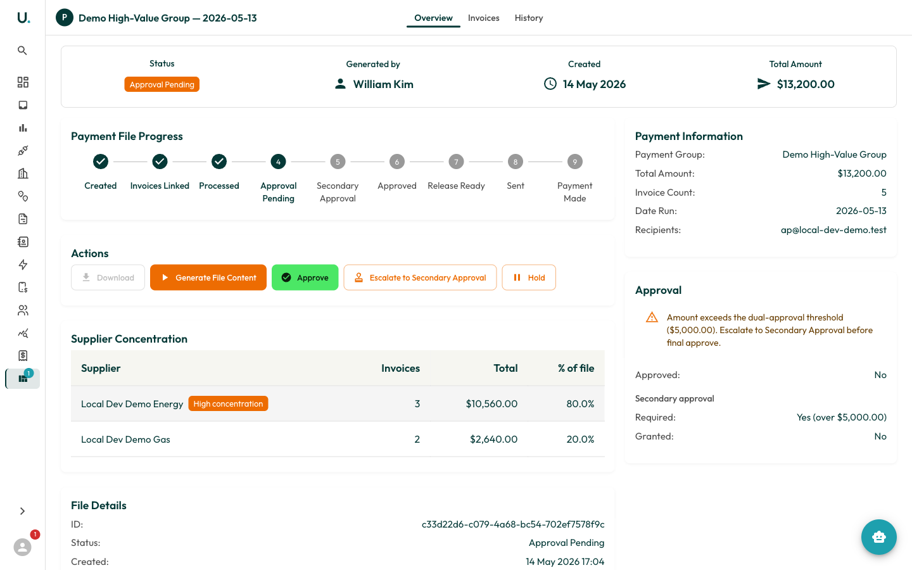

This guide walks through paying invoices in UMS, from setting up a payment group to marking the payment as made. For a reference of the Payments screens and statuses, see [Payments](/payments).

Open **Payments** in the **Operations** group of the sidebar (`/payments`). It has three tabs: **Overview**, **Groups** and **Files**. Payments only appears for users with access to the Validation module.

{/* screenshot-stale */}
<Frame>
  
</Frame>

## Create a payment group

Click **New payment group** on the **Overview** or **Groups** tab. The **Create payment group** dialog has these sections, with a **Summary** panel beside them that shows how many invoices the group would batch today and its schedule:

| Section                       | What you set                                                                 |
| ----------------------------- | ---------------------------------------------------------------------------- |
| **Basics**                    | The group's label, account, template (the export layout), currency and recipients |
| **Bank details (ABA)**        | The bank account the ABA file pays from. Shown only for the **ABA (bank direct entry)** template |
| **Schedule**                  | Frequency, start and end dates, whether scheduling is on, the run day and the due-date window |
| **Filters**                   | Which invoices the group picks up: suppliers to include or exclude, connections, amount and age limits, overdue and paid handling, and validation holds |
| **Distribution and approval** | The approver, an optional secondary approver and the dual-approval threshold |

**Filters** and **Distribution and approval** start collapsed. Click **Create payment group** to save.

Templates include **Xero Bills CSV**, **MYOB Service Purchases**, **NetSuite Vendor Bill CSV**, **SAP S/4HANA Vendor Invoice**, **Australian Standard CSV**, **New Zealand Standard CSV**, **Generic CSV**, **Custom (configure fields)** and **ABA (bank direct entry)**.

<Note>
  Only organisation admins can create payment groups or change who approves a payment, which invoices a group covers, or its bank details, recipients and validation holds.
</Note>

## Generate a payment file

<Steps>
  <Step title="Work through the pre-flight checklist">
    Open the group. Its **Overview** tab starts with a pre-flight checklist that reads **Ready to generate** or says how many items need attention. Work through it top to bottom:

    | Check | What it flags |
    | --- | --- |
    | **Blocked invoices** | Invoices held back by exceptions. Resolve the exception, or tick the invoice to pay it anyway |
    | **In-credit invoices** | Credits you can net on this run (see below). Shown only when there are any |
    | **Exception warnings** | Exceptions that don't block payment but need a look |
    | **Ledger attention** | Retail account ledgers with open issues |
    | **Expected but missing** | Bills the cadence says should have arrived |
    | **Bills not yet received** | Supplier accounts past their billing cadence |
    | **Validation warnings** | Unreviewed validation failures |
    | **Discounts at risk** | Early-payment discounts that lapse before the next run |

    Passing checks are hidden. Click **Show all checks** to see them too.
  </Step>

  <Step title="Check the eligible invoices">
    The **Eligible invoices** panel lists what this run will pay. Untick rows to leave them out of this run only; they stay eligible for future runs. If you ticked any blocked invoices to pay anyway, enter a reason for the override.

    Click **What's excluded?** to open the group's **Coverage** tab, which shows every invoice the group is not paying and why. From there you can exclude an invoice from all future runs, or put it back in scope.
  </Step>

  <Step title="Generate the file">
    Choose a **Format** and click **Generate Payment File**. You can also click **Generate payment file** in the group header, or on the **Files** tab (choose the **Payment Group**, **File Format** and **Due within (days)**).

    The formats are CSV, XLSX, PDF, XML and ABA, limited to what the group's template can produce. An ABA group produces an ABA file only.

    {/* screenshot-stale */}
    <Frame>
      
    </Frame>
  </Step>
</Steps>

<Note>
  An ABA file is a bank direct-entry file you upload to your bank. The other templates produce an export for your accounting or ERP system.
</Note>

## Approve, send and close the file

<Steps>
  <Step title="Open the file">
    Open the new file from the **Files** tab. If its content is missing, click **Generate File Content**. Use **Refresh Content** to re-render a processed file after an underlying invoice changes; it doesn't change the status.
  </Step>

  <Step title="Submit for approval">
    From **Processed** or **Release ready**, click **Submit for Approval**. To have the file checked first, click **Raise for Review**, then **Start Review**, **Mark Review Successful** and **Release for Approval**.
  </Step>

  <Step title="Approve">
    The approver clicks **Approve** and can add a comment. Approvers also see the file under **Your approvals** on the Payments **Overview** tab.

    <Warning>
      If the file total exceeds the group's dual-approval threshold, click **Escalate to Secondary Approval**. The secondary approver clicks **Grant Secondary Approval**, then the primary approver clicks **Final Approve**. Each approval records the approver and time.
    </Warning>

    {/* screenshot-stale */}
    <Frame>
      
    </Frame>
  </Step>

  <Step title="Send">
    Once the file is **Approved** (or **Release ready**), click **Send** to dispatch it to the group's recipients.

    <Tip>
      Click **Download** to save the file itself. Click **Download audit pack** for a **PDF report**, a **CSV bundle (zip)** or **Invoice copies (zip)**.
    </Tip>
  </Step>

  <Step title="Mark the payment as made">
    After your bank or ERP confirms the transfer, click **Mark Payment Made**. If the payment is rejected, click **Mark Rejected**, or **Record Rejections** to log which lines failed. From **Payment rejected**, **Reissue Rejected Lines** creates a new file containing only the rejected invoices.
  </Step>
</Steps>

**Hold** puts a file on hold at any point before payment; **Release Hold** returns it. While a file is unreleased, **Regenerate** rebuilds it and **Delete file** removes it.

## In-credit invoices and regeneration

When generating a payment file, expand **In-credit invoices** in the pre-flight checklist. Tick **Net on this run** for each credit you want to offset against bills on the same retail account. Enter a reason for the selected overrides before generating the file; UMS records the decision in the file's status log.

The list offers eligible credits from the last 24 months. It excludes manually excluded credits, credits already on an open payment file, and credits with blocking exceptions. The section is informational: available credits do not make an otherwise ready run unready. UMS does not pay a credit on its own and refuses a file that would leave a retail account net in credit.

For an unreleased payment file, **Regenerate** rebuilds the file using today's eligibility. The dialog offers eligible additional credits and blocked invoices, with a reason required for any selected overrides. Credits already netted on the file carry forward and do not appear as new choices.

If an existing credit is now excluded, blocked or otherwise ineligible, UMS refuses regeneration and preserves the original file. Review the reason and resolve the issue; where appropriate, override a blocked credit with a reason. If you intend to remove the credit, delete the unreleased file and generate a new one after reviewing the revised amount due.
