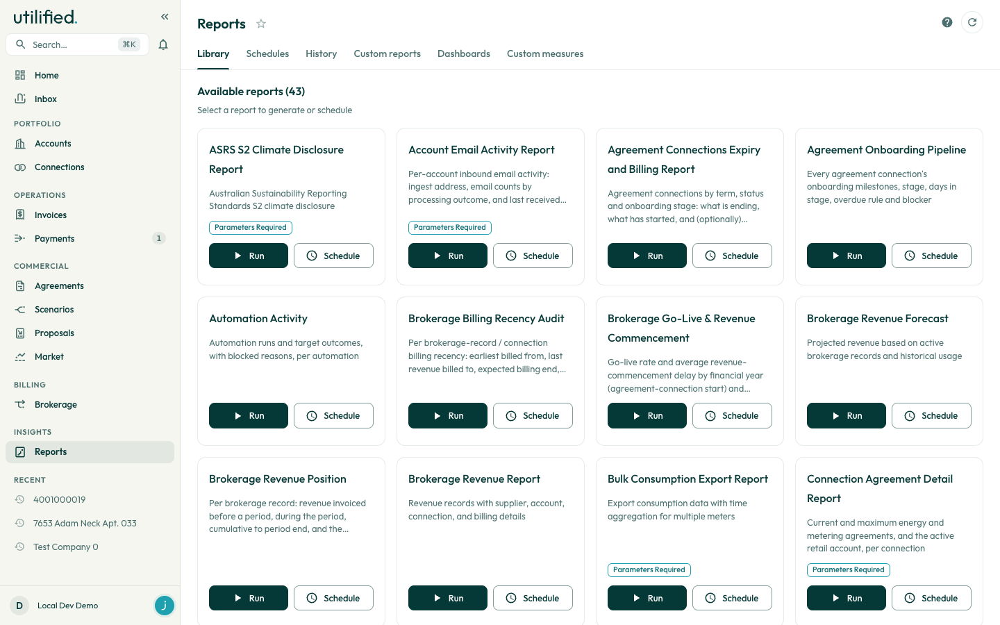

This guide covers running a report from the **Library**, finding its output in **History**, and setting up a schedule. For the full report catalogue and custom reports, see [Reports](/reports).

<Frame>
  
</Frame>

## Run a report

<Steps>
  <Step title="Open the Library">
    Select **Reports** in the **Insights** group of the sidebar. The **Library** tab lists the reports you can run.
  </Step>
  <Step title="Click Run">
    Click **Run** on the report's card. A **Parameters Required** chip means you must fill in filters first.
  </Step>
  <Step title="Fill in the parameters">
    Depending on the report, either a full page or a **Generate Report** dialog opens with its filters, such as dates, accounts and connections.

    On the full page you can save the filters you use often: type a **Preset name** and click **Save preset**. Click a saved preset under **Saved presets** to apply it.
  </Step>
  <Step title="Generate it">
    Click **Generate report** (or **Generate Report** in the dialog). The report is queued and runs in the background.
  </Step>
</Steps>

<Tip>
  **Invoice Batch Export** has its own form: choose the **Root Account** and **Date From** (both required) and optionally **Date To**. Use **Additional Columns** to add site, account and connection columns, including custom fields and tags, to each CSV row. Click **Generate Batch**. It produces a ZIP of an invoice CSV and the invoice PDFs.
</Tip>

## Find the output

<Steps>
  <Step title="Open History">
    Select the **History** tab. You also get a notification when the report finishes.
  </Step>
  <Step title="Find your run">
    Search by report name or user, or filter by **Status** and **From** / **To** dates. A run shows **Pending** until it finishes, then **Completed** or **Failed**.
  </Step>
  <Step title="Get the file">
    Click **Download**. For a CSV, **View in browser** previews the rows first. If a run failed, its reason shows under the name; where it can be retried, click **Retry this report**.
  </Step>
</Steps>

## Schedule a report

<Steps>
  <Step title="Start a schedule">
    Click **Schedule** on the report's card, or select the **Schedules** tab and click **Create Schedule**.
  </Step>
  <Step title="Name it and choose the report">
    Enter a **Schedule Name** and pick the **Report**.
  </Step>
  <Step title="Set the parameters">
    Fill in **Report Parameters**. For a date field, turn on **Use Relative Date** and pick a **Relative Date** such as **Previous Month** or **Since last successful run**, so each run covers a new period.
  </Step>
  <Step title="Choose the format and recipients">
    Pick the **Format** (**CSV**, **Excel (XLSX)** or **JSON**) and enter the **Email Addresses** that should receive it.
  </Step>
  <Step title="Set when it runs">
    Choose the **Frequency** and **Time**, plus the **Day of Week**, **Day of Month** or **Month** where needed. Leave **Enable Schedule** on, then click **Create Schedule**.
  </Step>
</Steps>

Manage schedules on the **Schedules** tab: use the **Enabled** switch to pause one, or **Edit** and **Delete** in the **Actions** column. Scheduled runs also appear in **History**.
