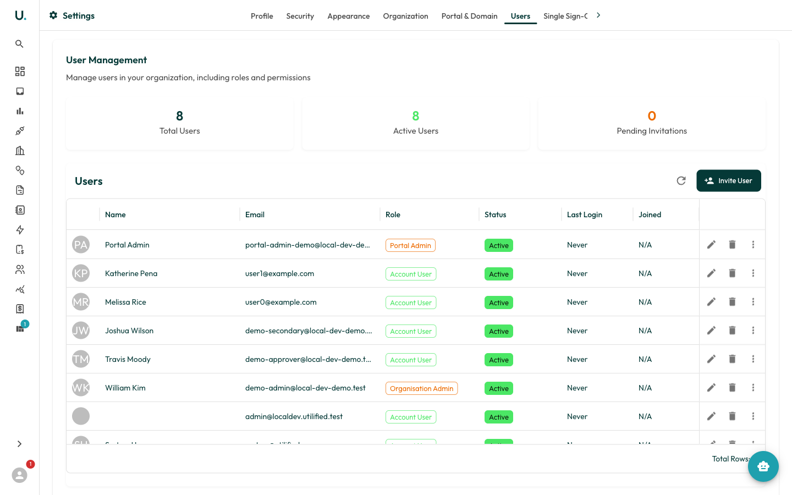

This guide covers inviting someone to your UMS organisation, choosing their role and accounts, and managing users afterwards.

You need access to the users module to see the **Users** section, and permission to create users to see **Invite user**. If you don't see them, ask an org admin.

## Open user management

Open the account menu at the bottom of the sidebar and choose **Settings**. Then select **Users** in the **Organisation** group of the left rail.

{/* screenshot-stale */}
<Frame>
  
</Frame>

A row of counts sits above the users table. Click a count to filter the table to those users, and click **All users** to clear the filter.

| Count | Users it includes |
| --- | --- |
| **All users** | Everyone in your organisation |
| **Active** | Users who can sign in |
| **Invited** | Users invited in the last 14 days who haven't registered yet |
| **Invite expired** | Users invited more than 14 days ago who still haven't registered |
| **Dormant** | Users with no activity in the last 30 days |
| **Never active** | Users who have never signed in or used UMS |
| **Deactivated** | Users whose access you have turned off |

## Invite a new user

<Steps>
  <Step title="Open the invitation">
    Click **Invite user** at the top of the Users section. The **Invite user** dialog opens, with a summary of the new user's access on the right.
  </Step>
  <Step title="Enter their details">
    Under **Details**, enter **First Name**, **Last Name** and **Email Address**. The invitation goes to that email address. **Phone Number (optional)** takes Australian formats such as `04XX XXX XXX` or `+614XX XXX XXX`.
  </Step>
  <Step title="Choose a role">
    Under **Role**, pick a role card. Each card shows the role's default access level. You can only choose roles at or below your own. For **Portal Admin** or **Portal User**, also choose a **Portal Account**. A portal admin must have one.
  </Step>
  <Step title="Choose account access (optional)">
    For **Organisation Admin**, **Member** and **Viewer**, an **Account access** section lets you assign the accounts this user can access. You can change this later. Portal roles don't have this step, because they see only their portal account.
  </Step>
  <Step title="Send the invitation">
    Click **Send invitation**. The user gets an email to complete registration and appears as **Invited** until they do.
  </Step>
</Steps>

<Tip>
  If a field is missing or invalid when you send, a summary at the top of the dialog lists the problems. Click one to jump to the field.
</Tip>

## User roles

| Role | Default access |
| --- | --- |
| **Organisation Admin** | Admin in every module, including users, settings and billing |
| **Member** | Edit, on their assigned accounts |
| **Viewer** | View, on their assigned accounts |
| **Portal Admin** | Administers one customer account in your white-label portal, and can invite portal users to it |
| **Portal User** | Uses one customer account in your white-label portal |

A role sets the default level for each module. By default, Organisation Admins see every account, and Members and Viewers see only the accounts assigned to them. You can raise or lower individual modules, or change account visibility, for one user on their **Access** tab.

## Manage existing users

Each row in the users table shows the user's **Name**, email, **Role**, **Status**, **Activity**, **Requests (30d)** and **Joined** date. **Activity** reads **Recent**, **Dormant** or **Never**, with the date the user was last active if they have been. Add **Last active**, **Last login**, **Phone** or **Login enabled** from the column picker. Row actions:

- **Manage user** opens the user's record.
- **Resend invitation** sends the invitation email again. It shows only for users who are **Invited** or **Invite expired**.
- **Deactivate user** turns off their access straight away. Their data and history are kept. **Reactivate user** lets them sign in again.
- **Delete user** removes the account outright. You type the user's email address to confirm. Deactivating is usually better, because it keeps their history and can be undone.

### Bulk actions

Tick several users to act on them together: **Resend invitations**, **Deactivate** or **Reactivate**. Each asks you to confirm. A bulk resend skips anyone who has already signed in, and a bulk deactivation leaves you out.

| Status | Meaning |
| --- | --- |
| **Invited** | Invitation sent, not yet registered |
| **Invite expired** | Invitation lapsed. Resend it. |
| **Active** | Registered and able to sign in |
| **Deactivated** | Access turned off |

## The user record

**Manage user** opens the user's record with three tabs.

| Tab | What it holds |
| --- | --- |
| **Profile** | **First name**, **Last name**, **Email** and **Portal account** (the account a portal user sees). Click **Save changes** after editing. Under **Security**, **Reset 2FA** removes every two-factor method so the user sets it up again at their next sign-in. Use it when they have lost their authenticator app and backup codes. |
| **Access** | **Role and permissions**: change the **Role** and adjust each module's level (**None**, **View**, **Edit** or **Admin**). A module override is saved only when it differs from the selected role's default level. Click **Save Role & Overrides** to save just the role and overrides. **Account access**: choose the user's assigned accounts. Click **Save role**, or **Save role and accounts** if you changed accounts, and confirm with **Apply**. **Account visibility** is set to **All accounts in the organisation** or **Only assigned accounts**, and has its own **Save visibility** button. Only org admins can change it. |
| **Activity** | **Engagement**, **Account state**, **Last active**, **Days active (30d)** and usage of UMS and the **Client portal**, with the dates the user was invited, registered, first joined and last signed in. |

Portal users always see only their portal account and its sub-accounts, so the **Access** tab doesn't offer account visibility for them.
