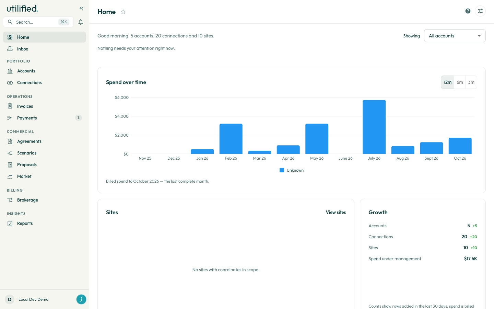

**Home** is the first item in the sidebar and the page you land on after signing in. It shows what is in your portfolio, what needs doing, and a grid of modules you can customise.

<Frame>
  
</Frame>

The page is built from four bands, top to bottom:

| Band                | What it shows                                                                          |
| ------------------- | -------------------------------------------------------------------------------------- |
| Greeting            | A greeting with your first name and a one-line count of accounts, connections and sites |
| Attention strip     | Tiles for work that needs doing, each linking to the list behind it                     |
| **Market news**     | A scrolling ticker of the latest market headlines                                      |
| Modules             | The modules you have chosen, in your order                                             |

## Scope

The **Showing** selector beside the greeting sets which accounts Home counts. Your choice is saved and applies to the greeting, the attention strip and the modules.

| Option                | What Home counts                                                           |
| --------------------- | -------------------------------------------------------------------------- |
| **All accounts**      | Your whole organisation                                                    |
| **Accounts I follow** | The accounts you follow and their associated accounts                      |
| **Specific accounts** | The accounts you pick in the **Accounts** field. Choose at least one.      |

When the scope is narrowed, the selector is highlighted and the greeting says "in scope". Some modules can't narrow to every scope. They show all accounts instead and say so in a caption under the module title.

## Attention strip

Each tile shows a count and opens the list it counts. A tile with nothing to report is hidden. When every tile is empty, the strip reads "Nothing needs your attention right now."

| Tile                         | Counts                                                        | Opens                                   |
| ---------------------------- | ------------------------------------------------------------- | --------------------------------------- |
| **Billing errors**           | Invoices with an unresolved billing error, and the amount at stake | [Validation](/validation), errors view |
| **Issues to review**         | Unresolved invoice exceptions in the review queue             | Invoice exceptions                      |
| **Duplicates**               | Suspected duplicate invoices                                  | Invoice exceptions, duplicates          |
| **Data gaps**                | Billing periods with no invoice                               | Invoice exceptions, gaps                |
| **Expiring in 90 days**      | Agreements whose end date falls within 90 days                | [Agreements](/agreements), expiring view |
| **Failed uploads (30 days)** | Imports that failed, or failed validation, in the last 30 days | [Import](/imports) › **History**, failed            |
| **Off supply**               | Connections affected by a current network outage              | Connection outages, in progress         |

**Billing errors** and **Failed uploads (30 days)** can't be narrowed by account, so they only appear under **All accounts**. Under a narrowed scope the other counts follow the scope, but the lists they open aren't filtered.

## Market news

The **Market news** ticker scrolls the latest headlines and pauses when you hover over it. Click a headline to open the story, or click **Market news** to open the news on the [Market](/market) page. The ticker is hidden when there are no headlines.

## Modules

| Module                        | What it shows                                                                        |
| ----------------------------- | ------------------------------------------------------------------------------------ |
| **Spend over time**           | Monthly billed spend, stacked by utility, to the last complete month                 |
| **Growth**                    | Account, connection and site counts and spend under management, with growth          |
| **Data quality**              | Invoice completeness score and the most common missing fields                        |
| **Sites**                     | Map of the sites in scope                                                            |
| **Renewals**                  | Agreements expiring in the next 90 days                                              |
| **Accounts**                  | Titled **Accounts you're following** under **Accounts I follow**, otherwise **Recent accounts** |
| **Connections by utility**    | Active connection mix                                                                |
| **Market**                    | Wholesale market snapshot                                                            |
| **Notifications**             | Your latest [notifications](/notifications), newest first                            |
| **Processing**                | Invoices in flight, by pipeline stage                                                |
| **Contracted annual volumes** | Contracted annual cost per utility, from connection records rather than billed data  |

### Customising Home

<Steps>
  <Step title="Open the drawer">
    Click the customise icon at the top right of the page (tooltip: **Choose which modules appear on your home page**). The **Customise home** drawer lists every module, including hidden ones.
  </Step>
  <Step title="Choose and order modules">
    Tick or clear a module's checkbox to show or hide it. Use the **Move up** and **Move down** arrows to change its position.
  </Step>
</Steps>

Changes apply straight away and are saved to your user, so Home looks the same on any device.

## During a free trial

On the [free trial](/getting-started/free-trial), Home adds a few things to help you get going.

### Trial banner

A banner across the top of the app shows the days left and your bill usage, for example *Free trial: 21 days left · 5 of 25 invoices processed*. Org admins see **Upgrade**, which opens **Settings** › **Plan & billing**. Other users see *"Ask your organisation admin to upgrade."*

When the trial ends, the banner reads *"Your free trial has ended. Your data is safe and read-only."*

### Getting-started checklist

The **Get started with your free trial** panel lists the steps below and counts how many are done. **Explore the sample client** drops off the list if you delete the sample client before opening it. Each step links to where you do it and ticks itself off once it's done.

| Step | Ticks off when |
| --- | --- |
| **Explore the sample client** | You open the sample client |
| **Add your first client** | You add an account of your own |
| **Upload a bill or import interval data (NEM12)** | A bill or NEM12 file is loaded for one of your clients |
| **Review processed results** | You open a validation run for one of your clients |
| **Run a client report** | You run a report |
| **Invite a colleague** | A second user joins your organisation |

### Empty modules

A module with nothing to show yet offers a button to fill it, such as **Upload bills** on **Spend over time** and **Data quality**, or **Add a connection** on **Connections by utility**.
