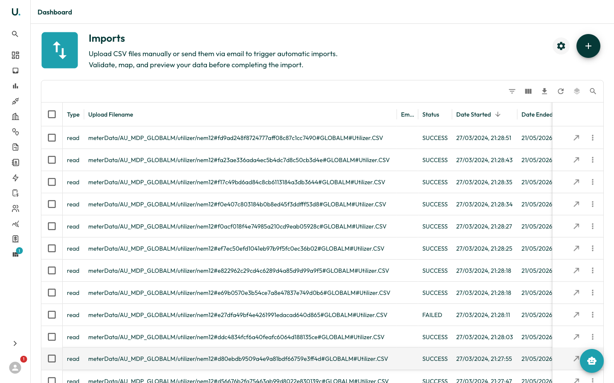

The **Imports** page is where you bring large volumes of data into UMS at once. You upload files through the bulk upload wizard, or send them by email to trigger automatic imports. Every import is checked against a template before the data is committed, so you can catch errors before they reach your records.

For a step-by-step walkthrough, see [Bulk Importing Data](/guides/bulk-importing-data).

## Where to find it

Open the account menu at the bottom of the sidebar (your name and organisation) and select **Bulk Imports**.

<Note>
  **Bulk Imports** only appears in the account menu for organisation admins.
</Note>

{/* screenshot-stale */}
<Frame>
  
</Frame>

## The Imports page

The page lists your imports, most recently started first. Each row covers one uploaded file:

| Column        | Description                                           |
| ------------- | ----------------------------------------------------- |
| **Type**      | The template the file was imported against            |
| **Filename**  | The original file name                                |
| **Email**     | The source email, when the file arrived by email      |
| **Status**    | The current processing state (see below)              |
| **Started**   | When processing began                                 |
| **Ended**     | When processing finished                              |
| **Added By**  | The user who started the import                       |
| **Succeeded** | Rows imported successfully                            |
| **Errors**    | Rows that failed                                      |

Click **New Import** to open the bulk upload wizard.

Email imports are set up in **Settings** › **Integrations** (organisation admins only), under **Import email addresses**. See [Organisation settings](/settings/organisation#integrations).

## Statuses

| Status                | Meaning                                                              |
| --------------------- | -------------------------------------------------------------------- |
| **Validating**        | Checking the file against the template                               |
| **Validation failed** | The file did not pass validation, so nothing was imported            |
| **Ready to review**   | A preview is ready. Check it in the wizard, then import              |
| **In progress**       | Importing rows in the background                                     |
| **Success**           | Every row imported                                                   |
| **Partly imported**   | Some rows imported and some failed. Review the exceptions            |
| **Failed**            | The import failed                                                    |
| **Rolled back**       | The import's changes were reversed                                   |

Processing runs in the background. The wizard shows live progress while you watch, and the list keeps the latest status once you leave.

<Tip>
  A link from the home page's failed-imports tile opens the list filtered to failed imports. Clear the filter chip to see everything again.
</Tip>

## Reviewing results and errors

Each row has a menu for reviewing the outcome:

| Action          | What it does                                                                  |
| --------------- | ----------------------------------------------------------------------------- |
| **Download**    | Downloads the original file you uploaded                                      |
| **Exceptions**  | Downloads a CSV of the rows that failed, each with its error type and message |
| **Result Data** | Downloads a CSV with every row's outcome and any failure reason               |
| **Refresh**     | Re-checks the status of an import in progress                                 |

<Note>
  Invalid rows are reported, not silently dropped. Use **Exceptions** to see which rows were rejected and why, fix them, then import just those rows again.
</Note>
