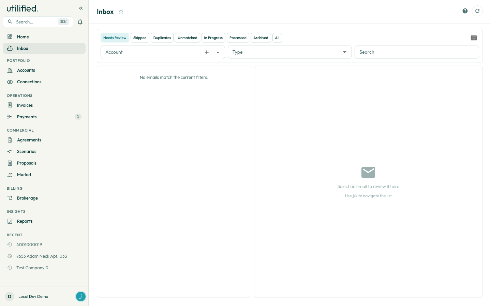
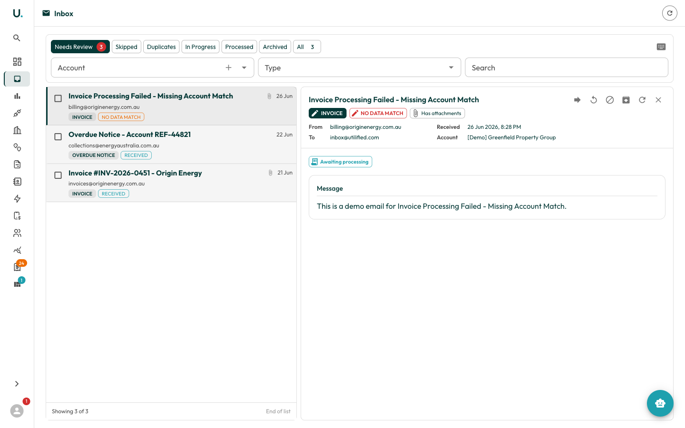

The **Inbox** is where emails sent by energy retailers land. Each account has its own email address. Messages sent to it are captured, matched to the account, classified, and passed to UtiliRead, the OCR pipeline, so their PDF attachments become [invoices](/invoices).

## Where to find it

Click **Inbox** in the unlabelled group at the top of the sidebar, under **Home**.

<Frame>
  
</Frame>

## From email to invoice

<Steps>
  <Step title="An email arrives">
    A retailer sends an email to an account's inbox address. UMS captures it and matches it to the account by the recipient. If no account matches, it is marked **Unmatched — no account**.
  </Step>
  <Step title="The sender is checked">
    Mail that fails the sender (DMARC) check is held and shows as **Held — sender check failed**. Forwarded supplier mail often fails this check. Utilified staff can release it once the sender is confirmed genuine.
  </Step>
  <Step title="It is classified">
    The message is given a type such as **Invoice**, **Statement**, **Overdue Notice** or **Data File**. Non-invoice types are marked **Skipped — non-invoice category**.
  </Step>
  <Step title="UtiliRead reads the attachments">
    For invoice emails, UtiliRead runs OCR over the PDF attachments to extract line items, totals and meter data.
  </Step>
  <Step title="An invoice is created">
    A matched, extracted attachment becomes an [invoice](/invoices), ready for [validation](/validation).
  </Step>
</Steps>

## The inbox list

The Inbox is a split view: a filterable list on the left, the selected message on the right. Status tabs group messages for triage, each with a live count:

| Tab              | Shows                                                                 |
| ---------------- | --------------------------------------------------------------------- |
| **Needs Review** | Received, failed, no data match, or processed with errors             |
| **Skipped**      | Messages classified as a non-invoice type                             |
| **Duplicates**   | Messages that duplicate an invoice already in UMS                     |
| **Unmatched**    | Mail no account claimed, and mail held for failing the sender check   |
| **In Progress**  | Messages being processed                                              |
| **Processed**    | Messages processed successfully                                       |
| **Archived**     | Archived and excluded messages                                        |
| **All**          | Every message                                                         |

Above the list, filter by **Account** and **Type**, or use **Search**.

Each row shows the subject (bold when unread), sender, received date and chips for the type, status and pipeline outcome, for example `2 invoices`, `OCR failed` or `OCR review`. Tick rows to **Exclude** or **Archive** them in bulk. The list refreshes every 30 seconds, and **Load more** pages through older messages.

Keyboard shortcuts: `j`/`k` (or the arrow keys) move through the list, `a` archives, `x` excludes, `r` reprocesses, and `Enter` marks the selected message read.

## Message statuses

| Status                              | Meaning                                                        |
| ----------------------------------- | -------------------------------------------------------------- |
| **Received**                        | Captured and awaiting processing                               |
| **Processing**                      | UtiliRead OCR is running                                       |
| **Processed successfully**          | An invoice was created from the email                          |
| **Processed with errors**           | Processed, but with issues to review                           |
| **No data match**                   | Couldn't match the content to a connection or retail account   |
| **Unmatched — no account**          | No account matched the recipient address                       |
| **Held — sender check failed**      | Held because the sender failed the DMARC check                 |
| **Skipped — non-invoice category**  | Classified as a non-invoice type                               |
| **Duplicate**                       | Matches an invoice already in UMS                              |
| **Failed**                          | Processing failed                                              |
| **Archived** / **Excluded**         | Triaged out of the active queue                                |

## Message detail

{/* screenshot-stale */}
<Frame>
  
</Frame>

Selecting a message opens its sender, recipient, date and linked account, the email body, its attachments and the pipeline result, including any duplicates detected and invoices created. Click the type chip to change the classification, or the status chip to change the status.

The toolbar has **Forward to me**, **Reprocess** (when the message can be reprocessed), **Mark Excluded**, **Archive**, **Refresh** and **Close**.

<Info>
  The same inbox appears on an account's detail page as the **Inbox** view of its **Invoices** tab, scoped to that account. The view shows only when the account has an inbox email address.
</Info>
