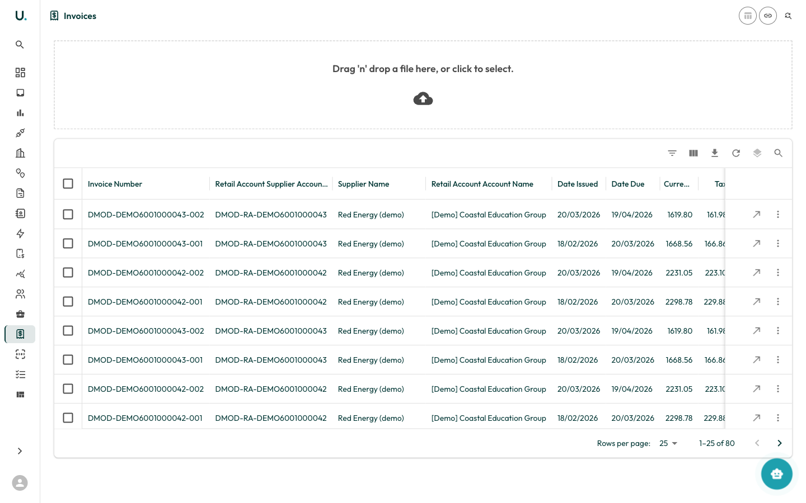
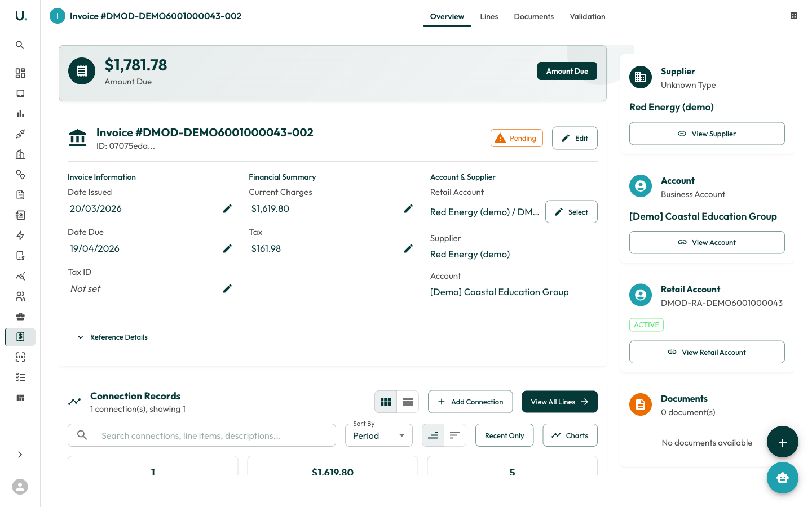

Open **Invoices** from the **Operations** group in the sidebar. It is the hub for every energy invoice in UMS, from upload and extraction through validation, exceptions and payment.

The sidebar link opens the **Overview** tab. Validation and exceptions have their own pages: see [Validation](/validation) and [Invoice exceptions](/invoice-exceptions).

## Hub tabs

| Tab | What it shows |
| --- | --- |
| **Overview** | Dashboards for validation quality, accuracy and recovery, data quality and upload performance. See [Validation](/validation#overview-dashboard). |
| **Invoices** | Every invoice in a data grid, with status views and bulk edit. |
| **Validations** | The **Needs attention** queue of validation runs. See [Validation](/validation). |
| **Exceptions** | Invoices flagged for a decision: gaps, variances, matching problems and duplicates. See [Invoice exceptions](/invoice-exceptions). |
| **Uploads** | The upload queue, where UtiliRead extracts invoice files. |
| **Activity** | A log of review actions taken on invoices, with revert. |

All six tabs need the Invoices permission.

## Invoices list

{/* screenshot-stale */}
<Frame>
  
</Frame>

The **Invoices** tab lists every invoice. The invoice number links to the invoice's detail page, and the **See Details** row action opens it too. Visible columns include **Supplier Account**, **Supplier**, **Account**, **Issued**, **Due**, **Charges**, **Amount Due** and **Tags**. Add balance and custom-field columns from the column picker.

### Views

| View | Shows |
| --- | --- |
| **All** | Every invoice (the default). |
| **Needs Validation** | Invoices with no validation run yet. |
| **Failed** | Invoices whose latest run failed. |
| **For Review** | Invoices whose latest run needs review. |
| **Passed** | Invoices whose latest run passed. |
| **Overdue** | Invoices past their due date that still carry a balance, aren't on an approved, sent or paid payment file, and aren't excluded from payment files. |
| **Due soon** | Invoices due in the next 7 days that still carry a balance, aren't on an approved, sent or paid payment file, and aren't excluded from payment files. |

### Actions

- **Edit selected**: select rows, then set one field across them. You can change **Retail account**, **Due date**, **Issue date** or **Exclude from payment files** (with a reason), then click **Apply to** the selected count.
- **Auto-Link Retail Accounts** (header icon): matches unlinked invoices to retail accounts and reports how many it linked.
- **Open the validation queue** (header icon): goes to the **Validations** tab.
- **View documentation** (header icon): opens this page.

## Uploads

The **Uploads** tab is where you upload invoice files and follow their extraction. UtiliRead extraction records live here.

### Uploading files

<Steps>
  <Step title="Open the upload area">
    Click **Upload invoices** (the upload icon in the header). The drop area opens above the queue.
  </Step>
  <Step title="Add your files">
    Drag files onto the area, or click it to choose files. It accepts PDF, CSV and Excel (`.xlsx`, `.xls`) files, several at a time.
  </Step>
  <Step title="Follow the upload">
    Each file shows its progress. Uploaded files join the queue below, and UtiliRead extracts them and matches them to accounts and connections.
  </Step>
</Steps>

Other header actions:

- **View import batches**: opens the list of upload batches (see [Import batches](#import-batches)).
- **Import from CSV (advanced)**: imports invoice data from a CSV file instead of extracting documents.
- **Auto-pilot settings**: opens the Auto-pilot section of **Settings**.

When you arrive from a billing gap's **Upload** action, a banner names the retail account and period. Uploading invoices for that period closes the gap.

### Upload queue

The **Upload queue** strip shows **Success (24h)**, **Auto-pilot**, **In queue**, **Needs review** and **Failed** counts.

| Filter | Options |
| --- | --- |
| Status | **Needs Review** (failed, in review or duplicate), **In Progress**, **Completed**, **All** |
| **Type** | **All types**, **PDF**, **CSV**, **Supplier template** |
| **Date** | **All time**, **Last 24h**, **Last 7 days**, **Last 30 days** |
| **Only my uploads** | Show only files you uploaded |

Row actions are **View details** (opens the upload's detail page), **View invoice** (opens the invoice it created) and **Retry** (for failed or in-review uploads). To retry several at once, select them and click **Retry selected**. Uploads without an extraction record, such as CSV imports, are skipped.

Upload statuses: **In progress**, **Importing**, **Needs review**, **Duplicate**, **Failed**, **Passed**, **Success**, **Excluded** and **Merged**.

### Upload detail

Click a row to open its detail page, titled `Upload #id` with the file name underneath. Tabs:

| Tab | What it shows |
| --- | --- |
| **Overview** | The source document beside the extraction metadata and linked records. |
| **Invoices** | Invoices extracted from the document. |
| **Connections** | Connections found on the selected invoice. |
| **Line Items** | Line items for the selected connection. |
| **Raw Output** | The raw extraction output. |
| **Review** | Field-by-field resolution. Shown only for records in review or with a past review. |

Header actions depend on the record's state:

| Action | When it shows |
| --- | --- |
| **Migrate extracted invoices to UMS** | Extraction has produced data. Creates the invoices. |
| **Reprocess from inbox** | The file came from an email. Re-runs the whole email pipeline. |
| **Retry processing from scratch** | A directly uploaded file that failed or is in review. |
| **Force process** | Shown alongside **Retry processing from scratch**. Bypasses the page-limit and validation gates. |
| **Re-run AI extraction (keeps OCR data)** | A directly uploaded file with OCR output. |
| **Re-run OCR from scratch (discards extracted data)** | Any directly uploaded file. Asks you to confirm. |
| **Export to CSV** | Extraction has produced data. Downloads `utiliread-<id>.csv`. |
| **Reload record** | Always. |

To resolve flagged fields and migrate the result, see [Reviewing OCR-extracted invoices](/guides/utiliread-review).

## Import batches

Each upload creates an import batch. Open the list from **View import batches** on the **Uploads** tab. Columns are **Name**, **Files**, **Status**, **Succeeded**, **Failed**, **Uploaded** and **By**. Batch statuses are **Empty**, **Processing**, **Completed** and **Completed with failures**.

Click a batch to see each file's status, with counts for **Succeeded**, **Needs review**, **Failed**, **Processing** and **Skipped**.

## Activity

The **Activity** tab lists review actions taken on invoices, including actions Joule took. Select a row to see what changed. Click **Revert** to put the record back as it was. The revert is refused if anyone has edited the same fields since.

## Invoice detail

{/* screenshot-stale */}
<Frame>
  
</Frame>

The page title is `Invoice #` and the invoice number. The supplier and account number sit underneath, with the payment status beside the title.

| Tab | What it shows |
| --- | --- |
| **Overview** | Key figures, **Details**, **Payment files**, **Connection records**, **Tags & custom fields**, **Source documents**, **Corrections** (with the payment hold) and **Related**. |
| **Lines** | Line items. Switch between **All lines** and **By connection**. See [Editing invoices](/guides/editing-invoices). |
| **Ledger** | The invoice's place in the retail account ledger: payments, adjustments and ledger rows to date. |
| **Review** | The validation workspace: each line beside its finding, an **Exceptions** section, and a **Validation runs** link to the full run. The tab badge counts unresolved errors. |
| **Activity** | The invoice's audit trail: field changes, Joule actions, exceptions and manual ledger rows. |
| **Settings** | Editable **Invoice Details**, **Financials** and **Custom Fields**, plus a **Danger zone** to reverse, adjust or delete the invoice. |

### Header actions

| Action | When it shows |
| --- | --- |
| **Show source document side-by-side** | The invoice has a source document and the window is at least 1400px wide. Docks the PDF beside the tabs and remembers your choice. |
| **Validate this invoice** | You can update validation. Opens **Run validation**, **Re-run with Joule detectors** and **Tariff review from this invoice**. |
| **Match Retail Accounts** | The invoice has no retail account. |
| **Extract Quantity** | No line item has quantities yet. |
| **Duplicate this invoice into a new draft** | Always. Opens a pre-filled create form without the invoice number, dated today. |
| **View documentation** | Always. Opens this section. With several actions it sits under **More**. |

## Related guides

- [Editing invoices](/guides/editing-invoices)
- [Reviewing OCR-extracted invoices](/guides/utiliread-review)
- [Working the validation queue](/guides/invoice-validation)
- [Invoice exceptions](/invoice-exceptions)
