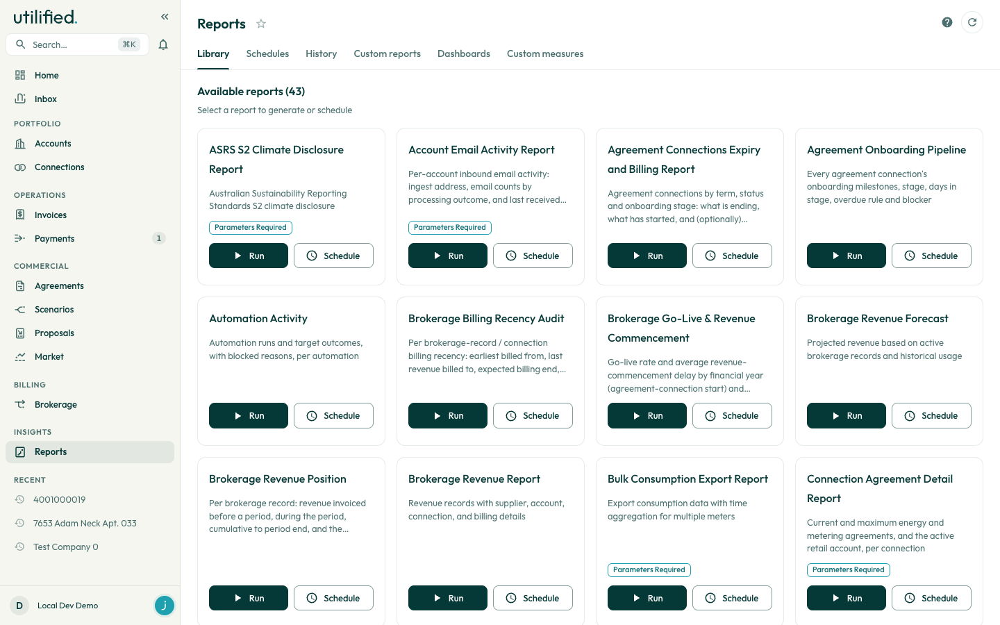

Select **Reports** in the **Insights** group of the sidebar (`/reports`).

Reports is where you run the standard report library, schedule reports for email delivery, collect finished files, and build custom reports and dashboards for your customers' portal.

## Tabs

| Tab                 | Route                  | What it holds                                                                         |
| ------------------- | ---------------------- | ------------------------------------------------------------------------------------- |
| **Library**         | `/reports`             | Every standard report you can run, as cards with **Run** and **Schedule**             |
| **Schedules**       | `/reports/schedules`   | Recurring report schedules and their recipients                                        |
| **History**         | `/reports/history`     | Every report run, with its status and file                                            |
| **Custom reports**  | `/reports/custom`      | Tabular reports you design and publish to the portal                                   |
| **Dashboards**      | `/dashboards`          | Portal dashboards. See [Dashboards](/dashboards).                                      |
| **Custom measures** | `/dashboards/measures` | Your own formulas for dashboards. See [Custom measures](/dashboards#custom-measures). |

<Note>
  **Custom reports** only appears when your role includes the custom reports permission. **Dashboards** and **Custom measures** need the dashboards permission.
</Note>

## Library

The **Library** tab lists the reports available to you under **Available reports**. Each card shows the report's name and description, a **Parameters Required** chip if it needs filters, and **Run** and **Schedule** buttons. Both buttons are disabled on an inactive report.

<Frame>
  
</Frame>

### Standard report catalogue

The reports under **Brokerage** only appear when your role includes the brokerage module. **Automation Activity** needs the automations module. The reports under **Emissions** need the emissions permission.

#### Agreements

| Report                                              | What it shows                                                                                                |
| --------------------------------------------------- | ------------------------------------------------------------------------------------------------------------ |
| **Agreement Connections Expiry and Billing Report** | Agreement connections by term, status and onboarding stage, and optionally whether each was billed in term |
| **Metering and Energy Agreement End Date Report**   | Energy and metering agreement end dates, grouped by connection                                               |
| **Connection Agreement Detail Report**              | Current and maximum energy and metering agreements, and the active retail account, per connection            |
| **Agreement Onboarding Pipeline**                   | Each agreement connection's onboarding milestones, stage, days in stage, overdue rule and blocker            |

#### Connections and data health

| Report                                          | What it shows                                                                                             |
| ----------------------------------------------- | --------------------------------------------------------------------------------------------------------- |
| **Connections With No Sites Report**            | Connections not linked to any site                                                                        |
| **Connections With No Retail Accounts Report**  | Connections with no active retail account                                                                 |
| **Connections With No Active Agreement Report** | Connections with no current energy retail agreement                                                       |
| **Connection Data Recency Report**              | Supplier, retail account status, agreement end date, last invoice and last meter read per connection      |
| **Retail Account Transfer Report**              | Retail accounts in transfer or pending states that need action                                            |
| **Account Email Activity Report**               | Each account's inbound email address, email counts by processing outcome, and last received date          |
| **Contestable Metering Opportunities**          | Contestable or unclassified NEM electricity connections with no active metering agreement                 |

#### Consumption

| Report                                   | What it shows                                                                                                   |
| ---------------------------------------- | --------------------------------------------------------------------------------------------------------------- |
| **Electricity Consumption Report**       | Electricity consumption statistics per connection over a period                                                 |
| **Gas Consumption Report**               | Natural gas and LPG consumption statistics per connection over a period                                         |
| **Water Consumption Report**             | Water consumption statistics per connection over a period                                                       |
| **Bulk Consumption Export Report**       | Consumption for many connections with time aggregation                                                          |
| **Period Consumption & Coverage Report** | Metered and invoiced usage side by side by day, month or year, with days-of-data coverage                        |
| **Sub-connection Consumption Report**    | Consumption for a parent connection and its sub-connections, with on-site consumption and variance              |
| **Invoiced Consumption Report**          | Consumption and charges from every invoice overlapping the range, with site context for emissions and audits    |
| **Interval Consumption Sync Export**     | Interval reads changed since the last sync, for loading into an external database                               |

#### Invoices and spend

| Report                           | What it shows                                                                                 |
| -------------------------------- | --------------------------------------------------------------------------------------------- |
| **Invoice Report**               | Invoices issued over a period for specific accounts                                           |
| **Invoice Gap Report**           | One row per missing billing period, with what you need to chase it                            |
| **Invoice Batch Export**         | A ZIP of an invoice CSV and the invoice PDFs for an account and date range                    |
| **Invoice Sync Export**          | Invoices flattened to one row per connection invoice record, with documents, for syncing out  |
| **Monthly Spend Accrual Report** | Monthly spend and usage per connection, projecting an accrual for incomplete months           |

#### Brokerage

| Report                                       | What it shows                                                                                    |
| -------------------------------------------- | ------------------------------------------------------------------------------------------------ |
| **Brokerage Revenue Report**                 | Revenue records with supplier, account, connection and billing details                           |
| **Brokerage Revenue Forecast**               | Projected revenue from active brokerage records and historical usage                             |
| **Contracted Revenue Detail**                | Expected, billed and remaining contracted revenue per brokerage record                            |
| **Contracted Revenue Movement**              | Monthly movement in contracted revenue from new contracts, billing and write-offs                |
| **Brokerage Revenue Position**               | Revenue invoiced before, during and to the end of a period, and what remains contracted          |
| **Brokerage Billing Recency Audit**          | How recently each brokerage record and connection was billed, and the gap to expected billing     |
| **Brokerage Go-Live & Revenue Commencement** | Go-live rate and average revenue-commencement delay by financial year and supplier                |
| **Metering Coverage**                        | Contestable NEM connections on an active retail contract, their metering agreement and whether it earns |
| **Supplier Statement Reconciliation**        | Each RCTI row's paid and calculated amounts and variance, summarised by supplier and month       |

#### Automations

| Report                  | What it shows                                                         |
| ----------------------- | --------------------------------------------------------------------- |
| **Automation Activity** | Automation runs and target outcomes, with blocked reasons, per automation |

#### Emissions

The framework reports (NGER, NPI, ASRS S2 and GHG Protocol) are covered in more detail under [ESG reports](/esg#reports).

| Report                                | What it shows                                                                                  |
| ------------------------------------- | ---------------------------------------------------------------------------------------------- |
| **Emissions Summary Report**          | Scope 1, 2 and 3 breakdown with site comparison and a quality overview                         |
| **Emissions Detail Report**           | Line-item emissions calculations with factor and evidence references                           |
| **Emissions Audit Report**            | An audit trail of emissions lifecycle events                                                   |
| **Data Quality Report**               | Data quality scores, evidence completeness and review items                                    |
| **NGER Section 19 Facility Report**   | NGER facility-level figures: Scope 1 by source category, Scope 2 and energy consumed in GJ     |
| **NGER Corporate Report**             | NGER corporate-level emissions across all facilities, with a threshold assessment              |
| **NPI Facility Report**               | Fuel burnt and electricity against the NPI Category 2a and 2b thresholds, with the substances to report |
| **ASRS S2 Climate Disclosure Report** | ASRS S2 climate disclosure: Scope 1, 2 and 3 metrics, targets and intensity                    |
| **GHG Protocol Corporate Inventory**  | A GHG Protocol corporate inventory with dual Scope 2 reporting                                 |

### How a run reaches History

Every run is queued and generated in the background.

- Some reports open a full page with the report's own filters, **Saved presets**, and **Generate report**. Saved presets are stored locally on this device, so they don't follow you to another browser. Submitting it takes you straight to **History**.
- Other reports open a **Generate Report** dialog with the report's parameters. A report with no parameters also has **Schedule Report** in the dialog, which opens the schedule form. **Invoice Batch Export** opens its own form instead. Submitting closes the dialog.

Either way, the run appears on the **History** tab as **Pending**, then **Completed** or **Failed**. You get a notification when it's ready.

## Schedules

The **Schedules** tab lists recurring schedules in a grid:

| Column         | Shows                                                    |
| -------------- | -------------------------------------------------------- |
| **Name**       | The schedule's name                                      |
| **Report**     | The report it runs                                       |
| **Frequency**  | Daily, weekly, monthly or yearly                         |
| **Next Run**   | When it runs next                                        |
| **Last Run**   | When it last ran, or **Never**                           |
| **Format**     | The file format sent                                     |
| **Recipients** | How many recipients; hover to see the addresses          |
| **Enabled**    | A switch to pause or resume the schedule                 |
| **Actions**    | **Edit** and **Delete**                                  |

Click **Create Schedule** to add one. The form asks for:

- **Schedule Name** and **Report**
- **Report Parameters**, where any date field can **Use Relative Date** (for example **Previous Month** or **Since last successful run**) so each run covers a fresh period
- **Output Format**: **CSV**, **Excel (XLSX)** or **JSON**
- **Recipients**: the **Email Addresses** that receive the file
- **Schedule Configuration**: **Frequency**, **Time**, and the **Day of Week**, **Day of Month** or **Month** the frequency needs
- **Enable Schedule**

Clicking **Schedule** on a Library card opens the same form with the report already chosen. Scheduled runs of standard reports also land in **History**.

## History

The **History** tab lists every run, newest first. Filter it with the search box (report name or user), **Status** (**All**, **Completed**, **Pending**, **Failed**) and **From** / **To** dates.

Each row shows the report, who requested it and when, the file format, and its status. A failed run shows its reason. Row actions:

- **Download** the file
- **View in browser** (CSV only) to preview the rows, with a **Download** button
- **Retry this report**, where a failed run can be retried

## Custom reports

The **Custom reports** tab holds tabular reports you design and publish to your customers' portal. The grid shows **Name**, **Source**, **Status**, **Audience**, **Template** and **Updated**, with **Duplicate** and **Delete** row actions.

**Status** is **Draft**, **Published**, or **Draft differs from published** (published, with edits not yet published).

<Steps>
  <Step title="Create the report">
    Click **New custom report**, enter a **Name**, and choose **Blank report** with a **Source** (what one row of the report is) or **Start from template**. Click **Create**.
  </Step>
  <Step title="Add columns">
    Click **Add column**. Each column is a **Source field**, **Measure**, **Attribute**, **Formula** or **Text template**, with a **Header label** and **Format**. A report holds at most 40 columns. The **Preview** panel updates as you go.
  </Step>
  <Step title="Set the audience and filters">
    Choose the **Audience** accounts. Portal users of these accounts, and of every account beneath them, can run the report once published. Click **Settings** for **Report filters**, **Filters viewers can change** (**Period**, **Account**, **Site**, **Connection**, **Utility**, **State**, **Site tag**), grouping and sorting. Settings also has switches for a **Totals row**, **Include sub-connections** (never counted in totals) and **Keep rows that net to zero**.
  </Step>
  <Step title="Publish">
    Click **Publish**. After later edits, click **Publish changes**. **Unpublish** takes the report out of the portal straight away.
  </Step>
</Steps>

Your changes save automatically while you edit. If a change can't be saved when you leave the page, UMS asks **Leave without saving?** so you can stay and try again.

**Export** downloads the report as **Excel (XLSX)** or **CSV**. Once a report is published to at least one audience account, **Schedule** sends it to recipients on a schedule for one of those accounts.

## Related guides

- [Running reports](/guides/running-reports)
- [Dashboards](/dashboards)
