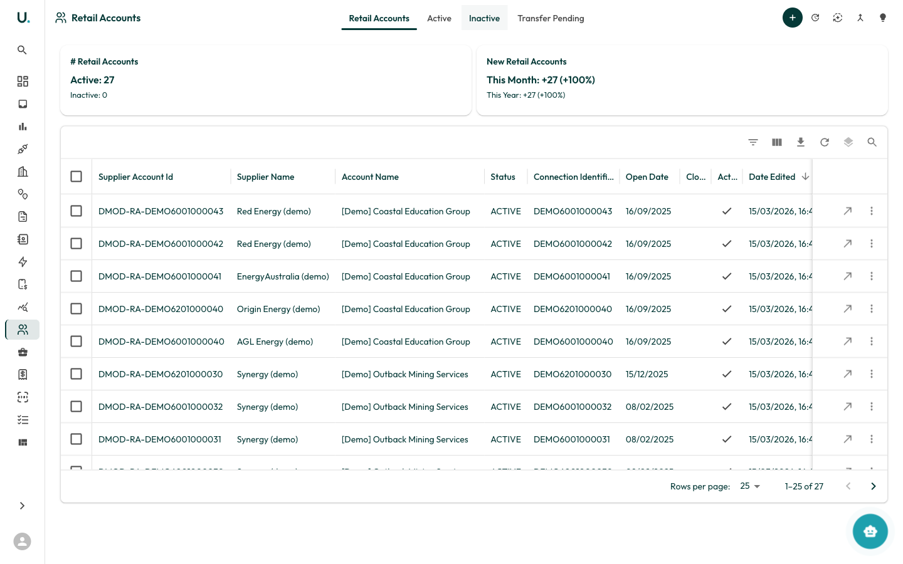
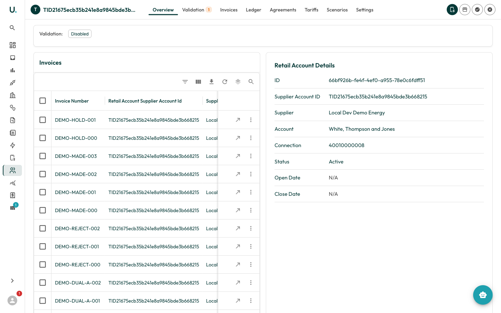

Retail accounts are the account references that energy retailers assign to your [connections](/connections). They link your internal account structure to the retailer's billing system, and they are how incoming [invoices](/invoices) get matched to the correct [account](/accounts) and connection.

## Where to find it

Open **Accounts** in the **Portfolio** group of the sidebar, then select the **Retail accounts** tab.

<Note>
  The **Retail accounts** tab only appears for users with access to the Validation module, and only when your plan includes retail accounts.
</Note>

{/* screenshot-stale */}
<Frame>
  
</Frame>

## Retail accounts list

The view switch above the grid filters the list:

| View                 | Shows                                                                  |
| -------------------- | ---------------------------------------------------------------------- |
| **All**              | Every retail account                                                   |
| **Active**           | Status Active only                                                     |
| **Inactive**         | Status Inactive only                                                   |
| **Transfer Pending** | Accounts in transition: pending active, pending inactive, draft or suggested active |

| Column                 | Description                                                    |
| ---------------------- | -------------------------------------------------------------- |
| **Account ID**         | The retailer's account reference. Click it to open the account |
| **Supplier**           | The retailer that issued the account                           |
| **Account**            | Your internal account the retail account belongs to            |
| **Status**             | Lifecycle status (see below)                                   |
| **Connection**         | The linked connection identifier (NMI or MIRN)                 |
| **Match Tolerance**    | Allowable variance when matching invoice values in validation  |
| **Billing Freq.**      | How often the retailer is expected to bill (used by gap checks) |
| **Next Bill Expected** | When the next bill is due to arrive                            |
| **Opened** / **Closed** | When the account opened and closed with the retailer          |
| **Created** / **Edited** | When the record was created and last changed in UMS          |

The grid also shows whether invoice validation and gap checks are switched on for each account.

### Header actions

| Action                       | What it does                                                  |
| ---------------------------- | ------------------------------------------------------------- |
| **New Retail Account**       | Opens a drawer to create a retail account                     |
| **Update from CSV**          | Bulk-updates existing retail accounts from a spreadsheet      |
| **Generate Retail Accounts** | Generates retail accounts for agreement connections on retail agreements that have none. New accounts start as **Draft** |
| **Merge Retail Accounts**    | Combines duplicate accounts (see below)                       |
| **Merge Recommendations**    | Reviews system-suggested merges of likely duplicates          |

### Creating a retail account

Click **New Retail Account** to open the drawer. Enter the retailer's account reference and link the supplier, account and connection. You can also set a parent retail account, the open and close dates and the status.

Set validation, billing and payment file settings, such as match tolerance, expected billing frequency and payment terms, on the detail page's **Settings** tab. Switch gap checks on or off on its **Validation** tab.

<Note>
  A retail account links one connection to one retailer reference. When a connection transfers between retailers, a new retail account is created and the old one is closed, which keeps a full billing history per retailer.
</Note>

## Statuses

The list and the detail page header label the same statuses slightly differently:

| Status value       | In the list          | On the detail page       | Meaning                                                   |
| ------------------ | -------------------- | ------------------------ | --------------------------------------------------------- |
| `ACTIVE`           | **Active**           | **Active**               | Currently billing: the live account for the connection    |
| `PENDING_ACTIVE`   | **Pending active**   | **Activation pending**   | Activation in progress, for example an unconfirmed transfer-in |
| `SUGGESTED_ACTIVE` | **Suggested active** | **Suggested**            | UMS suggests this is the active account; awaiting confirmation |
| `PENDING_INACTIVE` | **Pending inactive** | **Deactivation pending** | Closure in progress, for example an unconfirmed transfer-out |
| `INACTIVE`         | **Inactive**         | **Inactive**             | Closed: no longer billing                                 |
| `DRAFT`            | **Draft**            | **Draft**                | Created but not yet activated                             |

## Retail account detail page

{/* screenshot-stale */}
<Frame>
  
</Frame>

The header shows the retailer's account reference, a status chip and links to its account, supplier and connection.

| Tab            | What it shows                                                                                   |
| -------------- | ----------------------------------------------------------------------------------------------- |
| **Overview**   | **Retail Account Details**, a **Validation** summary and, if you have Modelling access, a **Scenarios** card |
| **Invoices**   | **Calendar** (billing-period calendar) and **Grid** (invoice list with a document preview) views |
| **Validation** | Validation and gap-check state, and open gaps. **Run Validation** asks for a **Period From** and **Period To**, then **Generate** runs it. The badge counts open items |
| **Ledger**     | Charges and payments with the outstanding balance. Add a **Payment**, **Adjustment** or **Opening Balance** row and click **Add**. **Set opening balance** records a starting balance |
| **Agreements** | **Agreements** view: linked [agreement](/agreements) connections. **Tariffs** view: [tariff](/tariffs) assignments, with **Assign / switch tariff** |
| **Settings**   | Account details, validation and billing settings, payment file settings and the change history |

The **Scenarios** card lists tariff-review [scenarios](/scenarios) for the account. Use **Model opportunities** to start a new one, or **Bulk tariff review** for a multi-period review.

### Header actions

| Action                             | What it does                                                                 |
| ---------------------------------- | ---------------------------------------------------------------------------- |
| **Assign tariff**                  | Opens the **Tariffs** view of the **Agreements** tab and the assign/switch tariff dialog |
| **New Associated Retail Account**  | Creates a retail account linked under this one                               |
| **Activate**                       | Activates the account. Hidden when it is already active                      |
| **Close account**                  | Closes the account on a date you choose. Hidden when it is already inactive  |

Activating an account also closes any other active or pending accounts on the connection. Tick **Mark as Pending** to close those as **Deactivation pending** instead of **Inactive**. When closing, tick **Mark as Pending** to close this account as **Deactivation pending**.

## Merging retail accounts

When duplicate retail accounts exist for the same connection, merge them into a single root. The merge is **irreversible**: agreement connections, invoices and other related data move into the root account.

<Steps>
  <Step title="Select">
    Click **Merge Retail Accounts**. Choose the root account to keep, then add the accounts to merge into it.
  </Step>
  <Step title="Review">
    Click **Review**. Check the root and the accounts being merged, each with its supplier reference and open and close dates.
  </Step>
  <Step title="Load">
    Click **Merge**. UMS reassigns the data to the root while the **Load** step runs.
  </Step>
  <Step title="Results">
    Review the **Success** and **Failed** counts. Click **Download Results** to save them as JSON, then resolve any failures.
  </Step>
</Steps>

<Tip>
  Use **Merge Recommendations** to let UMS surface likely duplicates instead of finding them by hand.
</Tip>

## Related

- [Agreements](/agreements): the contracts retail accounts are linked to
- [Validation](/validation): checks invoices against each retail account's tariffs
- [Payments](/payments): pays validated invoices by retail account
