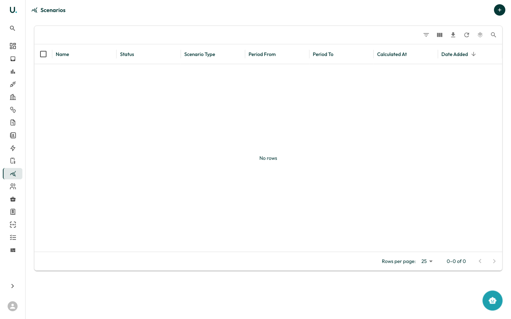

Scenarios is where you model what a site or retail account could save. A tariff review re-prices usage on alternative tariffs. A solar and battery study sizes new solar, batteries, generators and EV charging against interval data. You can run both together and draft a [proposal](/proposals) from the results.

Find it in the sidebar under **Commercial** › **Scenarios**. Opening scenarios needs access to Modelling.

## Hub tabs

| Tab               | What it's for                                                                   |
| ----------------- | ------------------------------------------------------------------------------- |
| **Scenarios**     | Every scenario run in your organisation, newest first                           |
| **Opportunities** | The assessment autopilot's queue of sites it screened and studied for solar and battery |
| **Portfolio**     | A quick solar, battery and power factor screen across many sites                |

**Opportunities** and **Portfolio** appear only with access to Solar & Battery Modelling, and also need access to Modelling. Opened without it, the tab says **Solar and battery modelling isn’t enabled for you**.

## Scenarios tab

Four tiles sit above the list:

| Tile                   | Shows                                                                             |
| ---------------------- | --------------------------------------------------------------------------------- |
| **Studies run**        | Scenarios that completed                                                          |
| **Scenarios modelled** | Solar and battery sizes, re-runs and existing-equipment options, plus tariff alternatives costed |
| **Best opportunity**   | The net present value (ex-GST) of the best recommended solar and battery system, linked to its study |
| **In progress**        | Scenarios calculating now                                                         |

The list shows each scenario's name, status, type, **Scenarios modelled**, period and when it was last calculated. Click a row to open the scenario.

{/* screenshot-stale */}
<Frame>
  
</Frame>

### Scenario types

| Type                        | Created today | Notes                                                    |
| --------------------------- | ------------- | -------------------------------------------------------- |
| **Tariff review**           | Yes           | Includes power factor correction and demand reset options |
| **Solar & battery**         | Yes           | Solar, battery, generator and EV charging options         |
| **Power factor correction** | No            | Older scenarios only                                      |
| **Procurement analysis**    | No            | Older scenarios only                                      |

### Statuses

| Status          | Meaning                                         |
| --------------- | ----------------------------------------------- |
| **Draft**       | Created but not calculated yet                  |
| **Calculating** | Running now. The scenario page updates itself    |
| **Completed**   | Results are ready                               |
| **Failed**      | The calculation stopped. Open it to see why     |

## New scenario

Click **New scenario** to open **Model opportunities**. You can also start it from a site's or retail account's **Model opportunities** action, which fills in the subject for you. You need create access to Modelling.

### Where

Choose **Site** or **Retail account**, then pick one. A site can run every measure across its connections. A retail account runs only the tariff, power factor and demand measures.

### What to explore

Tick the measures to model, or use a **Quick start**: **Full site assessment**, **Cut demand charges**, **Go solar** or **Tariff check**.

| Group                | Measures                                                                     |
| -------------------- | ---------------------------------------------------------------------------- |
| **Tariffs and demand** | **Tariff optimisation**, **Power factor correction**, **Demand reset**     |
| On-site energy       | **Solar PV**, **Battery storage**, **Generator**, **EV charging**             |

A measure you can't pick shows why on its tile. Common reasons:

- On-site energy needs Solar & Battery Modelling access and a site, not a retail account.
- The site needs a year of interval data and must be in a supported market.
- **Generator** needs a generator recorded in the site's [Energy assets](/sites#energy-assets). The tile links to **Record a generator**.

Where the site already has solar that is underperforming, **Solar PV** offers **Also model repowering**.

With **Tariff optimisation** ticked, the **Tariff review** panel lists **Tariffs to compare**. Each is costed against the current tariff over the last twelve months.

With an on-site measure ticked, two more panels appear:

- **Solar and battery setup** shows how much of what the study needs was found automatically. Click **Review** to check the site's data, installation areas and existing equipment.
- **Assumptions** sets **Optimise for**, which option is recommended. Click **Customise** to change engineering settings.

### Run

The summary on the right counts the scenarios this run models and says how it runs. Optionally enter **Name (optional)**, tick **Draft a proposal from the results**, then click **Run**. Drafting a proposal needs Proposals access and a site.

| You pick                             | It runs as                                   |
| ------------------------------------ | -------------------------------------------- |
| Tariff and demand measures only      | A tariff review                              |
| On-site energy measures only         | A solar and battery study                    |
| Both, or a proposal                  | A tariff review and a solar and battery study together, on one baseline |

### Other ways to start

The header of **Model opportunities** has two more actions:

- **Bulk tariff review** reviews many retail accounts across periods. See [Building and comparing scenarios](/guides/building-scenarios).
- **Screen a portfolio** opens the **Portfolio** tab. It shows only with Solar & Battery Modelling access.

## Opportunities tab

The assessment autopilot screens your sites for solar and battery, studies the promising ones, and queues them here. Click a row to open the opportunity's detail.

By default the list shows open opportunities: **New** or **Reviewed**, and not **Below threshold**. Clear the filters to see the rest. Click **Autopilot settings** to change the autopilot's thresholds, budget and scope in Settings.

| Column           | Description                                               |
| ---------------- | --------------------------------------------------------- |
| **Site**         | The site studied                                          |
| **Account**      | The site's account                                        |
| **Stage**        | How far the autopilot has got (below)                     |
| **Status**       | How far your team has got (below)                         |
| **Best system**  | The recommended solar and battery system                  |
| **NPV (ex-GST)** | Net present value of the best system                      |
| **Payback (yrs)**| Simple payback                                            |
| **Year-1 saving**| Saving in the first year                                  |
| **Why**          | Why the site was picked                                   |
| **Found**        | When the opportunity was found                            |

### Stages

| Stage               | Meaning                                         |
| ------------------- | ----------------------------------------------- |
| **Screening**       | Being screened                                  |
| **Queued**          | Waiting for a study                             |
| **Studying**        | The study is running                            |
| **Ready**           | The study is complete                           |
| **Below threshold** | Screened out by the autopilot's thresholds      |
| **Failed**          | The screen or study failed                      |

A **Stale** chip means an input changed since the study was calculated. Open the study to recalculate it.

### Statuses

| Status        | Meaning                                       |
| ------------- | --------------------------------------------- |
| **New**       | Not looked at yet                             |
| **Reviewed**  | Someone has looked at it                      |
| **Dismissed** | Not worth pursuing                            |
| **Converted** | Turned into an assessment and draft proposal  |

### Actions

From a row's menu or the detail:

- **Convert to assessment** runs the tariff review and creates a draft proposal. A person always issues it. Shown for **Ready** opportunities with a completed study.
- **Open study** and **Open proposal** open what the autopilot produced.
- **Mark reviewed**, **Dismiss** and **Move back to new** change the status.

Changing the status needs edit access to Solar & Battery Modelling. Converting also needs edit access to Proposals.

## Portfolio tab

A quick screen of solar, battery peak lopping and power factor correction across many sites, ranked by the best measure's NPV. It creates no study.

<Steps>
  <Step title="Choose the sites">
    Pick **By account** to screen an account's sites and its sub-accounts' sites, or **Pick sites** to choose up to 200.
  </Step>
  <Step title="Screen them">
    Click **Screen sites**. While sites are screening, click **Check now** to refresh.
  </Step>
  <Step title="Open a full study">
    Click **Full study** on a row for optimised dispatch and bill-grade figures. Shown with create access to Modelling and Solar & Battery Modelling.
  </Step>
</Steps>

The list shows each site's rank, **Site**, **NMI**, **Status**, **Best measure**, **NPV**, a column each for **Solar**, **Battery** and **PFC**, **Base year** and **Coverage**.

| Status               | Meaning                                    |
| -------------------- | ------------------------------------------ |
| **Screened**         | Results are ready                          |
| **Screening…**       | Still running                              |
| **No interval data** | The site has no interval data to screen    |
| **No location**      | The site needs a location                  |
| **Outside the NEM**  | The site's market isn't supported          |
| **No tariff**        | No tariff to price the site against        |
| **Failed**           | The screen failed                          |

Hover over a status for the reason.

## Energy assessments and existing equipment

Modelling existing equipment needs Modelling and Solar & Battery Modelling access. Proposals appear only when Proposals is also enabled for you. Assess a site's solar and battery options using its usage, tariffs and existing equipment. Joule can draft a proposal's narrative from the assessment for you to review and edit.

Declare equipment in the **Energy assets** segment of the site's **Usage** tab. See [Energy assets](/sites#energy-assets). In **Model opportunities**, open **Solar and battery setup** with **Review** and select the equipment to model in **Existing equipment**. Selected existing generators use their declared rating, parallel approval and operating limits. Equipment you don't select remains part of the measured load.

On the study's **Overview**, **Keep, extend or replace** compares keeping the equipment as it is with running it better, extending it with new solar or battery, repowering solar or replacing a battery. Every figure is against keeping the equipment as it is. **Existing generators** shows each generator's fuel, run hours, starts and Scope 1 emissions where the study inputs support it.

Before quoting a result, review data readiness, operating assumptions and any warnings, including those that mark the financial estimate as approximate. Re-dispatching an existing battery requires charge/discharge telemetry or a declared idle or backup-only operating mode.

<Note>
  Generator modelling covers generators already at the site. New-generator investment modelling and generator proposals or PDFs are not supported. An entered backup value is an assumption, not an outage simulation. Results depend on the available usage data and equipment specifications.
</Note>

### Tariff reviews with existing equipment

You can include declared generators or batteries in a bulk tariff review.

<Steps>
  <Step title="Select existing equipment">
    On the **Assumptions** step, use **Compare with existing equipment (optional)** to select declared equipment for the chosen retail accounts. Set **Existing battery operation** to **Keep observed operation (Replay)** or **Re-dispatch existing batteries (Retune)**, where the data supports it.
  </Step>
  <Step title="Review operating assumptions">
    Check **Generator value basis**, **Net fuel price per L or GJ**, **Retune cost, ex-GST** and **EMS fee a year, ex-GST**. The expected basis uses each generator's reliability factor; **Every start succeeds** is a modelling assumption. **Declared backup value a year, ex-GST** is your estimate, not an outage simulation.
  </Step>
  <Step title="Compare complete bills">
    After calculation, review **Tariffs as-is and with existing equipment**. Compare current and proposed bill sets for each retail account. The table separates bill charges, generator operating costs, expected value withheld, energy management and retune costs, declared backup value, and the resulting economic cost. Economic costs use the actual review period and are ex-GST; bill tax remains separate.
  </Step>
</Steps>

Screening needs complete calendar months, at most twelve months, and at least 90% interval coverage. Annual demand or ratchet charges need twelve months. Unsupported periods, missing required data or incompatible billing methods keep the ordinary tariff review results with a warning; they don't produce an equipment comparison.

If the missing-data check fails, click **Retry check** before you calculate.

## Related guides

- [Building and comparing scenarios](/guides/building-scenarios): run a bulk tariff review and read the results
- [Proposals](/proposals): turn a study into a proposal
- [Sites](/sites): declare the equipment you model
