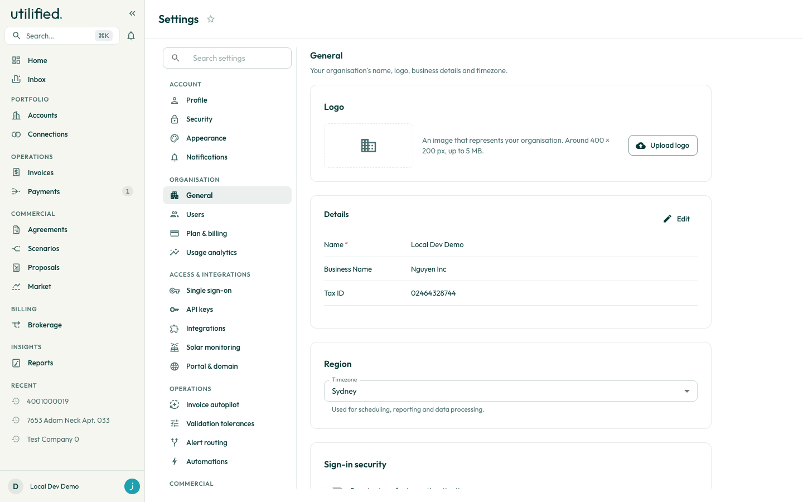
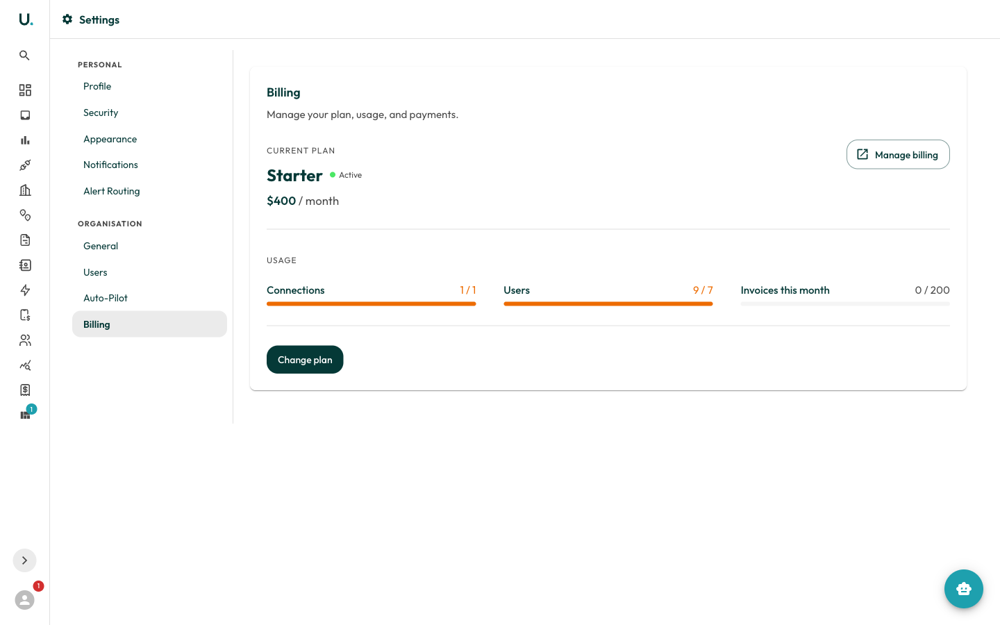

These [Settings](/settings) sections affect everyone in your organisation. Open the account menu at the bottom of the sidebar, choose **Settings**, then pick a section in the left rail.

| Section | Group | Who sees it |
| --- | --- | --- |
| [**General**](#general) | Organisation | Org admins |
| [**Users**](#users) | Organisation | Users with access to the users module |
| [**Plan & billing**](#billing) | Organisation | Org admins |
| [**Integrations**](#integrations) | Access & integrations | Org admins |
| [**Invoice autopilot**](#invoice-autopilot) | Operations | Org admins |
| [**Alert routing**](#alert-routing) | Operations | Everyone |

For the customer portal and single sign-on, see [Portal & custom domain](/settings/portal-domain) and [Portal theme and single sign-on](/settings/white-label).

## General

**General** holds your organisation's name, logo, business details and timezone.

<Frame>
  
</Frame>

| Panel | What it holds |
| --- | --- |
| **Logo** | An image that represents your organisation, around 400 × 200 px and up to 5 MB. Click **Upload logo**, or **Replace logo** if one is set. |
| **Details** | Your organisation's name and business details. Edit and save them in place. |
| **Region** | Your **Timezone** (Australian timezones only), used for scheduling, reporting and data processing. |
| **Sign-in security** | Who must use two-factor authentication, and whether Utilified support can open sessions. See [below](#sign-in-security). |
| **Reference** | Read-only **Organisation ID** (with a copy button) and **Parent organisation**. |

### Sign-in security

- **Require two-factor authentication**: everyone who signs in with a password also needs a code from an authenticator app or their email. Anyone who hasn't set it up does so at their next sign-in to UMS. People who sign in with SSO use your identity provider's multi-factor authentication instead, and portal users aren't included.
- **Allow Utilified support sessions**: lets authorised Utilified staff view your organisation read-only, for up to an hour at a time, to help with support. Each session and its reason appear in your audit log. It is on unless you turn it off.

## Users

**Users** is where you invite people, set their roles and choose which accounts they can see. See [Setting up a user](/guides/setting-up-a-user).

## Billing

The **Plan & billing** section shows your plan and usage and is where you change plans or open the Stripe billing portal. See [Plan & billing](/billing).

{/* screenshot-stale */}
<Frame>
  
</Frame>

## Integrations

**Integrations** connects accounting systems for brokerage invoicing, connects your CRM, and sets up email-triggered imports.

- **Xero**: click **Connect Xero** to create draft brokerage invoices in Xero, or **Disconnect** to remove the link. MYOB, QuickBooks and NetSuite are listed as coming soon.
- **Invoice field mapping**: appears once Xero is connected. Choose how brokerage data maps into Xero invoice fields. See [Customising Xero brokerage invoicing](/guides/customising-xero-brokerage-invoicing).
- **CRM**: connect your CRM so each client's portal plan follows a field on their CRM account. See [CRM](#crm).
- **Import email addresses**: dedicated addresses for specific data types, such as accounts, sites or invoices. Files sent to them are processed as bulk imports. They aren't tied to an account, so they suit supplier data feeds.
- **Account import emails**: an account can have its own address. Attachments sent to it become bulk uploads you can track in the inbox and import history.
- **Recent email-triggered imports**: the latest imports that arrived by email. See [Imports](/imports).

### CRM

Connect your CRM and a client's [client plan](/settings/portal-domain#client-plans) follows a field on their CRM account. When someone changes that field in the CRM, UMS moves the client onto the matching plan. Zoho CRM is the first CRM available.

Each CRM has its own block under **Integrations**, showing a status of **Connected**, **Not connected**, **Reconnect required** or **Unavailable**. Once connected, it also shows when the last sync ran. Only org admins can change these settings.

<Steps>
  <Step title="Connect the CRM">
    Click the CRM's connect button, such as **Connect Zoho CRM**. Sign in to the CRM and allow access.
  </Step>
  <Step title="Map field values to plans">
    In the mappings table, enter the **CRM field** that holds the plan and a **Value** it can take. Choose the plan and click **Add mapping**. Add a row for each value. To change a mapping, choose another plan in its row. **Remove** deletes it. Only active plans can be mapped.
  </Step>
  <Step title="Link your accounts">
    In the links table, choose the **UMS account**, enter its **CRM account ID**, and click **Link account**. **Unlink** removes a link. UMS only manages the plan of linked accounts.
  </Step>
  <Step title="Set up the webhook">
    Copy the **Webhook URL**. Click **Show webhook secret** and copy the secret. Add both to a notification or workflow in your CRM that fires when an account changes.
  </Step>
  <Step title="Sync">
    Click **Sync now** to bring every linked account up to date straight away.
  </Step>
</Steps>

<Warning>
  The webhook secret is shown once. After that, **Show webhook secret** disappears. If you lose the secret, click **Rotate webhook secret** to create a new one, then update it in your CRM. The old secret stops working.
</Warning>

#### How syncing works

- When the CRM calls the webhook, UMS fetches the changed accounts from the CRM and reads the field from there. It doesn't trust plan values sent in the webhook itself.
- UMS also syncs every linked account once a night, which catches any change the webhook missed.
- If an account's field value doesn't match exactly one mapping to an active plan, UMS leaves its plan as it is.
- A plan set by the CRM shows **Managed by** and the CRM's name on the account's [portal access](/accounts#managed-by-your-crm) settings, and can't be changed there. An org admin can click **Manage locally instead** to take the plan back. After that, CRM changes no longer update that account.

<Note>
  For Zoho CRM, UMS works with the Zoho data centre your account signs in to. Zoho can send the webhook secret either in the `X-Zoho-Webhook-Token` header or as a `token` field in the request body.
</Note>

To remove the connection, click the CRM's disconnect button, such as **Disconnect Zoho CRM**.

## Invoice autopilot

**Invoice autopilot** sets how much of invoice processing runs on its own, from intake through validation. Turn on **Enable auto-pilot** to let high-confidence invoices flow through automatically. Low-confidence items still surface in your Inbox for review. With it off, items move through the Inbox and Invoices pages by hand.

Once items have flowed through, the section shows **Auto-processed**, **Manual overrides** and **Automation rate**.

### Inbox stage

| Setting | What it does |
| --- | --- |
| **OCR confidence threshold for auto-creation** | 50–100%. Records below it go to manual review or AI re-extraction. |
| **Auto-create invoices from high-confidence OCR** | Creates invoices automatically when OCR confidence clears the threshold. |
| **Auto-archive email types** | Emails of the types you tick are archived without entering the inbox queue: **Overdue Notice**, **General Notice**, **Supply Disruption**, **Rate Change Notice**, **Payment Receipt**, **Payment Remittance** or **Other**. |

### Validation stage

| Setting | What it does |
| --- | --- |
| **Auto-run validation after invoice creation** | Validates each new invoice automatically. |
| **Variance tolerance for auto-pass** | 0–20%. Invoices within this variance of the expected charges pass automatically. |
| **Minimum interval-read coverage for recalculation** | 50–100%. Below this coverage, validation falls back to a rate check instead of recalculating the bill from interval data. |
| **Smart validation namespaces** | Limits smart validation to the namespaces you pick. Leave it empty for all namespaces. It applies to automatic and manual smart validation, so you can change it even with autopilot off. |
| **Derive tariffs from invoices** | When an account has no tariff, builds an unconfirmed one from the invoice so it can still be validated. |
| **Use AI for tariff derivation** | Lets the model interpret rate structures the parser can't. Available only when **Derive tariffs from invoices** is on. |
| **Require AI PASS recommendation** | The AI must also recommend PASS before an invoice passes automatically. |

The validation settings, apart from **Smart validation namespaces**, need **Enable auto-pilot** and **Auto-run validation after invoice creation** on. Changes are held until you click **Save changes**. **Discard changes** goes back to the saved configuration.

## Alert routing

**Alert routing** sends alerts to the right contacts by event type and filter. Everyone can see this section. The table lists each rule's **Name**, **Account**, **Event Type**, **Enabled** state, **Recipients** and **Filters**.

### Create a rule

<Steps>
  <Step title="Open the form">
    Click **Create rule**.
  </Step>
  <Step title="Describe the rule">
    Enter a **Name**. Choose an **Account**, or leave **All accounts (org-wide)**. Choose the **Event Type** that triggers the rule, and set **Enabled**.
  </Step>
  <Step title="Narrow it (optional)">
    Some event types offer **Filter Criteria**. For incoming inbox emails you can filter by **Email Types**, **Sender Contains** and **Subject Contains**. The text filters take comma-separated patterns, such as `origin.com.au, agl.com.au`. Data feed errors filter by **Providers**, and budget alerts by **Utilities** and **Metric**. Empty filters don't narrow the rule.
  </Step>
  <Step title="Save">
    Click **Create**.
  </Step>
</Steps>

### Manage recipients

Click **Manage Recipients** on a rule's row. Pick a contact in **Add Contact** and click **Add**. Remove a recipient with the delete icon on their row.

Use **Edit Rule** to change a rule, or **Delete Rule** to remove it along with its recipients.
