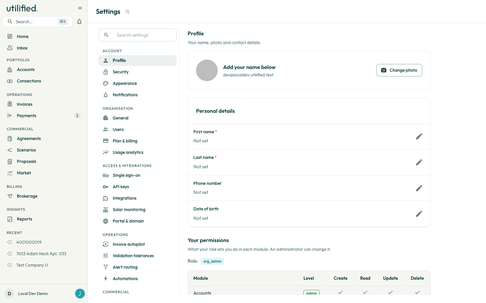
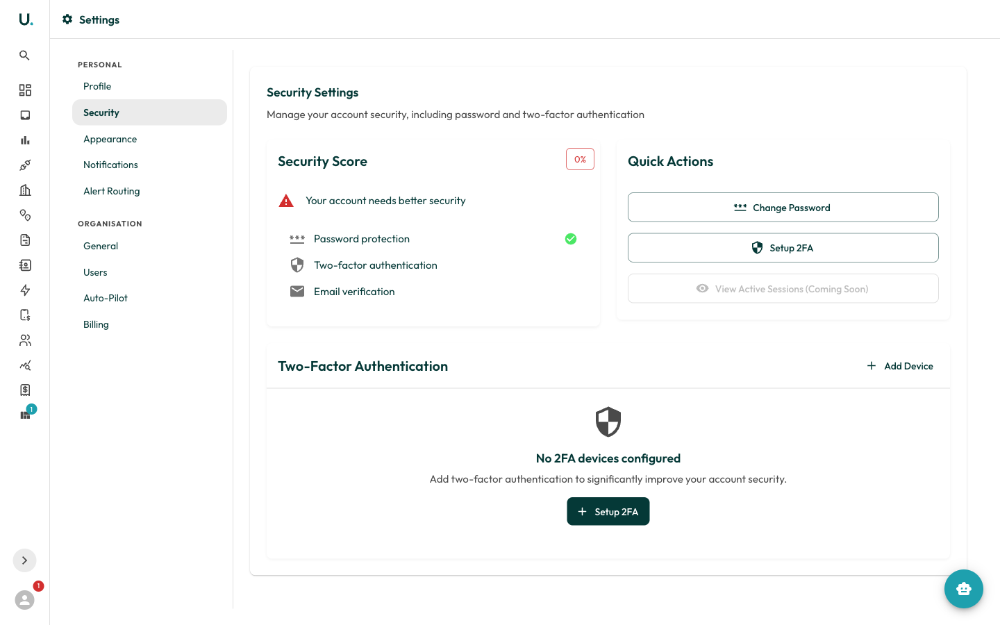

The **Account** group of [Settings](/settings) holds the settings that apply only to you. Open the account menu at the bottom of the sidebar and choose **My Account** to land on your profile. Everyone sees these four sections, whatever their role.

| Section | What it covers |
| --- | --- |
| [**Profile**](#profile) | Your photo and personal details, and what your role lets you do |
| [**Security**](#security) | Your password and two-factor authentication |
| [**Appearance**](#appearance) | The theme on this device |
| [**Notifications**](#notifications) | Desktop notifications and your subscriptions |

## Profile

{/* screenshot-stale */}
<Frame>
  
</Frame>

- **Change photo** uploads a profile picture. Use an image file under 5 MB.
- **Personal details** lists **First name**, **Last name**, **Phone number** and **Date of birth**. Click the pencil beside a field to edit it, then **Save** or **Cancel**. Your email address is shown but can't be changed here.

### Your permissions

**Your permissions** shows your role and the access level it gives you in each module: **None**, **View**, **Edit** or **Admin**. It is read-only. An org admin can change your role or adjust individual modules from **Settings** › **Users**. See [Setting up a user](/guides/setting-up-a-user).

## Security

{/* screenshot-stale */}
<Frame>
  
</Frame>

### Password

Click **Change password**, enter your **Current password**, then a **New password** and **Confirm new password**. The new password needs at least 12 characters and must differ from the current one.

### Two-factor authentication

The **Two-factor authentication** panel shows **On** or **Off** and lists each method you have set up, with when it was last used. Two-factor authentication asks for a code from your phone or email as well as your password when you sign in.

Your organisation may require it. If an org admin has turned on **Require two-factor authentication**, you set it up at your next sign-in. See [Organisation settings](/settings/organisation#sign-in-security).

<Steps>
  <Step title="Start setup">
    Click **Set up 2FA**. If you already have a method, the button reads **Add method**.
  </Step>
  <Step title="Choose a method">
    Choose **Authenticator app (recommended)**, **Email verification** or **Backup codes**.
  </Step>
  <Step title="Verify it">
    - **Authenticator app**: scan the QR code with an app such as Google Authenticator or Authy, or type the manual entry code. Enter the 6-digit code from the app and **Your password**, then click **Verify**.
    - **Email verification**: click **Send verification email**. Enter the **Verification code** from the email and **Your password**, then click **Verify**.
    - **Backup codes**: enter **Your password**, or click **Use a code from my authenticator app instead** and enter a code. Click **Generate backup codes**, save the codes somewhere safe, then click **Complete setup**.
  </Step>
</Steps>

<Warning>
  Backup codes are shown only once. Save them before you click **Complete setup**.
</Warning>

To manage a method, use the icons on its row:

- **Regenerate backup codes** asks for your password, then shows a new set. Your old codes stop working.
- **Remove device** asks for your password before it removes the method.

If you lose your authenticator app and your backup codes, an org admin can reset your two-factor authentication from your user record. You then set it up again at your next sign-in.

## Appearance

Choose a **Theme**: **System** (follow your operating system), **Light** or **Dark**. The choice applies straight away and is remembered on this device. You can also switch with **Dark mode** or **Light mode** in the account menu.

## Notifications

This section controls which notifications you get and where. The notifications themselves are in the drawer and on the `/notifications` page. See [Notifications](/notifications).

### Desktop notifications

**Desktop notifications** shows Utilified notifications on your desktop, even when no Utilified tab is open. Each browser and device is set up separately.

| Status | What you can do |
| --- | --- |
| **Off** | Click **Turn on** and allow notifications when the browser asks. |
| **On** | Click **Send a test** to check, or **Turn off**. |
| **Blocked** | The browser is blocking notifications from this site. Allow them in the browser's site settings, then reload the page. |
| **Unavailable** | This browser doesn't support desktop notifications, or they aren't available yet. |

### Subscriptions

**Subscriptions** lists the notification types you can opt in to, each with a short description. Turn a switch on to subscribe. A subscription sends that type both by email and in the app. Turn it off to stop receiving it.

Some notifications only go to subscribers. For example, agreement expiry warnings go out 90, 60 and 30 days before an agreement ends, and only to subscribers who are assigned to that agreement's account.
