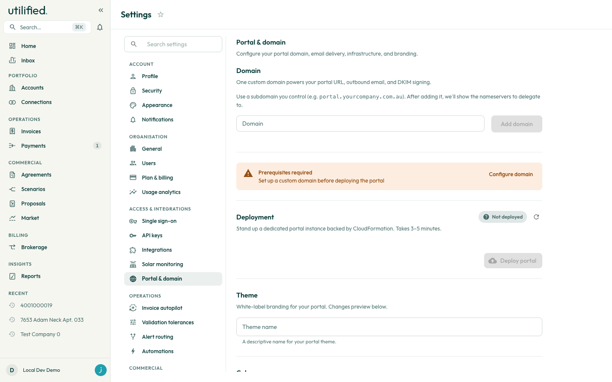
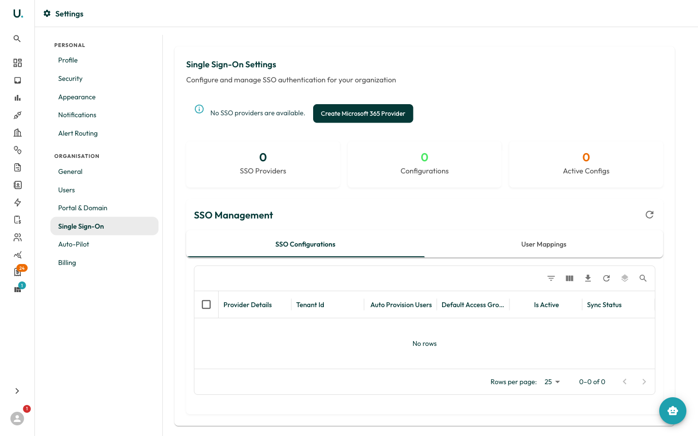

Both sections sit in the **Access & integrations** group of [Settings](/settings).

<Note>
  Only org admins see **Portal & domain** and **Single sign-on**, and only on plans that include them (Business and Enterprise). If you don't see a section, your plan or role doesn't include it.
</Note>

## Portal theme

The **Portal & domain** section runs top to bottom: **Domain**, **Deployment**, then **Theme**. Domain setup and deployment are covered in [Portal & custom domain](/settings/portal-domain). This page covers the theme.

{/* screenshot-stale */}
<Frame>
  
</Frame>

**Theme** controls your portal's white-label branding. Changes show in **Preview** before you save.

| Group | Fields |
| --- | --- |
| **Theme name** | A descriptive name for your portal theme. |
| **Colours** | **Primary** (primary actions and headers), **Secondary** (accents) and **Background** (the portal's main background). |
| **Typography** | Fonts for **Body**, **Button** and **Heading** text. |
| **Branding & links** | **Logo URL** (SVG or PNG, up to 400×200 px), **Favicon URL** (PNG, 32×32 or 192×192 px), **Support URL**, **Terms of Use URL** and **Privacy Policy URL**. |
| Analytics and chat | **Google Analytics measurement ID** (optional, for example `G-ABC123`) loads Google Analytics 4 in the portal. **Zoho SalesIQ widget code** (optional, the `wc=` value from your SalesIQ embed code) shows the SalesIQ chat widget, with **Zoho data centre** set to **Australia**, **United States**, **Europe** or **India**. Leave them blank to turn them off. |

Click **Save theme** to apply your changes. **Reset to default** returns every field to the Utilified theme, and you still need to click **Save theme** to apply it.

## Single sign-on

**Single sign-on** lets your team sign in with your organisation's identity provider. The status badge at the top shows **On** when a configuration is active.

<Note>
  If the section says single sign-on isn't available for your organisation yet, contact Utilified support to turn it on.
</Note>

{/* screenshot-stale */}
<Frame>
  
</Frame>

### Set up single sign-on

The **Set up single sign-on** wizard has five steps. Each step is saved as you go, so you can leave and come back. A tick marks each finished step, and you can click any step to reopen it.

<Steps>
  <Step title="Verify your email domain">
    Enter your **Email domain**, such as `example.com`, and click **Add domain**. Add the TXT record shown in the **Verified domains** table at your domain's DNS provider. The **Status** moves from **Pending** to **Verified** once UMS finds it. Click **Check now** on the row to check straight away. Single sign-on only works for verified domains.
  </Step>
  <Step title="Connect your identity provider">
    Choose **Microsoft Entra ID** or **Google Workspace**.

    - **Microsoft Entra ID**: in the Microsoft Entra admin center, create an app registration as the on-screen steps describe. Add both redirect URIs shown as **Web** redirect URIs, grant admin consent for the `openid`, `profile` and `email` permissions, and create a client secret. Then enter the **Application (client) ID**, **Directory (tenant) ID** and **Client secret**.
    - **Google Workspace**: your team signs in through Utilified's Google sign-in, so there's nothing to register.

    Click **Connect**.
  </Step>
  <Step title="Test the sign-in">
    Click **Sign in to test** and sign in as yourself. Nobody else is signed in. When it works, UMS shows who you signed in as. Click **Test again** to repeat it.
  </Step>
  <Step title="Choose who gets access">
    Turn on **Create an account the first time someone from your organisation signs in** to provision users automatically. Under **New accounts get**, choose **Member access** or **Read-only access**.
  </Step>
  <Step title="Require single sign-on">
    Choose a policy and click **Save policy**:

    - **Off: everyone uses passwords**
    - **Optional: your domain goes to single sign-on, passwords still work**
    - **Required: only single sign-on, except break-glass admins**

    For **Required**, tick the org admins who keep password sign-in (with two-factor) in case your identity provider is unavailable. UMS warns you if some people haven't signed in with single sign-on yet. Tick **I understand that password sign-in stops for everyone else** before you save.
  </Step>
</Steps>

<Warning>
  Test the sign-in before you choose **Required**. People without an account in your identity provider can't sign in once password sign-in stops.
</Warning>

### Customer accounts

**Customer accounts** lists the accounts whose portal admins have set up their own single sign-on, with **Account**, **Single sign-on** (**Off**, **Optional** or **Required**), **Required since** and **Connection health**. You allow this per account in the **Portal Access** section of the account's **Settings** tab, or for every account under **Default portal access** in [Portal & custom domain](/settings/portal-domain#default-portal-access).

### Manage connections

Below the wizard, **Manage connections** switches between **SSO Configurations** and **User Mappings**. Use **Add configuration** to add a connection by hand. Each configuration has **Edit Configuration**, **Test Connection** and **Sync Users** actions.
