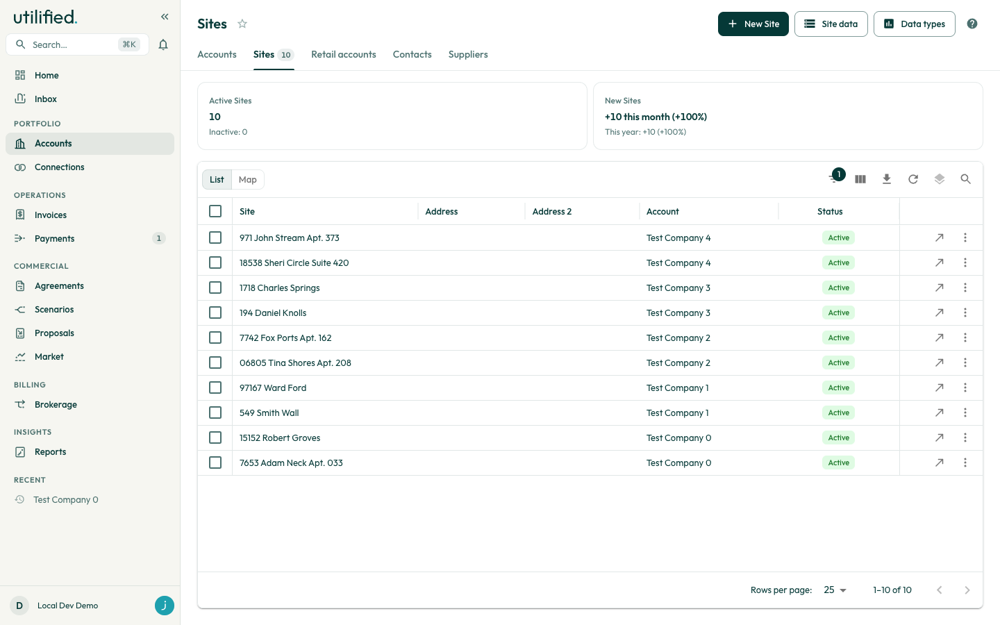
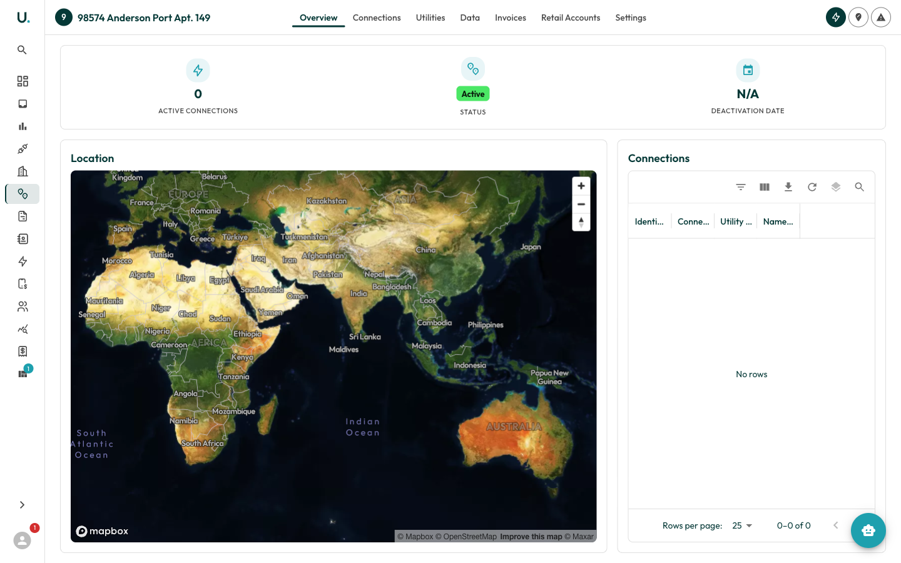

Go to **Accounts** in the sidebar, then the **Sites** tab.

Sites represent the physical locations associated with your accounts: offices, warehouses, retail stores, or any premises with energy connections. Each site sits under an [account](/accounts) and holds the [connections](/connections) at that location.

{/* screenshot-stale */}
<Frame>
  
</Frame>

## Sites list

Tiles above the grid show **Active Sites** and **New Sites** (this month and this year). A **List** / **Map** switch at the start of the grid toolbar changes the view:

| View     | What it shows                                                                  |
| -------- | ------------------------------------------------------------------------------ |
| **List** | A grid of active sites, most recently edited first                             |
| **Map**  | Your sites on a map. Sites appear once they have coordinates.                  |

| Column        | Description                             |
| ------------- | --------------------------------------- |
| **Site**      | The site name. Click it to open the site. |
| **Address**, **Address 2**, **Address 3** | Street address lines |
| **State**     | State code                              |
| **Account**   | The parent account                      |
| **Status**    | **Active** or **Inactive**              |

### Actions

| Action          | What it does                                                               |
| --------------- | -------------------------------------------------------------------------- |
| **New Site**    | Opens the **Create New Site** drawer                                       |
| **Site data**   | Opens the [site data](/site-data) records across all sites                 |
| **Data types**  | Opens the [site data types](/site-data#site-data-types)                    |

The create drawer asks for the site `name` and parent `account`, then the address. Start typing in the first address line to search with Google Places, or enter it manually. You can also add a site from an account's **New** menu, or bulk-upload sites from the account's **Sites** tab.

## Site detail page

{/* screenshot-stale */}
<Frame>
  
</Frame>

The header shows the site name, "Site of" its account and the address, and a status chip. A deactivated site shows **Deactivated** with the date.

| Tab             | Segments                                                                    | What it shows                                                        |
| --------------- | --------------------------------------------------------------------------- | -------------------------------------------------------------------- |
| **Overview**    | None                                                                        | The site's active connections and a **Location** panel with a map     |
| **Connections** | None                                                                        | Every [connection](/connections) linked to the site                   |
| **Usage**       | **Site data**, **Consumption**, **Usage analytics**, **Solar**, **Energy assets** | Site data records, consumption, analytics and installed equipment |
| **Invoices**    | **Invoices**, **Retail accounts**                                           | [Invoices](/invoices) and [retail accounts](/retail-accounts) for the site's connections |
| **Budgets**     | None                                                                        | Budgets set for the site                                             |
| **Settings**    | None                                                                        | Site settings (see below)                                            |

On the **Overview** tab, a banner appears when a network outage affects the site. Click a row on the **Connections** tab to open the connection, or use **Edit site link** to change how the connection is linked to the site.

### Usage segments

| Segment             | What it shows                                                                    | Appears when                                       |
| ------------------- | -------------------------------------------------------------------------------- | -------------------------------------------------- |
| **Site data**       | The site's [site data](/site-data). **Add New** adds a record; **Bulk Upload** imports many. | Always                                  |
| **Consumption**     | Consumption for the site's connections                                           | Always                                             |
| **Usage analytics** | Usage analytics for the site                                                     | The feature is enabled for your organisation and you have analytics access |
| **Solar**           | Solar generation for the site                                                    | The feature is enabled for your organisation and you have analytics access |
| **Energy assets**   | Equipment installed at the site (see [Energy assets](#energy-assets))            | You have modelling access                          |

### Header actions

| Action                                       | What it does                                                         |
| -------------------------------------------- | -------------------------------------------------------------------- |
| **Add a Connection** (connection icon)       | Links a connection to this site                                      |
| **Model opportunities**                      | Starts a [scenario](/scenarios) to model tariff, power factor, solar, battery and generator options for the site. Shown for active sites when you can create modelling records. |
| **Change Location** (location icon)          | Edits the site's address and map pin                                 |
| **Deactivate site** (warning icon)           | Deactivates the site. Only shown while the site is active.           |

### Settings tab

| Section                | What you can do                                                                         |
| ---------------------- | --------------------------------------------------------------------------------------- |
| **Site Details**       | Edit **Site name**, **Account**, **Active Status**, **Date Active** and **Date Inactive** |
| **Location**           | View the address and coordinates. Click **Edit location** to change them.               |
| **Cost Allocations**   | Split the site's charges across cost centres on [payment files](/payments)              |
| **Custom Fields**      | Store organisation-defined fields against the site                                      |
| **Additional details** | View the site's other recorded fields                                                   |
| **Danger Zone**        | **Archive site** (set it inactive) or **Delete site** (permanent)                        |

## Energy assets

The **Energy assets** segment on the **Usage** tab appears when your user has modelling access. It records the solar, batteries, inverters and generators already installed at the site. Declare equipment and maintain its specifications and operating assumptions before selecting it for an [energy assessment](/scenarios#energy-assessments-and-existing-equipment).

For existing generators, check the rating, fuel costs, parallel approval and operating limits. Detected equipment needs a declaration so the study knows its specifications. Energy assessments require modelling and DER-modelling access for your organisation and the relevant user permissions. Proposals require proposal access as well.
