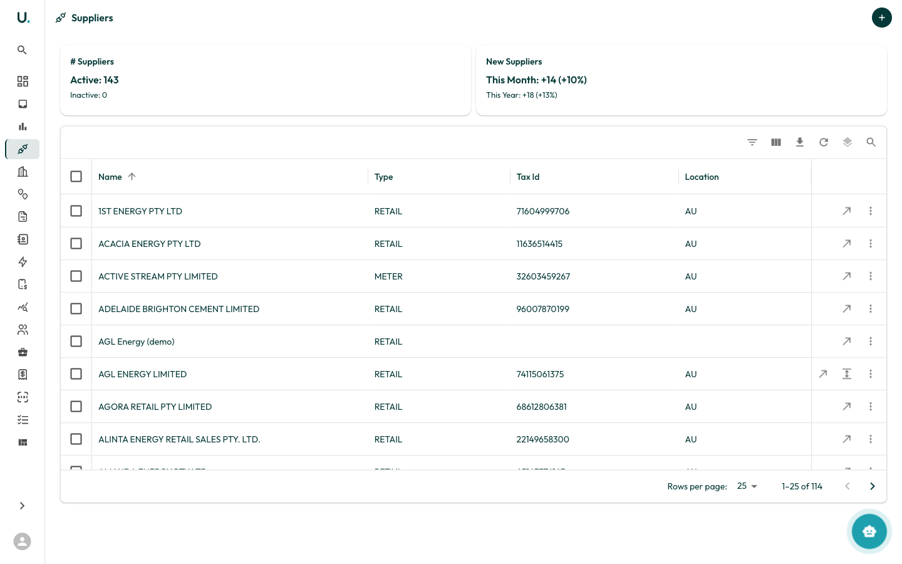

Go to **Accounts** in the sidebar, then the **Suppliers** tab. The tab only appears if you have access to suppliers.

Suppliers are the energy retailers, network operators, metering providers and other utility companies your accounts hold agreements and retail accounts with, and who issue your invoices.

{/* screenshot-stale */}
<Frame>
  
</Frame>

## Suppliers list

Tiles above the grid show **Active Suppliers** and **New Suppliers** (this month and this year).

Suppliers form a hierarchy: a parent supplier can have associated (child) suppliers. The grid opens on top-level suppliers, sorted by name. Click the expand control on a row to show its associated suppliers.

| Column       | Description                            |
| ------------ | -------------------------------------- |
| **Name**     | The supplier name. Click it to open the supplier. |
| **Type**     | The supplier type (see below)          |
| **Tax ID**   | The supplier's ABN or ACN              |
| **Location** | Country code, for example `AU`         |

Click **New Supplier** to open the **Create New Supplier** drawer.

### Supplier types

| Type                      | Code           |
| ------------------------- | -------------- |
| **Retailer**              | `RETAIL`       |
| **Network Operator**      | `NETWORK`      |
| **Distributor**           | `DISTRIBUTION` |
| **Transmission Operator** | `TRANSMISSION` |
| **Metering Provider**     | `METER`        |
| **Wholesaler**            | `WHOLESALE`    |

## Supplier detail page

The header shows the supplier name and an **Active** or **Inactive** status chip.

| Tab                 | What it shows                                                                                  |
| ------------------- | ---------------------------------------------------------------------------------------------- |
| **Overview**        | Counts of **Associated suppliers**, **Agreements**, **Invoices** and **Retail accounts**; **Recent agreements**; **Associated suppliers**; and **Supplier details** |
| **Agreements**      | [Agreements](/agreements) with this supplier                                                   |
| **Retail accounts** | [Retail accounts](/retail-accounts) held with this supplier                                    |
| **Invoices**        | [Invoices](/invoices) issued by this supplier                                                  |
| **Brokerage**       | **Brokerage records** and **Revenue data** segments for this supplier. See [Brokerage](/brokerage). |
| **Settings**        | Supplier settings (see below)                                                                  |

### Actions

| Action             | What it does                                                                     |
| ------------------ | -------------------------------------------------------------------------------- |
| **Edit**           | Opens the **Edit Supplier** drawer                                               |
| **Add Associated** | Opens the **Add Associated Supplier** drawer to create a child supplier. Only shown on top-level suppliers. |

### Settings tab

| Section              | What you can do                                                                                     |
| -------------------- | --------------------------------------------------------------------------------------------------- |
| **Supplier Details** | Edit **Name**, **Type**, **Parent**, **Tax ID**, **Tax URL**, **Location** and **Entity Type**        |
| **Payment Details**  | Set the **Payment Method** and **Remittance Email**, and the bank details used in ABA direct-entry [payment files](/payments): **BSB**, **Account Number** and **Account Name**. Only organisation admins can change the bank details. |
| **Contacts**         | The supplier's contacts. Turn on **Receives submissions** for each contact who should be emailed the signed retail agreement pack. |
| **Learned rules**    | Rules learned while resolving invoice exceptions for this supplier. They apply immediately; click **Remove** to start flagging again. |
| **Data management**  | **Archive supplier** (set it inactive) or **Delete supplier** (permanent)                            |
