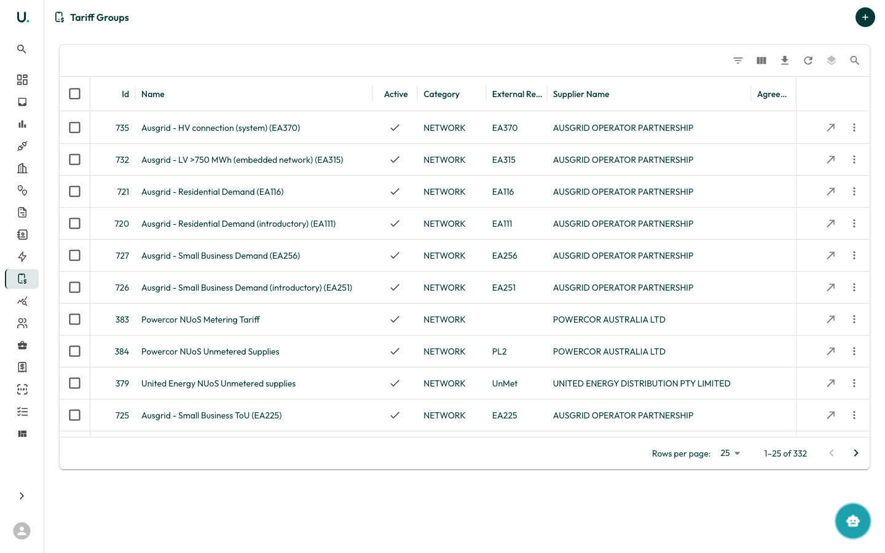
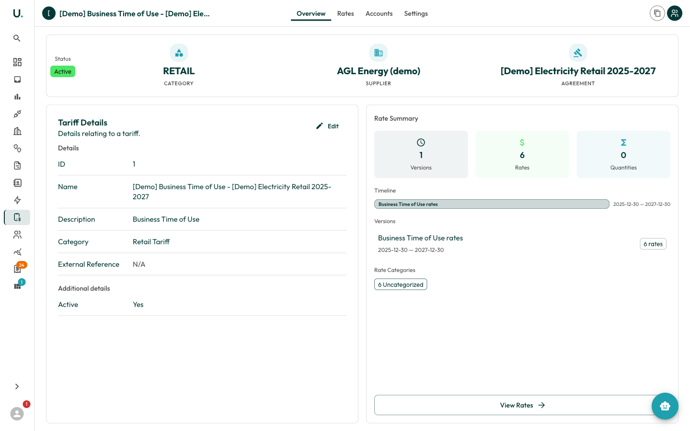

Tariffs define the rate structures that energy retailers charge for electricity, gas and water. UMS uses them to validate invoice charges, calculate expected costs and run brokerage calculations.

Find them under **Portfolio** › **Connections** › **Tariffs**.

## How tariffs are structured

UMS models pricing in three nested layers:

| Layer            | Description                                                                                          |
| ---------------- | ---------------------------------------------------------------------------------------------------- |
| **Tariff group** | The overall rate plan, for example "Business Time of Use", linked to a supplier and an [agreement](/agreements) |
| **Version**      | A date-scoped version of the group, with a start date and optional end date, so rates can change over time while keeping history |
| **Rate**         | An individual charge component within a version, with a category, value and display units (for example c/kWh or $/day) |

Each rate can carry quantities: the factors or consumption blocks that decide when the rate applies. See [Key concepts](/getting-started/key-concepts) for where tariffs sit in the wider data model.

## Tariffs list

The **Tariffs** tab lists every tariff group in your organisation.

{/* screenshot-stale */}
<Frame>
  
</Frame>

| Column           | Description                                                    |
| ---------------- | -------------------------------------------------------------- |
| **Name**         | The rate plan's name. Click it to open the tariff group        |
| **Status**       | Active or Inactive                                             |
| **Confirmation** | Whether someone has checked the rates (see below)              |
| **Source**       | Where the rates came from (see below)                          |
| **Category**     | The tariff category                                            |
| **Reference**    | The retailer's own reference for the tariff                    |
| **Supplier**     | The retailer the tariff belongs to                             |
| **Agreement**    | The linked [agreement](/agreements)                            |

The grid also has an ID column and a hidden description column.

Click **New Tariff Group** to open the **Create tariff** wizard. See [Managing tariffs](/guides/managing-tariffs).

### Confirmation and source

| Confirmation    | Meaning                                                                                       |
| --------------- | --------------------------------------------------------------------------------------------- |
| **Confirmed**   | Someone has checked the rates                                                                 |
| **Unconfirmed** | Nobody has checked the rates yet. Validations that use them raise an unconfirmed-tariff discrepancy |
| **Rejected**    | The rates were rejected                                                                       |

| Source              | The rates were                       |
| ------------------- | ------------------------------------ |
| **Manual**          | Entered by hand                      |
| **Invoice-derived** | Derived from an invoice              |
| **Agreement**       | Taken from the agreement             |
| **Template**        | Created from a template              |
| **EMP award**       | Created from an EMP award            |

## Tariff group page

The header shows the group's name, its supplier and agreement, and an **Active** or **Inactive** status.

{/* screenshot-stale */}
<Frame>
  
</Frame>

| Tab          | What it shows                                                                                                        |
| ------------ | -------------------------------------------------------------------------------------------------------------------- |
| **Overview** | **Tariff Details**, and a summary of versions, rates, quantities and rate categories. Click **View Rates** to open the rates |
| **Rates**    | The rates in each version, as a **Tree** or a **Table**                                                              |
| **Retail accounts** | The retail accounts the group is assigned to                                                                  |
| **Settings** | Edit the group's details, or archive or delete it                                                                    |

### Header actions

| Action                    | What it does                                                                                     |
| ------------------------- | ------------------------------------------------------------------------------------------------ |
| **Add to Retail Account** | Assigns the group to a retail account (see [Tariff assignments](#tariff-assignments))             |
| Duplicate (icon)          | Copies the group with all its rates and opens the copy. Tooltip: **Duplicate this tariff group with all rates** |
| Confirm (icon)            | Marks the rates as checked. Tooltip: **Confirm these rates are correct**                          |
| Reject (icon)             | Rejects the tariff. Tooltip: **Reject this tariff**                                               |

Confirm and Reject only appear on a group that wasn't entered by hand or isn't confirmed yet, and only if you can edit utilities. Reject asks you to confirm in a **Reject this tariff?** dialog; click **Reject tariff** to go ahead. Rejecting ends the group's open account and connection assignments and resolves the tariff-review exceptions it raised.

### Banners

- **Confirmed tariff**, **Unconfirmed tariff** or **Rejected tariff**: says where the rates came from and whether they've been checked. A hand-entered, confirmed group shows no banner.
- **Tariff health**: lists errors and warnings in how the rates are set up that would make validation price invoices wrongly. Click **Show rate** to jump to the rate. Click **Hide** or **Show** to collapse the list.

### Rates tab

Switch between **Tree** (rates grouped under their version) and **Table**.

- **New Version**: creates a version with a description, start date and optional end date.
- **Add Rate**: adds a rate to a version. A group needs at least one version first.

**New Version** and **Add Rate** don't appear on shared tariffs your organisation can't edit.

After you change a confirmed tariff's rates, UMS offers **Re-check affected validation runs**, because runs already priced with the tariff still use the old rates. Click **Later** to skip it.

## Tariff assignments

A tariff assignment links a tariff group to a [retail account](/retail-accounts) for a date range, so invoices on that account are validated against the right rates.

To create one, click **Add to Retail Account** on the tariff group. In the **Assign tariff** dialog:

- **Retail account**: the account to assign the tariff to.
- **Connection**: optional. Leave it empty to apply the tariff to every connection on the account.
- **Start date** and **End date**: the end date is optional and inclusive.
- **Replaces**: to switch tariffs, pick the assignment this one replaces. UMS end-dates it the day before the new start date. Choose **Nothing (add alongside)** to keep both.

Click **Assign tariff** (or **Switch tariff** when replacing one).

The group's **Retail accounts** tab lists its assignments with **Start**, **End**, **Tariff Group**, **Account** and **Supplier**. Click a row to open the **Tariff assignment** drawer, where you can edit the dates or click **Delete tariff assignment**. Deleting keeps the tariff and the retail account.

## Tariff reviews and scenarios

Comparing tariffs against actual or modelled consumption lives under **Scenarios**. Use scenarios to model expected costs across rate plans before committing. See [Building scenarios](/guides/building-scenarios) for the workflow.

With modelling and DER-modelling access enabled for your organisation and the relevant user permissions, you can also compare complete current and proposed bills with selected existing generators or batteries. Review operating costs and expected generator value separately from bill charges. See [Tariff reviews with existing equipment](/scenarios#tariff-reviews-with-existing-equipment) for the workflow and data requirements.

<Note>
  Accurate tariffs are essential for invoice validation and brokerage calculations. Keep versions and effective dates current as retailers re-price.
</Note>

## Related guides

- [Managing tariffs](/guides/managing-tariffs)
