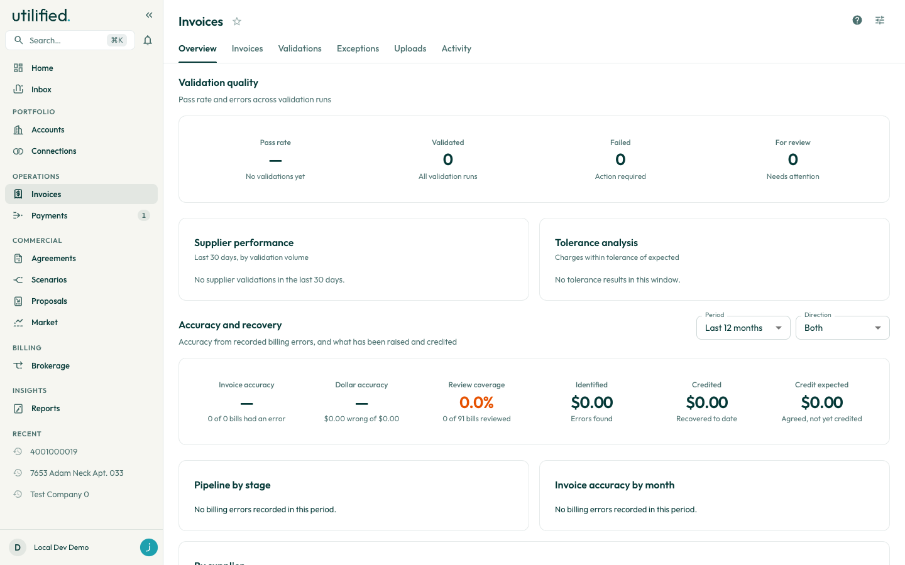

Validation checks each invoice's charges against the expected tariff and records the result as a validation run. Open **Invoices** in the **Operations** group of the sidebar, then the **Validations** tab. Validation health is summarised on the **Overview** tab.

A run's status is one of **Passed**, **Failed**, **Needs review** or **Not validated**. Each finding on a run is classified as **Expected**, **Justifiable**, **Error** or **Needs a look**.

## Validations tab

The **Validations** tab is the **Needs attention** queue. It lists validation runs, not invoices.

### Views

The tiles at the top switch the queue's view and count what's in each:

| Tile | Shows |
| --- | --- |
| **Errors found** | Runs still carrying an unanswered error (the default view). |
| **Money at stake** | Total error variance on those runs. Clicking it opens **Errors found**. |
| **Awaiting tariff confirmation** | Runs priced on a tariff nobody has confirmed. |
| **Awaiting review** | Runs that failed or need review and haven't been reviewed. |

A fourth view, **All runs**, shows every run. You reach it from the **Pass rate** and **Validated** tiles on the Overview tab, or from a saved view.

The **Views** rail on the left holds saved views. It starts with **Errors over $500**, **Awaiting tariff confirmation**, **Awaiting review** and **Passed this week**, and you can save, rename and delete your own. Below it, filter by **Supplier**, **Status**, **Method**, **Tariff**, **Namespace**, **Added on or after**, **Added on or before** and **Error variance at least**.

Queue columns include **Invoice**, **Supplier**, **Retail account**, **Invoice date**, **Invoiced**, **Error variance**, **Findings**, **Tariff**, **Method**, **Age**, **Status** and **Reviewed**.

### Review panel

Click a run to open its review panel beside the queue. It shows the status, whether the tariff is confirmed, the **Error variance**, **Age** and **Tariff basis**, then the run's findings. Outcomes:

| Action | What it does |
| --- | --- |
| **Accept variance** | Accepts the run as billed. Tick **Record the variance as justifiable so validation learns from it** to teach validation. |
| **Fix tariff** | Opens the tariff to correct. Disabled when you can't edit it. |
| **Hold payment** / **Release payment** | Holds the invoice out of payment files, or releases it. |
| **Record billing error** | Records the variance as a billing error to dispute. Shown on failed or needs-review runs. |
| **Re-run validation** | Runs validation again. |
| **Open invoice review** | Opens the invoice's **Review** tab. |

### Actions

- Select rows for **Accept selected**, **Re-run selected** or **Hold selected**. Each asks you to confirm.
- **Run validation for these invoices** (header icon): re-runs every invoice the current view and filters match.
- **Billing errors** (header button): opens the billing errors tracker. See [Invoice exceptions](/invoice-exceptions#billing-errors).
- **Keyboard shortcuts** (header icon): <kbd>j</kbd>/<kbd>k</kbd> to step through runs, <kbd>a</kbd> to accept, <kbd>f</kbd> to fix the tariff, <kbd>h</kbd> to hold or release, <kbd>r</kbd> to re-run, <kbd>Esc</kbd> to close the panel and <kbd>?</kbd> for the full list.

## Overview dashboard

<Frame>
  
</Frame>

The **Overview** tab is the Invoices landing page. Tiles link to the tab that holds the work they count.

| Section | What it shows |
| --- | --- |
| **Validation quality** | **Pass rate**, **Validated**, **Failed** and **For review**, plus **Supplier performance** and **Tolerance analysis**. |
| **Accuracy and recovery** | **Invoice accuracy**, **Dollar accuracy**, **Review coverage**, **Identified**, **Credited** and **Credit expected**, with **Pipeline by stage**, **Invoice accuracy by month** and **By supplier**. Filter by **Period** and **Direction**. |
| **Data quality** | **Unresolved issues**, **Invoice gaps**, **Duplicates & overlaps** and **Incomplete invoices**, plus **Completeness** and **Most common missing fields**. |
| **Upload performance** | **Extraction success**, **In queue**, **Failed**, **Needs review**, **Auto-Pilot processed** and **Auto-Pilot exceptions**. |

**Bulk update retail account validation settings** (header icon) changes validation settings across many retail accounts at once.

## Validation run detail

Open a run from **Validation runs** on an invoice's **Review** tab. The page title is `Validation:` followed by the invoice number, and the subtitle links back to the invoice.

| Tab | What it shows |
| --- | --- |
| **Overview** | The run's status and review state, with **Pass**, **Fail** and (once reviewed) **Edit Review**, plus the invoice PDF. |
| **Line Items** | The saved comparison: expected, invoiced and variance for each finding. |
| **Variance** | The same saved comparison, read for the variance. |
| **AI Analysis** | **Run AI Analysis**, **Re-run with Fresh Data** and **Error Analysis**, with the result and its confidence score. |
| **Dispute** | **Billing errors** recorded against the invoice, and **Generate Dispute Letter** to draft a letter you can edit, copy or download. Available for failed or needs-review runs. |

Header actions: **Accept as billed** (failed or needs-review runs), **Re-run AI analysis**, **Export Report** (a PDF) and **Refresh**.

## Related guides

- [Working the validation queue](/guides/invoice-validation)
- [Invoice exceptions](/invoice-exceptions)
- [Invoices](/invoices)
